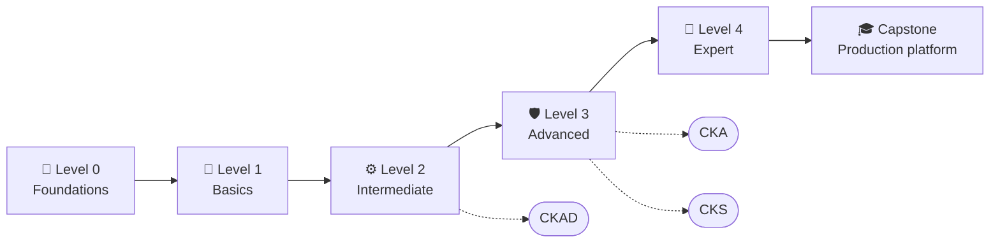

<div align="center">


# Kubernetes Course

### A Hands-On Guide to Platform Engineering and Reliability

*From zero to expert in Kubernetes, one hands-on lab at a time*

[](https://kubernetes.io/docs/home/)
[](#-curriculum)
[](#-curriculum)
[](LICENSE)

</div>

---

## 📋 About this course

**Kubernetes Course** takes you from
*"I have never used a container"* to *"I design, secure and operate production clusters"*.

It is built on the [official Kubernetes documentation](https://kubernetes.io/docs/home/) (v1.37) and
organized step by step: **5 levels, 29 modules, 29 hands-on labs, 150+ exercises and a
capstone project**.

| Who it is for | What you will achieve |
|---|---|
| Developers who deploy to Kubernetes | Understand what really happens when you run `kubectl apply` |
| System administrators / Ops | Operate, upgrade and debug clusters with confidence |
| Aspiring Platform Engineers | Design reliable platforms with SLOs, security and GitOps |
| CKAD / CKA / CKS candidates | Guided practice with broken scenarios and practice rounds |

## 🧭 Teaching philosophy

| Pillar | What it looks like in every module |
|---|---|
| 🧠 **Analogy first** | Every concept starts with an everyday story before the first technical term |
| 🗺️ **See the mechanism** | Diagrams that show *how* it works, not just *what* it is |
| ⌨️ **Hands on the keyboard** | A guided lab with a check after every step |
| 💥 **Break it on purpose** | Every lab causes a real failure so you learn to diagnose it |
| 🧯 **In production** | What fails in production, how to detect it and how to mitigate it |

## 🗺️ Course map



## 📚 Curriculum

### 🌱 Level 0 — Foundations
| # | Module | The question it answers |
|---|---|---|
| 01 | [Containers and why Kubernetes](modules/level-0-foundations/01-containers-and-kubernetes/) | What problem does Kubernetes solve? |
| 02 | [Linux, networking and YAML for Kubernetes](modules/level-0-foundations/02-linux-networking-yaml/) | What do I need to know before I start? |
| 03 | [Your local lab](modules/level-0-foundations/03-local-lab/) | How do I run a cluster on my laptop? |

### 🧱 Level 1 — Basics
| # | Module | The question it answers |
|---|---|---|
| 04 | [Kubernetes architecture](modules/level-1-basics/04-architecture/) | What pieces make up a cluster and how do they talk? |
| 05 | [Pods](modules/level-1-basics/05-pods/) | What is the smallest unit you can run? |
| 06 | [Namespaces, labels and selectors](modules/level-1-basics/06-namespaces-labels/) | How do I organize and find resources? |
| 07 | [ReplicaSets and Deployments](modules/level-1-basics/07-deployments/) | How do I deploy and update with zero downtime? |
| 08 | [Services and DNS](modules/level-1-basics/08-services-dns/) | How do apps find other apps? |
| 09 | [ConfigMaps and Secrets](modules/level-1-basics/09-configmaps-secrets/) | How do I keep configuration out of my code? |

### ⚙️ Level 2 — Intermediate
| # | Module | The question it answers |
|---|---|---|
| 10 | [Resources, QoS and quotas](modules/level-2-intermediate/10-resources-qos/) | How much CPU and memory does each app get? |
| 11 | [Probes and Pod lifecycle](modules/level-2-intermediate/11-probes-lifecycle/) | How does Kubernetes know my app is healthy? |
| 12 | [Storage](modules/level-2-intermediate/12-storage/) | Where do I keep data that must survive? |
| 13 | [StatefulSets, DaemonSets, Jobs and CronJobs](modules/level-2-intermediate/13-statefulsets-daemonsets-jobs/) | Which controller fits each workload? |
| 14 | [Ingress and Gateway API](modules/level-2-intermediate/14-ingress-gateway-api/) | How does traffic get in from the Internet? |
| 15 | [Scheduling](modules/level-2-intermediate/15-scheduling/) | How does Kubernetes decide where each Pod runs? |

### 🛡️ Level 3 — Advanced
| # | Module | The question it answers |
|---|---|---|
| 16 | [Autoscaling](modules/level-3-advanced/16-autoscaling/) | How do I grow and shrink automatically? |
| 17 | [Security I: AuthN, AuthZ and RBAC](modules/level-3-advanced/17-security-rbac/) | Who can do what? |
| 18 | [Security II: Pod security and NetworkPolicy](modules/level-3-advanced/18-pod-security-networkpolicy/) | How do I limit the blast radius? |
| 19 | [Networking deep dive](modules/level-3-advanced/19-networking-deep-dive/) | How does a packet really travel? |
| 20 | [Observability](modules/level-3-advanced/20-observability/) | How do I know what is going on? |
| 21 | [Systematic troubleshooting](modules/level-3-advanced/21-troubleshooting/) | How do I find the root cause fast? |
| 22 | [Cluster administration](modules/level-3-advanced/22-cluster-administration/) | How do I upgrade, back up and maintain a cluster? |

### 🚀 Level 4 — Expert
| # | Module | The question it answers |
|---|---|---|
| 23 | [Kustomize and Helm](modules/level-4-expert/23-kustomize-helm/) | How do I package and reuse manifests? |
| 24 | [GitOps and CI/CD](modules/level-4-expert/24-gitops-cicd/) | How do I make Git the source of truth? |
| 25 | [CRDs and Operators](modules/level-4-expert/25-crds-operators/) | How do I extend the Kubernetes API? |
| 26 | [Admission policies](modules/level-4-expert/26-admission-policies/) | How do I enforce rules across the cluster? |
| 27 | [DRA, GPUs and AI workloads](modules/level-4-expert/27-dra-gpus-ai/) | How do I run AI/ML on Kubernetes? |
| 28 | [Reliability engineering](modules/level-4-expert/28-reliability/) | How do I design so it does not go down? |
| 29 | [What's new in v1.35 – v1.37](modules/level-4-expert/29-whats-new/) | What is the latest and greatest? |

### 🎓 [Capstone — Production-ready platform](capstone/)

## 🚀 Getting started

```bash
# 1. Clone the repository
git clone https://github.com/<your-user>/kubernetes-course.git
cd kubernetes-course

# 2. Install the tools (macOS; Linux/Windows in docs/setup.md)
brew install kubectl kind helm

# 3. Build your lab cluster (1 control plane + 2 workers) — full config in module 03
kind create cluster --name kc --config kind-kc.yaml

# 4. Start with module 01
open modules/level-0-foundations/01-containers-and-kubernetes/README.md
```

## 🗂️ Repository layout

```text
kubernetes-course/
├── README.md        ← you are here
├── STUDY-PLAN.md    ← levels, progress checkpoints, suggested schedule
├── modules/         ← 5 levels × modules (README · LAB · EXERCISES)
├── capstone/        ← final project: a production-ready platform
├── docs/            ← learning paths, glossary, cheatsheet, setup, self-check rubric
└── assets/          ← Kubernetes logo (trademark of The Linux Foundation)
```

## 📎 Student resources

| Resource | Description |
|---|---|
| [📅 Study plan](STUDY-PLAN.md) | Levels, progress checkpoints and suggested schedule |
| [🧭 Learning paths](docs/learning-path.md) | Paths by role and by certification |
| [⌨️ kubectl cheatsheet](docs/kubectl-cheatsheet.md) | The commands you will use every day |
| [📖 Glossary](docs/glossary.md) | Every term, explained in one line |
| [🧪 Environment setup](docs/setup.md) | kind, minikube and k3d on macOS, Linux and Windows |
| [📏 Self-check rubric](docs/self-check-rubric.md) | A checklist to review your labs and capstone |
| [🎓 Official tutorials companion](docs/official-tutorials.md) | Every kubernetes.io tutorial mapped to a course module |

## 🤝 Contributing

Found a mistake or want to suggest a topic? Open an issue or read [CONTRIBUTING.md](CONTRIBUTING.md).

## 📜 License

Content licensed under [CC BY-SA 4.0](LICENSE). Kubernetes® and the Kubernetes logo are registered
trademarks of The Linux Foundation, used only to identify the subject (see [assets](assets/README.md)).
This course is independent and not affiliated with or endorsed by the CNCF.

<div align="center">

*Built with ☸️ · "Hope is not a strategy"*

</div>
