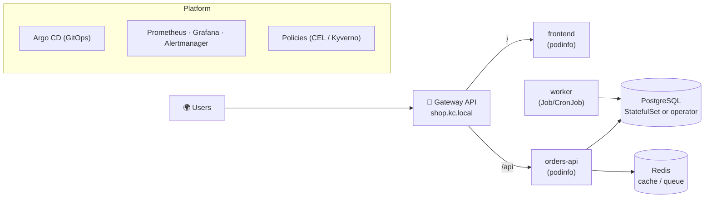

# 🎓 Capstone · A Production-Ready Platform

| Code | Credits | Duration | Prerequisites |
|---|---|---|---|
| KC-590 | 4 | ~30 h (1–2 weeks) | Modules 01–29 |

You are the founding SRE of **KC Shop**, a small online store. Your job: take three services from
"it runs on my laptop" to a platform you would be proud to put on call for. At the end you present it
in a **Production Readiness Review (PRR)**, graded with the [rubric](../docs/grading-rubric.md).

---

## 🧭 The scenario



| Component | Requirement |
|---|---|
| `frontend` | Stateless, ≥ 3 replicas, HPA, behind the Gateway at `/` |
| `orders-api` | Stateless, ≥ 3 replicas, HPA, canary-capable, behind the Gateway at `/api` |
| `postgres` | Persistent storage, backup and **tested restore** |
| `redis` | In-cluster cache |
| `report-worker` | CronJob, idempotent, with failure policy and history limits |

You may replace the sample images with your own app — the platform requirements stay the same.

---

## 📋 Requirements (mapped to modules)

### 1. Delivery (modules 23–24)
- [ ] Everything (apps **and** platform add-ons) defined in a Git repository with Kustomize overlays (`dev`, `prod`) and/or Helm.
- [ ] Argo CD (or Flux) deploys the full stack **from an empty cluster in under 15 minutes**.
- [ ] Promotion dev → prod is a pull request; rollback is `git revert`.

### 2. Security (modules 17, 18, 26)
- [ ] One ServiceAccount per app, least-privilege RBAC, `automountServiceAccountToken: false` where not needed.
- [ ] All app namespaces enforce Pod Security **`restricted`**.
- [ ] **Default-deny** NetworkPolicies + explicit allows (including DNS).
- [ ] No plain Secrets in Git (Sealed Secrets, SOPS or External Secrets).
- [ ] At least three admission policies: required labels, pinned images, memory requests.

### 3. Health and capacity (modules 10, 11, 15, 16)
- [ ] Requests and limits on every container, justified by measurements.
- [ ] Startup/readiness/liveness probes following the module 11 rules; graceful shutdown tested.
- [ ] Topology spread across both zones; PDBs on every multi-replica workload.
- [ ] HPA on `frontend` and `orders-api`, proven with a load test.

### 4. Observability (modules 20, 28)
- [ ] Metrics scraped for all apps; one Grafana dashboard with golden signals per service.
- [ ] Logs from all Pods searchable for at least the last 24 h (Loki or similar) — *stretch goal on a laptop*.
- [ ] **SLOs** defined for `orders-api` (availability and latency) with multi-window burn-rate alerts.

### 5. Resilience (modules 12, 21, 22, 28)
- [ ] Game day: survive a Pod kill loop, a node drain and an unplanned node stop — with measured SLI impact.
- [ ] PostgreSQL backup and restore drill with measured **RPO** and **RTO**.
- [ ] etcd snapshot procedure documented and tested.

### 6. Operations (modules 21, 28)
- [ ] Runbooks for the top 3 alerts (symptom, impact, diagnosis steps, mitigation, escalation).
- [ ] One blameless postmortem from an incident you caused during the game day.
- [ ] Architecture diagram and at least 3 ADRs (architecture decision records).

---

## 🗓️ Milestones

| Day | Milestone | Evidence |
|---|---|---|
| 1 | Warm-up: run the official [Guestbook tutorial](https://kubernetes.io/docs/tutorials/stateless-application/guestbook/) on `kc`; design + ADRs | Diagram, ADR-001..003 |
| 2–3 | Apps running with Kustomize/Helm; GitOps bootstrap | Argo CD screenshot, repo link |
| 4–5 | Security hardening and policies | `kubectl label --dry-run=server` clean, NetworkPolicy test output |
| 6–7 | Observability and SLOs | Dashboard, alert rules, burn-rate test |
| 8–9 | Game day, backup/restore, load test | Game day report, RPO/RTO numbers |
| 10 | PRR presentation | Slides or a README walkthrough + live demo |

---

## 📦 Deliverables

```text
kc-shop-platform/
├── README.md                 ← overview, how to bootstrap from zero
├── docs/
│   ├── architecture.md       ← diagram + components
│   ├── adr/                  ← ADR-001-gitops-tool.md, ADR-002-…
│   ├── slos.md               ← SLIs, SLOs, error budget policy
│   ├── runbooks/             ← one file per alert
│   ├── game-day-report.md
│   └── postmortem.md
├── bootstrap/                ← Argo CD install + root app
├── platform/                 ← monitoring, policies, gateway, operators
└── apps/
    ├── frontend/  (base + overlays)
    ├── orders-api/
    ├── postgres/
    ├── redis/
    └── report-worker/
```

Templates: [PRR checklist](PRR-TEMPLATE.md) · [ADR](ADR-TEMPLATE.md) · [Runbook](RUNBOOK-TEMPLATE.md).

---

## 🏁 The live demo (20 minutes)

1. `kind create cluster` → bootstrap GitOps → everything Healthy (timed).
2. Show the dashboard and SLO status under load.
3. Kill a node; show the SLI and the alert behavior.
4. Ship a broken release; show automatic canary abort **or** a `git revert` rollback.
5. Restore the database from backup; show the data and the measured RTO.
6. Answer the reviewers' PRR questions.

> 💡 Tip: rehearse the demo end to end at least once. A PRR is also a test of your runbooks.
