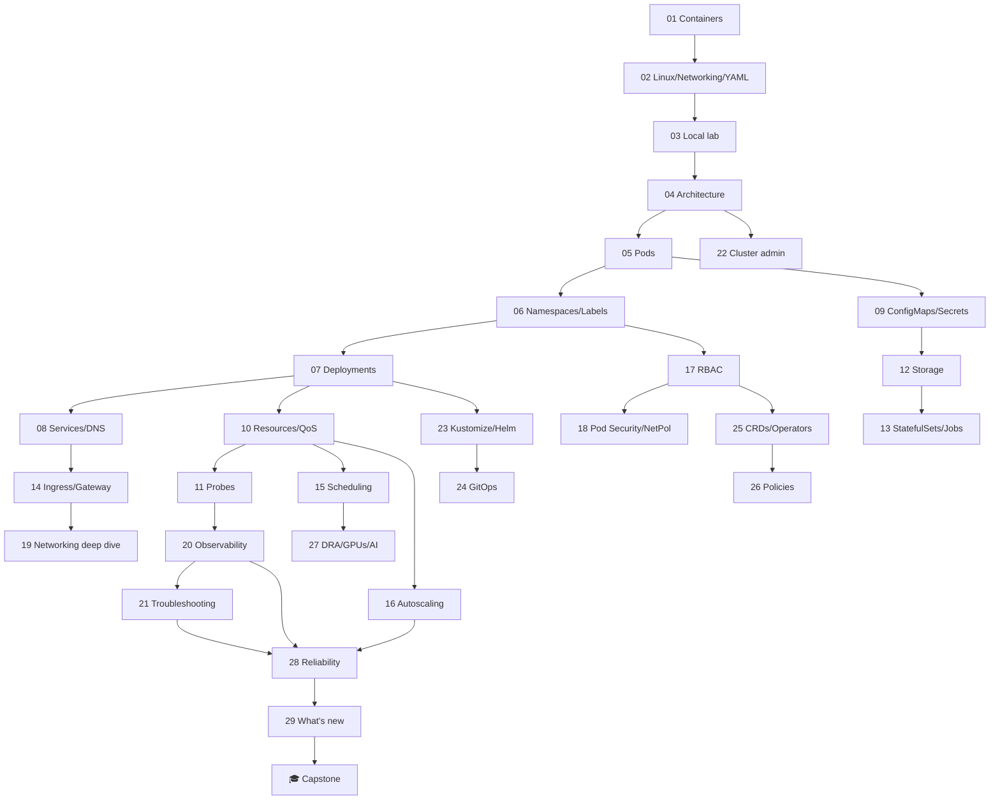

# 🧭 Learning paths

## Module dependencies

## Paths by role

| Role | Recommended path | Length |
|---|---|---|
| 👩‍💻 Developer | 01–14, 16, 20, 23, 24 | ~10 weeks |
| 🛠️ Administrator / Ops | All of levels 0–3, then 23, 28 | ~15 weeks |
| 🧯 Platform Engineer | Full course + capstone | 20 weeks |
| 🔐 Security | 01–09, 17, 18, 22, 25, 26 | ~10 weeks |
| 🤖 ML/AI Engineer | 01–13, 15, 16, 27 | ~10 weeks |

## Paths by certification (CNCF / Linux Foundation)

| Certification | Key modules | Tip |
|---|---|---|
| **KCNA** | 01–09, 20, 24 | Theory and vocabulary; the quizzes are good practice |
| **CKAD** | 05–14, 16, 23 | Speed with `--dry-run=client -o yaml` |
| **CKA** | 04–22 | Master `drain`, etcd backups and node troubleshooting |
| **CKS** | 17, 18, 22, 26 + supply-chain security | Requires an active CKA |

> Always check the current official curriculum at https://github.com/cncf/curriculum — it changes with each release.
