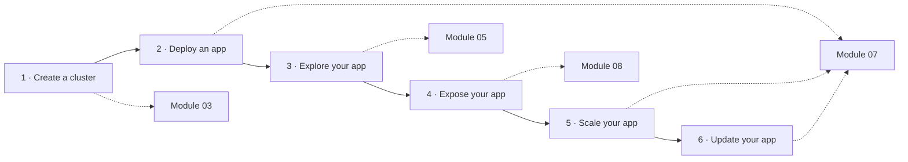

# 🎓 Official Tutorials Companion

The [official Kubernetes tutorials](https://kubernetes.io/docs/tutorials/) are short, focused
walkthroughs maintained by SIG Docs. This course uses them as **companion reading**: do the course
module first (analogy, concepts, lab with failures), then run the official tutorial to see the same
idea from the upstream point of view.

## 🧱 Learn Kubernetes Basics → course modules

The [Kubernetes Basics](https://kubernetes.io/docs/tutorials/kubernetes-basics/) track follows the
lifecycle of one app. Here is how each step maps to this course:

| Basics step | Official page | Course module |
|---|---|---|
| 1. Create a cluster | [Using Minikube to create a cluster](https://kubernetes.io/docs/tutorials/kubernetes-basics/create-cluster/cluster-intro/) | [03 · Local lab](../modules/level-0-foundations/03-local-lab/) (we use kind) |
| 2. Deploy an app | [Using kubectl to create a Deployment](https://kubernetes.io/docs/tutorials/kubernetes-basics/deploy-app/deploy-intro/) | [07 · Deployments](../modules/level-1-basics/07-deployments/) |
| 3. Explore your app | [Viewing Pods and Nodes](https://kubernetes.io/docs/tutorials/kubernetes-basics/explore/explore-intro/) | [05 · Pods](../modules/level-1-basics/05-pods/) |
| 4. Expose your app | [Using a Service to expose your app](https://kubernetes.io/docs/tutorials/kubernetes-basics/expose/expose-intro/) | [08 · Services and DNS](../modules/level-1-basics/08-services-dns/) |
| 5. Scale your app | [Running multiple instances of your app](https://kubernetes.io/docs/tutorials/kubernetes-basics/scale/scale-intro/) | [07 · Deployments](../modules/level-1-basics/07-deployments/) |
| 6. Update your app | [Performing a rolling update](https://kubernetes.io/docs/tutorials/kubernetes-basics/update/update-intro/) | [07 · Deployments](../modules/level-1-basics/07-deployments/) |

## 📚 Every official tutorial, mapped

| Section | Official tutorial | Course module |
|---|---|---|
| Basics | [Hello Minikube](https://kubernetes.io/docs/tutorials/hello-minikube/) | 03 |
| Configuration | [Configuring Redis using a ConfigMap](https://kubernetes.io/docs/tutorials/configuration/configure-redis-using-configmap/) | 09 |
| Authoring Pods | [Adopting sidecar containers](https://kubernetes.io/docs/tutorials/configuration/pod-sidecar-containers/) | 05 |
| Stateless apps | [Exposing an external IP address](https://kubernetes.io/docs/tutorials/stateless-application/expose-external-ip-address/) | 08 |
| Stateless apps | [PHP Guestbook with Redis](https://kubernetes.io/docs/tutorials/stateless-application/guestbook/) | Capstone warm-up |
| Stateful apps | [StatefulSet basics](https://kubernetes.io/docs/tutorials/stateful-application/basic-stateful-set/) | 13 |
| Stateful apps | [WordPress and MySQL with persistent volumes](https://kubernetes.io/docs/tutorials/stateful-application/mysql-wordpress-persistent-volume/) | 12 |
| Stateful apps | [Cassandra with StatefulSets](https://kubernetes.io/docs/tutorials/stateful-application/cassandra/) | 13 |
| Stateful apps | [Running ZooKeeper, a CP distributed system](https://kubernetes.io/docs/tutorials/stateful-application/zookeeper/) | 13, 28 |
| Services | [Connecting applications with Services](https://kubernetes.io/docs/tutorials/services/connect-applications-service/) | 08 |
| Services | [Using source IP](https://kubernetes.io/docs/tutorials/services/source-ip/) | 08, 19 |
| Services | [Pods and endpoint termination flow](https://kubernetes.io/docs/tutorials/services/pods-and-endpoint-termination-flow/) | 11 |
| Security | [Pod Security Standards at cluster level](https://kubernetes.io/docs/tutorials/security/cluster-level-pss/) | 18 |
| Security | [Pod Security Standards at namespace level](https://kubernetes.io/docs/tutorials/security/ns-level-pss/) | 18 |
| Security | [Restrict access with AppArmor](https://kubernetes.io/docs/tutorials/security/apparmor/) | 18 |
| Security | [Seccomp](https://kubernetes.io/docs/tutorials/security/seccomp/) | 18 |
| Cluster management | [Namespaces walkthrough](https://kubernetes.io/docs/tutorials/cluster-management/namespaces-walkthrough/) | 06 |
| Cluster management | [Use Pod-level resources with kubelet resource managers](https://kubernetes.io/docs/tutorials/cluster-management/use-pod-level-resource-managers/) | 10 |
| Cluster management | [Configuring swap memory on nodes](https://kubernetes.io/docs/tutorials/cluster-management/provision-swap-memory/) | 10, 22 |
| Cluster management | [Running kubelet in standalone mode](https://kubernetes.io/docs/tutorials/cluster-management/kubelet-standalone/) | 04, 22 |
| Cluster management | [Install drivers and allocate devices with DRA](https://kubernetes.io/docs/tutorials/cluster-management/install-use-dra/) | 27 |
| Cluster management | [Explore validating and mutating admission policies](https://kubernetes.io/docs/tutorials/cluster-management/admission-policies/) | 26 |

> 💡 Many official tutorials use minikube. On the course's kind cluster `kc` they work the same, except
> for minikube-specific commands (`minikube service`, `minikube addons`) — use `kubectl port-forward` instead.
