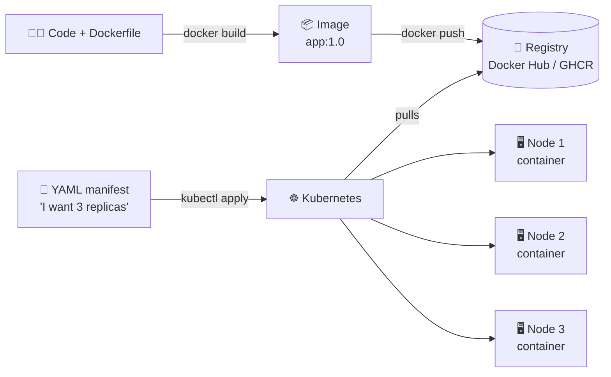
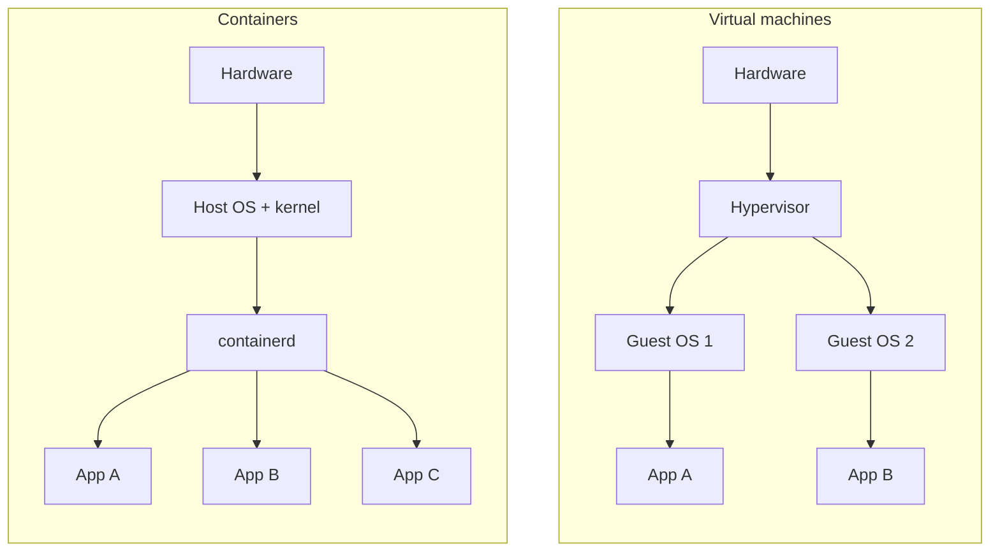

# 01 · Containers and Why Kubernetes

| Level | Duration | Prerequisites |
|---|---|---|
| 🌱 Foundations | 4 h | None. You only need to know how to open a terminal |

**By the end you will be able to:**
- **Explain** what a container is and how it differs from a virtual machine.
- **Build** and run your first container image.
- **Describe** the problems that appear when you run hundreds of containers by hand.
- **Justify** why Kubernetes exists and what "orchestration" means.

---

## 🧠 The analogy: from moving trucks to shipping containers

Before 1956, loading a ship was chaos. Cargo came in sacks, crates and barrels of every size. Dock
workers spent days packing it, and something always broke or went missing.

Then came the **shipping container**: a steel box with a standard size. The ship, the crane and the
truck **do not care what is inside**; they only know how to move standard boxes. Loading time dropped
from days to hours.

Software went through the same change:

| Shipping world | Software world |
|---|---|
| Mixed cargo (sacks, barrels) | Your app + libraries + Python/Java version + config |
| Standard container | **Container image** |
| Ship, crane, truck | Any server with a container engine |
| A port with thousands of containers and automated cranes | **Kubernetes** |

A container solves *"it works on my machine"*. Kubernetes solves *"who moves, watches and replaces
5,000 containers at 3 a.m.?"*.

---

## 📖 Concepts

### 1. The original problem: "it works on my machine"

Your app needs Python 3.12, version 2.4 of a library and an environment variable. The production server
has Python 3.9 and version 1.8 of the library. Result: it fails in production even though it worked on
your laptop.

### 2. Virtual machines vs. containers

A **virtual machine (VM)** simulates a whole computer, with its own operating system. It is secure and
isolated, but heavy: every VM boots a full kernel and takes up gigabytes.

A **container** is a normal Linux process that the kernel puts "blinkers" on: it only sees its own
files, its own network and a limited amount of CPU and memory. It shares the host kernel, so it starts in
milliseconds and weighs megabytes.

| Feature | Virtual machine | Container |
|---|---|---|
| What it virtualizes | Hardware | The operating system |
| Kernel | Its own | Shared with the host |
| Typical size | GBs | MBs |
| Start-up | Minutes | Milliseconds to seconds |
| Isolation | Very strong | Strong (and can be hardened: see module 18) |
| Density per server | Tens | Hundreds |

### 3. The three kernel features behind the magic

- **Linux namespaces** → what the process *can see* (its PIDs, its network, its filesystem).
- **cgroups** → what the process *can use* (CPU, memory, I/O).
- **Layered filesystem (OverlayFS)** → the image is built from reusable layers.

> 💡 Do not confuse *Linux namespaces* with *Kubernetes Namespaces* (module 06). Different ideas, same name.

### 4. Image vs. container

- **Image**: the frozen recipe (read-only). Example: `nginx:1.27`.
- **Container**: the recipe running, with a writable layer on top.
- **Registry**: the image warehouse (Docker Hub, GHCR, Quay, ECR…).

An image is identified by `registry/repository:tag` or, even better, by its immutable *digest*
`@sha256:...`. Tags can move; digests cannot.

### 5. The OCI standard

The **Open Container Initiative (OCI)** defines how an image is packaged and how it runs. Thanks to that,
an image built with Docker runs on `containerd`, CRI-O or Podman. Kubernetes uses `containerd` or CRI-O,
**not** Docker Engine (direct support, called *dockershim*, was removed in v1.24).

### 6. Why isn't Docker enough?

With 3 containers on one server, Docker is fine. With 300 containers on 30 servers, hard questions appear:

| Question | Without an orchestrator | With Kubernetes |
|---|---|---|
| Which server do I put it on? | You decide by hand | The *scheduler* decides |
| What if the container dies? | Someone restarts it | It restarts by itself |
| What if the server dies? | 3 a.m. incident | It is recreated on another node |
| How do other services find it? | IPs in config files | Stable DNS names and Services |
| How do I update with no downtime? | Fragile script | Declarative rolling update |
| How do I scale with demand? | Manually | Autoscaling |

### 7. The core idea of Kubernetes: declare, don't command

With a script you **command steps**: "start 3 containers". With Kubernetes you **declare a desired
state**: "I always want 3". A control loop keeps comparing desired with actual and fixes the difference.
It works like a thermostat: you set 21 °C and it takes care of the rest.

---

## 🗺️ Diagram: from code to cluster





---

## ⌨️ Essential commands

| Command | What it does | When to use it |
|---|---|---|
| `docker build -t app:1.0 .` | Builds an image from a Dockerfile | Packaging your app |
| `docker run -d -p 8080:80 nginx:1.27` | Runs a container in the background | Trying an image |
| `docker ps` | Lists running containers | Seeing what is running |
| `docker logs <id>` | Shows the container output | Debugging |
| `docker exec -it <id> sh` | Opens a shell inside the container | Looking inside |
| `docker images` | Lists local images | Seeing what you downloaded |
| `docker stop <id>` / `docker rm <id>` | Stops / removes a container | Cleanup |

```bash
# Run a web server in a container
docker run -d --name web -p 8080:80 nginx:1.27

# Test it from your laptop
curl -s localhost:8080 | head -n 4

# See that it is "just a process"
docker top web

# Clean up
docker rm -f web
```

---

## 🧯 In production

- **Images are immutable**: never "patch" a running container. Build a new image.
- **Pin versions**: `nginx:latest` today and tomorrow can be different images. Use specific tags and, in
  production, digests.
- **Smaller images = smaller attack surface** and faster start-up (`distroless`, `alpine`, `chainguard` bases).
- **One process per container**: logs, restarts and scaling stay independent.
- **Containers are ephemeral**: anything written inside disappears when it is replaced (module 12).

## ⚠️ Common mistakes

| Symptom | Cause | Fix |
|---|---|---|
| `port is already allocated` | Another process uses the host port | Use another port: `-p 8081:80` |
| The container exits immediately | Its main process finished | A container lives as long as its PID 1 lives |
| `manifest unknown` | The tag does not exist in the registry | Check the tag in the registry |
| Changes lost after re-creating | They were written to the container layer | Use volumes |

## 📚 Official references

- [Kubernetes overview](https://kubernetes.io/docs/concepts/overview/)
- [Containers](https://kubernetes.io/docs/concepts/containers/)
- [Images](https://kubernetes.io/docs/concepts/containers/images/)
- [Container Runtime Interface (CRI)](https://kubernetes.io/docs/concepts/architecture/cri/)
- [Dockershim removal FAQ](https://kubernetes.io/blog/2022/02/17/dockershim-faq/)

➡️ Next: [🧪 LAB.md](LAB.md)
