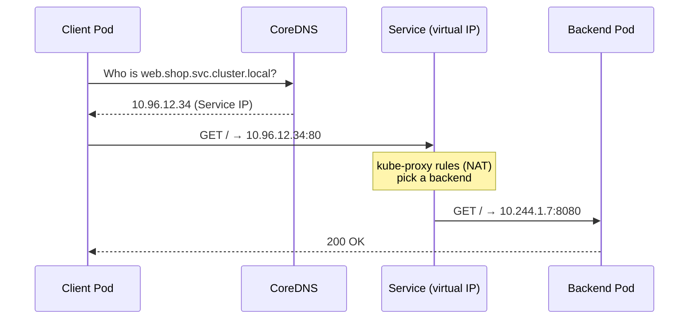

# 02 · Linux, Networking and YAML for Kubernetes

| Level | Duration | Prerequisites |
|---|---|---|
| 🌱 Foundations | 4 h | Module 01 |

**By the end you will be able to:**
- **Use** the Linux commands you will need inside containers and nodes.
- **Explain** IP addresses, ports, DNS and HTTP well enough to debug a Service.
- **Read and write** YAML without indentation errors.
- **Recognize** the four top-level fields every Kubernetes object has.

---

## 🧠 The analogy: a city, its addresses and its forms

Think of a cluster as a **city**:

| City | Network / Kubernetes |
|---|---|
| A building's street address | An **IP address** |
| An apartment number inside the building | A **port** |
| The phone book that turns names into addresses | **DNS** |
| The postal service that moves letters | **TCP/IP** |
| The standard form you fill in at the town hall | A **YAML manifest** |

When you fill in a form at the town hall, each box has a name and a value, and some boxes contain
sub-boxes. A clerk reads the form and makes it happen. In Kubernetes, the "form" is YAML and the "clerk"
is the API server.

---

## 📖 Concepts

### 1. The Linux you actually need

You do not need to be a Linux expert. You need about 20 commands to look around inside a container or a node.

| Area | Commands |
|---|---|
| Files | `ls -la`, `cat`, `less`, `cd`, `pwd`, `find`, `df -h` |
| Processes | `ps aux`, `top`, `kill`, `env` |
| Network | `ip addr`, `ss -tlnp`, `curl -v`, `nslookup`, `dig`, `ping`, `nc -zv` |
| Text | `grep`, `head`, `tail -f`, `wc -l`, `sort`, `uniq` |
| Permissions | `id`, `whoami`, `chmod`, `chown` |

**Signals** matter a lot in Kubernetes. When a Pod is stopped, the container gets `SIGTERM` (please stop)
and, after a grace period (30 s by default), `SIGKILL` (stop now). An app that ignores `SIGTERM` drops
requests on every deploy.

**Exit codes** tell you how a process ended: `0` = OK, `1` = app error, `137` = killed by `SIGKILL`
(often OOM), `143` = ended by `SIGTERM`.

### 2. Networking in 5 minutes

- **IP address**: where a machine lives. In a cluster, every Pod gets its own IP.
- **Port**: which program on that machine. A web server usually listens on `80` or `8080`.
- **TCP vs UDP**: TCP is a phone call (reliable, ordered); UDP is a postcard (fast, no guarantees). DNS uses UDP 53.
- **CIDR**: a range of IPs. `10.244.0.0/16` = the 65,536 addresses from `10.244.0.0` to `10.244.255.255`.
- **DNS**: turns `api.example.com` into an IP. In Kubernetes, `my-svc.my-ns.svc.cluster.local` → Service IP.
- **HTTP**: requests (`GET /health`) and status codes (`200` OK, `404` not found, `503` unavailable).
- **NAT**: rewriting addresses as packets pass. Kubernetes Services rely on it.
- **Load balancer**: spreads requests across several backends.

### 3. YAML: the language of manifests

YAML is a way to write structured data that humans can read. It has only three building blocks:

| Block | Example | Like… |
|---|---|---|
| **Scalar** (a value) | `replicas: 3` | One box on the form |
| **Map** (key → value) | `metadata:` followed by indented keys | A box with sub-boxes |
| **List** (sequence) | `- name: web` | A numbered list of items |

**The golden rules:**
1. Indent with **spaces**, never tabs. Two spaces per level is the convention.
2. `key: value` needs a space after the colon.
3. A dash `- ` starts a list item.
4. Quote strings that look like other things: `"yes"`, `"080"`, `"1.10"`, `"*"`.
5. `---` separates several documents in one file.

```yaml
# A map with scalars, a nested map and a list
app: shop              # string
replicas: 3            # number
public: true           # boolean
version: "1.10"        # quoted, otherwise YAML reads it as the number 1.1
owner:                 # nested map
  team: payments
  email: pay@example.com
ports:                 # list of maps
  - name: http
    port: 80
  - name: metrics
    port: 9090
```

### 4. The anatomy of every Kubernetes object

Every manifest has the same four top-level fields:

```yaml
apiVersion: v1          # 1. Which version of the API defines this kind
kind: Pod               # 2. What type of object it is
metadata:               # 3. Identity: name, namespace, labels, annotations
  name: hello
  labels:
    app: hello
spec:                   # 4. Desired state: what YOU want
  containers:
    - name: web
      image: nginx:1.27
```

After you create it, Kubernetes adds a fifth field, **`status`**: the actual state, written by the system.
You write `spec`; controllers write `status`. Reconciliation is the work of making `status` match `spec`.

---

## 🗺️ Diagram: how a request finds a Pod



---

## ⌨️ Essential commands

| Command | What it does | When to use it |
|---|---|---|
| `curl -v http://host:port/path` | Makes an HTTP request and shows details | Test an endpoint |
| `nslookup name` / `dig name` | Resolves a DNS name | "Cannot find host" errors |
| `nc -zv host port` | Checks whether a TCP port is open | Connectivity tests |
| `ss -tlnp` | Lists listening ports | Is my app listening? On which port? |
| `yq '.spec' file.yaml` | Reads a field from YAML | Inspecting manifests |
| `kubectl explain pod.spec` | Shows the docs for a field | Writing manifests |

```bash
# Validate YAML syntax locally (needs yq)
yq '.' manifest.yaml > /dev/null && echo "valid YAML"

# Ask the API server to validate without creating anything
kubectl apply -f manifest.yaml --dry-run=server
```

---

## 🧯 In production

- **Most "Kubernetes problems" are networking or DNS problems.** Learn `curl`, `nslookup` and `nc` well.
- **Handle `SIGTERM`** in your app: finish in-flight requests, then exit. That is what makes deploys invisible to users.
- **Exit codes are evidence.** `137` points to memory; `1` points to the app; `0` in a loop points to a command that ends.
- **YAML errors are cheap to catch early**: use an editor with YAML/Kubernetes support and `--dry-run=server`.

## ⚠️ Common mistakes

| Symptom | Cause | Fix |
|---|---|---|
| `error converting YAML to JSON: found character that cannot start any token` | A tab character | Replace tabs with spaces |
| `mapping values are not allowed here` | Missing space after `:` or bad indentation | `key: value`, align siblings |
| A version like `1.10` becomes `1.1` | YAML read it as a number | Quote it: `"1.10"` |
| `unknown field "contianers"` | Typo in a field name | `kubectl explain` and strict validation |
| `Connection refused` | Nothing listening on that port | `ss -tlnp` inside the container |

## 📚 Official references

- [Objects in Kubernetes](https://kubernetes.io/docs/concepts/overview/working-with-objects/)
- [Kubernetes API concepts](https://kubernetes.io/docs/reference/using-api/api-concepts/)
- [Cluster networking](https://kubernetes.io/docs/concepts/cluster-administration/networking/)
- [DNS for Services and Pods](https://kubernetes.io/docs/concepts/services-networking/dns-pod-service/)
- [Pod termination](https://kubernetes.io/docs/concepts/workloads/pods/pod-lifecycle/#pod-termination)

➡️ Next: [🧪 LAB.md](LAB.md)
