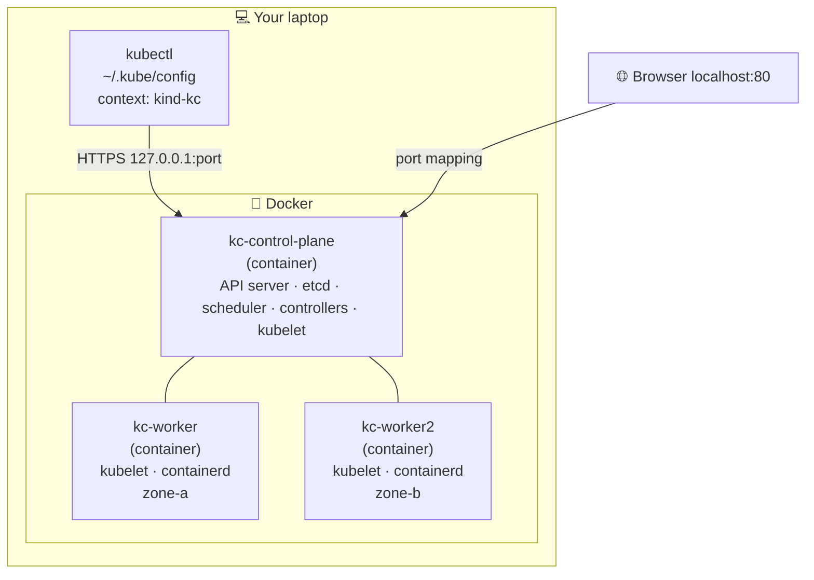

# 03 · Your Local Lab

| Level | Duration | Prerequisites |
|---|---|---|
| 🌱 Foundations | 4 h | Modules 01–02 · tools from [setup](../../../docs/setup.md) |

**By the end you will be able to:**
- **Create** a multi-node Kubernetes cluster on your laptop with kind.
- **Explain** what a kubeconfig file, a context and a namespace selection are.
- **Run** your first workload with `kubectl` and reach it from your browser.
- **Destroy and recreate** your lab in under two minutes.

---

## 🧠 The analogy: a flight simulator

Pilots do not learn on a real plane full of passengers. They learn in a **flight simulator**: same
controls, same instruments, and if they crash, they press "reset".

**kind** (*Kubernetes IN Docker*) is your flight simulator. Each "node" is a Docker container that runs
a real kubelet, a real API server and real etcd. The controls (`kubectl`) are exactly the ones you will
use in production. And if you break it, you delete it and create a new one.

---

## 📖 Concepts

### 1. Ways to run Kubernetes

| Option | Examples | Good for |
|---|---|---|
| Local, in containers | **kind**, k3d | Learning, CI, quick tests |
| Local, in a VM | minikube | Learning with built-in addons |
| Self-managed | kubeadm, Talos, RKE2 | Full control, on-prem |
| Managed by a cloud | EKS, GKE, AKS, OKE | Production without running the control plane |
| Enterprise distribution | OpenShift, Rancher, Tanzu | Production with extra tooling and support |

The Kubernetes API is the same everywhere. What you learn on kind works on EKS or OpenShift.

### 2. kubectl and the kubeconfig file

`kubectl` is just an HTTP client for the API server. It reads `~/.kube/config` (the **kubeconfig**) to
know three things:

| Part | Question it answers | Example |
|---|---|---|
| **cluster** | Where is the API server? | `https://127.0.0.1:52341` + CA certificate |
| **user** | Who am I? | A client certificate or token |
| **context** | Which cluster + user + default namespace? | `kind-kc` |

You can have many contexts and switch between them. Always check where you are before running a
destructive command — this has caused real production incidents.

### 3. The course cluster: `kc`

Every lab uses the same cluster, defined in `kind-kc.yaml` (you create it in the lab):

- 1 **control-plane** node: runs the API server, scheduler, controllers and etcd.
- 2 **worker** nodes labeled as two zones, so you can practice topology spread and failover.
- Ports 80/443 mapped to your laptop, for Ingress and Gateway API labs.

### 4. Addons you will install later

| Addon | Module | Why |
|---|---|---|
| metrics-server | 10, 16 | `kubectl top` and autoscaling |
| An Ingress / Gateway controller | 14 | Routing HTTP traffic into the cluster |
| local-path-provisioner | 12 | Already included in kind: dynamic volumes |
| Prometheus + Grafana | 20 | Metrics and dashboards |

---

## 🗺️ Diagram: what kind builds on your laptop



---

## ⌨️ Essential commands

| Command | What it does | When to use it |
|---|---|---|
| `kind create cluster --name kc --config kind-kc.yaml` | Creates the cluster | Start of the course / after a reset |
| `kind get clusters` | Lists kind clusters | Is my lab still there? |
| `kind delete cluster --name kc` | Destroys the cluster | Reset |
| `kind load docker-image kc/hello:1.0 --name kc` | Copies a local image into the nodes | Testing images you built |
| `kubectl config current-context` | Shows where you are | **Before every destructive command** |
| `kubectl get nodes -o wide` | Lists nodes with IPs and versions | Health check |
| `kubectl get pods -A` | All Pods in all namespaces | See the system components |

```bash
# Where am I and what is running?
kubectl config current-context
kubectl get nodes
kubectl get pods -n kube-system
```

---

## 🧯 In production

- **Cattle, not pets**: your lab should be disposable. If recreating it takes more than 2 minutes, automate it.
- **Know your context**: put the current context in your shell prompt (`kube-ps1`) or use `kubectx`.
- **Same version as production**: pin the node image (`--image kindest/node:vX.Y.Z`) to match the cluster you run at work.
- **Labs are where you break things**: you will learn more from the 💥 steps than from the happy path.

## ⚠️ Common mistakes

| Symptom | Cause | Fix |
|---|---|---|
| `failed to create cluster: ... port is already allocated` | Something on your laptop uses port 80/443 | Stop it, or change `hostPort` in the config |
| `The connection to the server localhost:8080 was refused` | No kubeconfig / wrong context | `kubectl config use-context kind-kc` |
| Nodes stuck `NotReady` | Docker has too little CPU/RAM | Give Docker ≥ 4 CPU and 8 GB |
| `ErrImagePull` for a local image | The image is on your laptop, not in the nodes | `kind load docker-image ...` |

## 🎓 Official tutorial companion

After the lab, run the upstream tutorial to see the same idea from the official docs:

- [Hello Minikube](https://kubernetes.io/docs/tutorials/hello-minikube/)
- [Kubernetes Basics 1 · Create a cluster](https://kubernetes.io/docs/tutorials/kubernetes-basics/create-cluster/cluster-intro/)

> Tutorials that use minikube work on `kc` too; replace `minikube service` with `kubectl port-forward`.

## 📚 Official references

- [Install tools](https://kubernetes.io/docs/tasks/tools/)
- [Learning environment](https://kubernetes.io/docs/setup/learning-environment/)
- [Organizing access with kubeconfig files](https://kubernetes.io/docs/concepts/configuration/organize-cluster-access-kubeconfig/)
- [kind quick start](https://kind.sigs.k8s.io/docs/user/quick-start/)
- [kubectl reference](https://kubernetes.io/docs/reference/kubectl/)

➡️ Next: [🧪 LAB.md](LAB.md)
