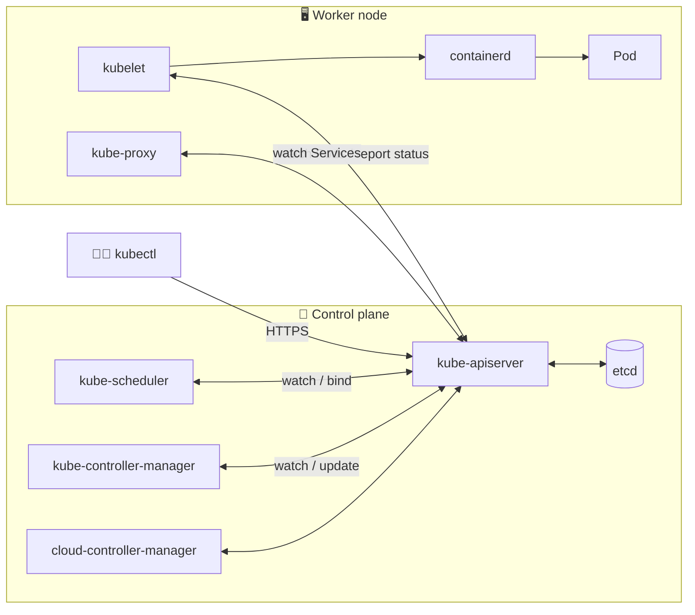
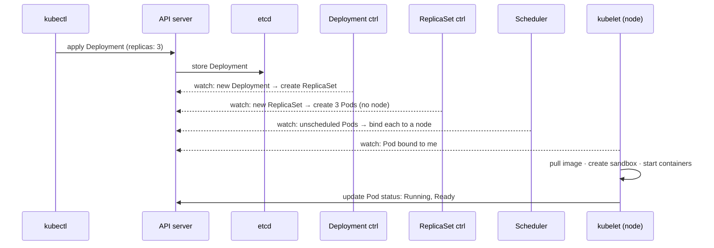

# 04 · Kubernetes Architecture

| Level | Duration | Prerequisites |
|---|---|---|
| 🧱 Basics | 5 h | Module 03 (running `kc` cluster) |

**By the end you will be able to:**
- **Name** every control plane and node component and explain its job in one sentence.
- **Trace** what happens, step by step, from `kubectl apply` to a running container.
- **Explain** the controller pattern and why Kubernetes is "level-triggered".
- **Inspect** the components of a real cluster and their health.

---

## 🧠 The analogy: a restaurant

| Restaurant | Kubernetes | Job |
|---|---|---|
| The **order book** at the counter | **etcd** | The single source of truth: every order ever taken |
| The **head waiter** who takes every order | **kube-apiserver** | The only door in. Checks who you are and writes to the book |
| The **maître d'** who assigns tables | **kube-scheduler** | Decides which node (table) each Pod (party) sits at |
| **Shift managers** who keep walking around | **kube-controller-manager** | "We promised 3 pizzas on table 5; I see 2; order another" |
| The **chef at each station** | **kubelet** | Cooks what was assigned to their station and reports back |
| The **stove** | **container runtime** (containerd) | Actually does the cooking |
| The **runners** with the floor map | **kube-proxy** | Know how to route each dish to the right table |
| The **phone directory** | **CoreDNS** | Turns names into addresses |

Nobody shouts orders directly to a chef. Everything goes through the head waiter and the order book.
Every manager simply watches the book and works until reality matches it.

---

## 📖 Concepts

### 1. Two halves: control plane and nodes

The **control plane** is the brain: it stores state and makes decisions. The **nodes** (workers) are
the muscle: they run your containers. In production the control plane runs on 3 or 5 machines for high
availability; in kind it is one container.

### 2. Control plane components

| Component | What it does | If it fails… |
|---|---|---|
| **kube-apiserver** | REST API front door. Authenticates, authorizes, runs admission, validates and stores objects in etcd. Every other component talks only to it. | No changes possible; running Pods keep running |
| **etcd** | Distributed, consistent key-value store (Raft consensus). Holds the whole cluster state. | The cluster "forgets"; this is why you back it up (module 22) |
| **kube-scheduler** | Watches for Pods with no node and picks the best node (filter → score → bind). | New Pods stay `Pending` |
| **kube-controller-manager** | Runs dozens of control loops: Deployment, ReplicaSet, Node, Job, EndpointSlice, ServiceAccount… | Nothing reconciles: no self-healing, no scaling |
| **cloud-controller-manager** | Talks to the cloud provider: load balancers, node lifecycle, routes. | `LoadBalancer` Services stay `<pending>` |

### 3. Node components

| Component | What it does |
|---|---|
| **kubelet** | Agent on every node. Watches the API for Pods bound to its node, asks the runtime to start them, runs probes, reports status and sends heartbeats (Leases). |
| **Container runtime** | `containerd` or CRI-O. Pulls images and runs containers through the **CRI** (Container Runtime Interface). |
| **kube-proxy** | Programs iptables/nftables/IPVS rules so Service IPs reach Pods. Some CNI plugins (e.g., Cilium) replace it. |
| **CNI plugin** | Gives every Pod an IP and connects Pods across nodes (kindnet, Calico, Cilium, Flannel…). |

### 4. The controller pattern (the heart of Kubernetes)

Every controller runs the same loop forever:

1. **Observe** the desired state (`spec`) and the actual state (`status`) through the API server (*watch*).
2. **Diff**: are they different?
3. **Act**: make one change to move actual toward desired.
4. Repeat.

This is **level-triggered**, not edge-triggered: a controller does not care *what event* happened, only
*what the state is now*. If it misses an event or crashes, it simply looks again and fixes things. That
is why Kubernetes heals itself.

### 5. Everything goes through the API server

Components never talk to each other directly. The scheduler does not call the kubelet; it writes
`spec.nodeName` on the Pod, and the kubelet *watches* and notices. This "hub and spoke" design makes the
system loosely coupled and easy to extend.

### 6. The request pipeline inside the API server

`kubectl apply` → **Authentication** (who are you?) → **Authorization** (RBAC: may you?) →
**Mutating admission** (change the object, e.g., add defaults) → **Schema validation** →
**Validating admission** (policies) → **Persist to etcd** → respond. Modules 17 and 26 go deeper.

---

## 🗺️ Diagrams

### Components



### From `kubectl apply` to a running container



---

## ⌨️ Essential commands

| Command | What it does | When to use it |
|---|---|---|
| `kubectl get --raw='/readyz?verbose'` | API server readiness checks | Is the control plane healthy? |
| `kubectl get pods -n kube-system` | Control plane and addon Pods | Health overview |
| `kubectl get leases -n kube-node-lease` | Node heartbeats | Is a node still talking? |
| `kubectl get leases -n kube-system` | Leader election for scheduler/controllers | Who is the active leader? |
| `kubectl describe node <name>` | Capacity, conditions, Pods, events | Node issues |
| `kubectl get --raw /metrics \| head` | API server Prometheus metrics | Observability |
| `kubectl api-versions` | Served API groups/versions | Writing manifests |

```bash
# Control plane static Pods live as files on the control-plane node
docker exec kc-control-plane ls /etc/kubernetes/manifests
# etcd.yaml  kube-apiserver.yaml  kube-controller-manager.yaml  kube-scheduler.yaml
```

---

## 🧯 In production

- **The data plane survives a control plane outage.** If the API server dies, running Pods keep serving
  traffic; you just cannot change anything. Know this before you panic during an incident.
- **etcd is the crown jewel**: back it up, encrypt Secrets at rest, give it fast disks, keep it at an odd
  number of members (3 or 5).
- **API server latency is a top SLI** for platform teams (`apiserver_request_duration_seconds`).
- **Controllers make progress slowly and safely** — reconciliation is eventually consistent. "It takes
  a few seconds" is normal; "it never converges" is a bug to investigate.

## ⚠️ Common mistakes

| Symptom | Cause | Fix |
|---|---|---|
| Pods stuck `Pending`, no events | Scheduler down or no node fits | `kubectl get pods -n kube-system`, `describe pod` |
| Node `NotReady` | kubelet stopped / network / disk pressure | `describe node`, then check kubelet logs on the node |
| `etcdserver: request timed out` | Slow disk or overloaded etcd | Check etcd metrics (`wal_fsync_duration`) and disk IOPS |
| Thinking `kubectl` talks to nodes | Misunderstanding of the hub design | Everything goes through the API server |

## 🎓 Official tutorial companion

After the lab, run the upstream tutorial to see the same idea from the official docs:

- [Running kubelet in standalone mode](https://kubernetes.io/docs/tutorials/cluster-management/kubelet-standalone/)

> Tutorials that use minikube work on `kc` too; replace `minikube service` with `kubectl port-forward`.

## 📚 Official references

- [Cluster architecture](https://kubernetes.io/docs/concepts/architecture/)
- [Kubernetes components](https://kubernetes.io/docs/concepts/overview/components/)
- [Controllers](https://kubernetes.io/docs/concepts/architecture/controller/)
- [Nodes](https://kubernetes.io/docs/concepts/architecture/nodes/)
- [Leases](https://kubernetes.io/docs/concepts/architecture/leases/)
- [Communication between nodes and the control plane](https://kubernetes.io/docs/concepts/architecture/control-plane-node-communication/)

➡️ Next: [🧪 LAB.md](LAB.md)
