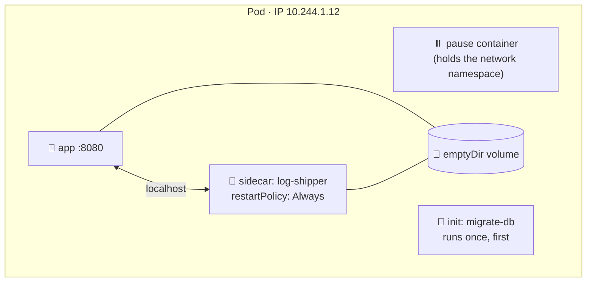
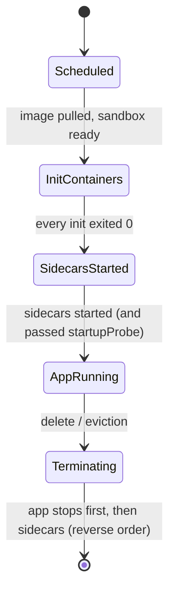

# 05 · Pods

| Level | Duration | Prerequisites |
|---|---|---|
| 🧱 Basics | 5 h | Module 04 |

**By the end you will be able to:**
- **Explain** why the smallest unit in Kubernetes is a Pod and not a container.
- **Write** Pod manifests with commands, environment variables, ports and multiple containers.
- **Use** init containers and native sidecar containers correctly.
- **Read** Pod phases, container states and restart policies to diagnose problems.

---

## 🧠 The analogy: a shared apartment

A **Pod** is an apartment. The **containers** are the roommates.

- They share the **address** (one IP for the whole Pod) and talk to each other through the hallway (`localhost`).
- They can share **storage rooms** (volumes).
- They move in and out **together**: the whole apartment is scheduled to one building (node).
- Each roommate keeps their own **bedroom** (filesystem, process).

Most apartments have one roommate. Sometimes you add a helper who lives with the main tenant: someone
who collects the mail (**log shipper**), translates calls (**proxy**) or prepares the place before the
tenant moves in (**init container**).

---

## 📖 Concepts

### 1. What a Pod is

A Pod is a group of one or more containers that share network namespace, IPC and (optionally) volumes,
and are always scheduled together on the same node. Each Pod gets a unique IP in the cluster.

**Pods are mortal.** They are never "moved" or "repaired": if a Pod dies or its node dies, a controller
creates a *new* Pod with a new name and a new IP. That is why you almost never create bare Pods — you
use Deployments, StatefulSets or Jobs (modules 07 and 13).

### 2. A complete Pod manifest, explained

```yaml
apiVersion: v1
kind: Pod
metadata:
  name: api                      # unique within the namespace
  labels:
    app: api                     # labels: how others find this Pod (module 06)
spec:
  restartPolicy: Always          # Always (default) | OnFailure | Never
  containers:
    - name: app                  # container name inside the Pod
      image: ghcr.io/stefanprodan/podinfo:6.7.0
      command: ["./podinfo"]     # overrides the image ENTRYPOINT
      args: ["--port=9898"]      # overrides the image CMD
      ports:
        - name: http
          containerPort: 9898    # informative, but name it: probes and Services can use the name
      env:
        - name: PODINFO_UI_MESSAGE
          value: "Hello from KC"
        - name: MY_POD_IP        # Downward API: facts about the Pod itself
          valueFrom:
            fieldRef:
              fieldPath: status.podIP
      resources:                 # module 10
        requests: { cpu: 50m, memory: 64Mi }
        limits:   { memory: 128Mi }
```

### 3. Pod phases and container states

| Pod phase | Meaning |
|---|---|
| `Pending` | Accepted, but not all containers are running (scheduling, pulling images, init containers) |
| `Running` | Bound to a node, at least one container running |
| `Succeeded` | All containers ended with exit 0 and will not restart |
| `Failed` | All containers ended and at least one failed |
| `Unknown` | The node stopped reporting |

Each container also has a **state**: `Waiting` (with a *reason* like `ImagePullBackOff` or
`CrashLoopBackOff`), `Running` or `Terminated` (with an exit code and a reason like `OOMKilled`).

> ⚠️ `CrashLoopBackOff` is not a phase — it is a container waiting *reason*. The kubelet restarts the
> container with an exponential back-off (10 s, 20 s, 40 s … up to 5 min).

### 4. Restart policy

| `restartPolicy` | Restarts the container when… | Typical use |
|---|---|---|
| `Always` | It exits, for any reason | Long-running services (Deployments) |
| `OnFailure` | It exits with a non-zero code | Batch Jobs that should retry |
| `Never` | Never | One-shot tasks, debugging |

### 5. Multi-container patterns

| Pattern | What the extra container does | Example |
|---|---|---|
| **Init container** | Runs to completion *before* app containers start, one after another | Wait for a DB, run migrations, download config |
| **Sidecar** | Runs *alongside* the app for the whole Pod life | Log shipper, service mesh proxy, cert reloader |
| **Ambassador** | A proxy the app talks to on `localhost` | Connection pooling to a DB |
| **Adapter** | Transforms the app's output | Converts custom metrics to Prometheus format |

### 6. Native sidecar containers (GA since v1.33)

In the past, sidecars were just regular containers, which caused problems: they could start after the
app, and they kept Jobs running forever. Now you declare a sidecar as an **init container with
`restartPolicy: Always`**:

```yaml
spec:
  initContainers:
    - name: log-shipper
      image: busybox:1.36
      restartPolicy: Always        # ← this makes it a native sidecar
      command: ["sh", "-c", "tail -F /var/log/app/app.log"]
      volumeMounts:
        - { name: logs, mountPath: /var/log/app }
  containers:
    - name: app
      image: busybox:1.36
      command: ["sh", "-c", "while true; do date >> /var/log/app/app.log; sleep 2; done"]
      volumeMounts:
        - { name: logs, mountPath: /var/log/app }
  volumes:
    - name: logs
      emptyDir: {}
```

Native sidecars **start before** the app containers, **stay running** during the Pod's life, and are
**stopped after** the app containers — and they do not block a Job from completing.

### 7. Ephemeral debug containers

Production images are often minimal (no shell). `kubectl debug` adds a temporary container to a running
Pod, sharing its process namespace, so you can inspect it without restarting it.

---

## 🗺️ Diagrams

### Inside a Pod



### Pod start-up order



---

## ⌨️ Essential commands

| Command | What it does | When to use it |
|---|---|---|
| `kubectl run tmp --image=busybox:1.36 --rm -it --restart=Never -- sh` | Throwaway debug Pod | Testing DNS/connectivity |
| `kubectl get pod api -o wide` | IP, node, readiness | Where does it run? |
| `kubectl describe pod api` | Full state + events | **First stop when debugging** |
| `kubectl logs api -c app --previous` | Logs from the last crashed instance | `CrashLoopBackOff` |
| `kubectl exec -it api -c app -- sh` | Shell in a container | Looking around |
| `kubectl debug -it api --image=busybox:1.36 --target=app` | Ephemeral debug container | Distroless images |
| `kubectl get pod api -o jsonpath='{.status.containerStatuses[*].restartCount}'` | Restart count | Flapping apps |
| `kubectl explain pod.spec.containers.lifecycle` | Field docs | Writing manifests |

---

## 🧯 SRE mindset

- **Never run bare Pods in production.** No controller means no self-healing.
- **Restart count is a leading indicator.** A slowly rising `restartCount` is an incident waiting to happen; alert on it.
- **`kubectl logs --previous` is the most underused command** in incident response.
- **Keep sidecars light**: they consume resources in every replica; 100 replicas × 50 Mi = 5 Gi.
- **Pin image tags** and set `imagePullPolicy: IfNotPresent` for tagged images to avoid surprises and registry rate limits.

## ⚠️ Common mistakes

| Symptom | Cause | Fix |
|---|---|---|
| `ErrImagePull` / `ImagePullBackOff` | Typo in the image, missing tag, private registry | Check the image; add `imagePullSecrets` |
| `CrashLoopBackOff` | The process exits (error, wrong command, missing config) | `kubectl logs --previous` |
| `Init:0/1` forever | Init container never finishes | `kubectl logs <pod> -c <init-name>` |
| `Completed` then restarting | Command ends but `restartPolicy: Always` | Use a Job, or a long-running command |
| `CreateContainerConfigError` | Referenced ConfigMap/Secret key missing | `describe pod` → events |

## 🎓 Official tutorial companion

After the lab, run the upstream tutorial to see the same idea from the official docs:

- [Kubernetes Basics 3 · Explore your app](https://kubernetes.io/docs/tutorials/kubernetes-basics/explore/explore-intro/)
- [Adopting sidecar containers](https://kubernetes.io/docs/tutorials/configuration/pod-sidecar-containers/)

> Tutorials that use minikube work on `kc` too; replace `minikube service` with `kubectl port-forward`.

## 📚 Official references

- [Pods](https://kubernetes.io/docs/concepts/workloads/pods/)
- [Pod lifecycle](https://kubernetes.io/docs/concepts/workloads/pods/pod-lifecycle/)
- [Init containers](https://kubernetes.io/docs/concepts/workloads/pods/init-containers/)
- [Sidecar containers](https://kubernetes.io/docs/concepts/workloads/pods/sidecar-containers/)
- [Ephemeral containers](https://kubernetes.io/docs/concepts/workloads/pods/ephemeral-containers/)
- [Downward API](https://kubernetes.io/docs/concepts/workloads/pods/downward-api/)

➡️ Next: [🧪 LAB.md](LAB.md)
