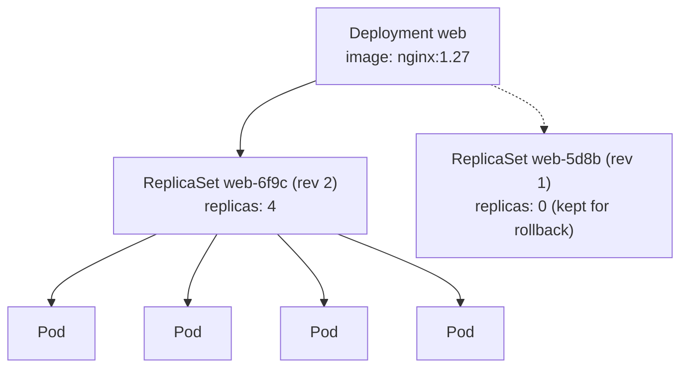
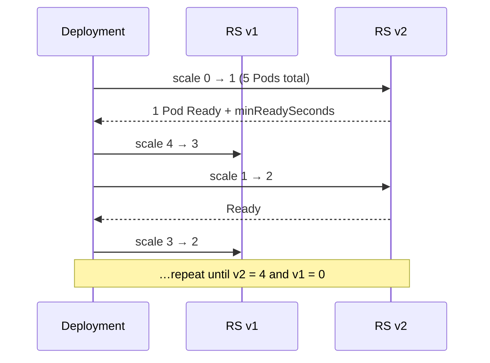

# 07 · ReplicaSets and Deployments

| Level | Duration | Prerequisites |
|---|---|---|
| 🧱 Basics | 6 h | Modules 05–06 |

**By the end you will be able to:**
- **Explain** the relationship Deployment → ReplicaSet → Pod.
- **Perform** rolling updates, pauses and rollbacks with zero downtime.
- **Tune** `maxSurge`, `maxUnavailable`, `minReadySeconds` and `progressDeadlineSeconds`.
- **Implement** blue/green and canary releases using only native objects.

---

## 🧠 The analogy: a bakery shift change

A bakery must always have **3 bakers** at the ovens (the desired replicas).

- The **ReplicaSet** is the shift supervisor: "there must be exactly 3 bakers wearing the *blue apron*".
  If one goes home sick, it calls in another one. It never cares about anything but the count.
- The **Deployment** is the store manager. When a new recipe arrives (new image), the manager hires a
  new supervisor for *green aprons* and swaps bakers **one at a time**: one green baker starts, proves
  they can bake (readiness), and only then does one blue baker go home. Customers never see an empty oven.
- If the new recipe is a disaster, the manager calls the old supervisor back: **rollback**.

---

## 📖 Concepts

### 1. ReplicaSet

A ReplicaSet keeps N Pods matching a selector running. It is the self-healing engine. You rarely
create one directly, because it cannot update Pods: changing its template does not touch existing Pods.

### 2. Deployment

A Deployment manages ReplicaSets to give you **declarative updates**. Every change to the Pod template
(image, env, resources…) creates a new ReplicaSet (a new *revision*) and gradually moves Pods from the
old one to the new one. Old ReplicaSets are kept (scaled to 0) for rollback.

```yaml
apiVersion: apps/v1
kind: Deployment
metadata:
  name: web
  labels:
    app: web
spec:
  replicas: 4
  revisionHistoryLimit: 5            # old ReplicaSets kept for rollback
  minReadySeconds: 5                 # a Pod must be Ready this long to count as available
  progressDeadlineSeconds: 120       # mark the rollout as failed if it makes no progress
  selector:                          # immutable; must match template labels
    matchLabels:
      app: web
  strategy:
    type: RollingUpdate              # or Recreate (kill all, then create: has downtime)
    rollingUpdate:
      maxSurge: 1                    # up to replicas+1 Pods during the update
      maxUnavailable: 0              # never go below 4 available Pods
  template:                          # the Pod template: changes here trigger a rollout
    metadata:
      labels:
        app: web
    spec:
      containers:
        - name: web
          image: nginx:1.26
          ports:
            - containerPort: 80
          readinessProbe:            # the rollout only advances when new Pods are Ready
            httpGet: { path: /, port: 80 }
            periodSeconds: 2
```

### 3. Rolling update math

With `replicas: 4`, `maxSurge: 1`, `maxUnavailable: 0`: Kubernetes creates 1 new Pod (5 total), waits
until it is available, removes 1 old Pod (back to 4), and repeats. Percentages are allowed too:
`maxSurge: 25%` rounds **up**, `maxUnavailable: 25%` rounds **down**.

| Setting | Effect |
|---|---|
| `maxSurge: 0, maxUnavailable: 1` | No extra capacity needed, but you lose one replica during the update |
| `maxSurge: 1, maxUnavailable: 0` | Safest for traffic; needs room for one extra Pod |
| `maxSurge: 100%, maxUnavailable: 0` | Fast "blue/green-like" rollout; needs double capacity briefly |

### 4. Rollout lifecycle

| Command | Effect |
|---|---|
| `kubectl rollout status` | Waits until done or failed (exit code ≠ 0 on failure: great for CI) |
| `kubectl rollout history` | Lists revisions (`kubernetes.io/change-cause` annotation shows the reason) |
| `kubectl rollout undo [--to-revision=N]` | Rolls back: the old ReplicaSet scales up again |
| `kubectl rollout pause` / `resume` | Batch several changes into one rollout |
| `kubectl rollout restart` | New rollout with the same spec (adds a `restartedAt` annotation) |

A Deployment reports its health through **conditions**: `Available`, `Progressing` and, when
`progressDeadlineSeconds` is exceeded, `Progressing=False` with reason `ProgressDeadlineExceeded`.
Kubernetes does **not** roll back automatically — your pipeline or GitOps tool must react.

### 5. Release strategies with native objects

| Strategy | How | Trade-off |
|---|---|---|
| **Rolling update** | Default Deployment behavior | Simple; old and new versions run together briefly |
| **Recreate** | `strategy.type: Recreate` | Downtime, but never two versions at once (DB schema changes) |
| **Blue/green** | Two Deployments (`version=blue`, `version=green`); switch the Service selector | Instant switch and rollback; double capacity |
| **Canary** | Two Deployments with the same `app` label; Service selects both; traffic ≈ replica ratio | Coarse control; use Gateway API or a mesh for precise percentages (module 14) |

---

## 🗺️ Diagrams

### Ownership



### A rolling update, step by step (replicas 4, maxSurge 1, maxUnavailable 0)



---

## ⌨️ Essential commands

| Command | What it does |
|---|---|
| `kubectl create deployment web --image=nginx:1.26 --replicas=4` | Create imperatively |
| `kubectl set image deployment/web web=nginx:1.27` | Trigger a rollout |
| `kubectl annotate deployment/web kubernetes.io/change-cause="upgrade to 1.27"` | Record why |
| `kubectl rollout status deployment/web --timeout=2m` | Wait for success/failure |
| `kubectl rollout history deployment/web --revision=2` | Inspect a revision |
| `kubectl rollout undo deployment/web` | Roll back |
| `kubectl scale deployment/web --replicas=8` | Scale |
| `kubectl get rs -l app=web` | See the ReplicaSets behind it |

---

## 🧯 In production

- **A rollout without a readiness probe is a blind rollout**: Kubernetes will happily replace healthy Pods with broken ones.
- **Gate deploys on `rollout status`**: in CI, a failed rollout must fail the pipeline and trigger rollback.
- **Change one thing at a time** and record the change cause; most incidents start with a change.
- **Rollback first, debug later.** Mean time to recovery matters more than finding the root cause during the incident.
- **Keep old and new versions compatible** (APIs, DB schemas): during a rolling update both serve traffic.

## ⚠️ Common mistakes

| Symptom | Cause | Fix |
|---|---|---|
| Rollout stuck at "1 of 4 updated" | New Pods never become Ready | `describe` the new Pods; roll back |
| `ProgressDeadlineExceeded` | Same as above, past the deadline | Fix image/config or `rollout undo` |
| Change to `replicas` did not create a revision | Only template changes create revisions | Expected behavior |
| `kubectl apply` resets replicas set by HPA | `replicas` in Git fights the autoscaler | Remove `replicas` from the manifest when using HPA |
| Pods restart on every apply | A changing value in the template (e.g., timestamp) | Keep the template deterministic |

## 🎓 Official tutorial companion

After the lab, run the upstream tutorial to see the same idea from the official docs:

- [Kubernetes Basics 2 · Deploy an app](https://kubernetes.io/docs/tutorials/kubernetes-basics/deploy-app/deploy-intro/)
- [Kubernetes Basics 5 · Scale your app](https://kubernetes.io/docs/tutorials/kubernetes-basics/scale/scale-intro/)
- [Kubernetes Basics 6 · Update your app](https://kubernetes.io/docs/tutorials/kubernetes-basics/update/update-intro/)

> Tutorials that use minikube work on `kc` too; replace `minikube service` with `kubectl port-forward`.

## 📚 Official references

- [Deployments](https://kubernetes.io/docs/concepts/workloads/controllers/deployment/)
- [ReplicaSet](https://kubernetes.io/docs/concepts/workloads/controllers/replicaset/)
- [Performing a rolling update (tutorial)](https://kubernetes.io/docs/tutorials/kubernetes-basics/update/update-intro/)
- [Run a stateless application using a Deployment](https://kubernetes.io/docs/tasks/run-application/run-stateless-application-deployment/)
- [kubectl rollout](https://kubernetes.io/docs/reference/kubectl/generated/kubectl_rollout/)

➡️ Next: [🧪 LAB.md](LAB.md)
