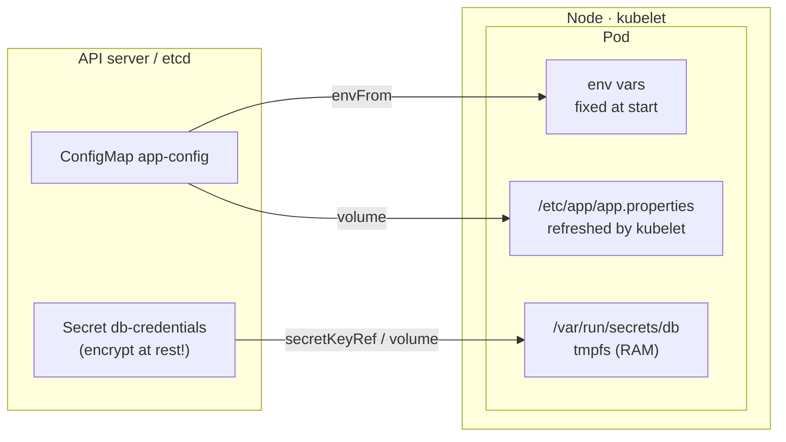

# 09 · ConfigMaps and Secrets

| Level | Duration | Prerequisites |
|---|---|---|
| 🧱 Basics | 5 h | Modules 05, 07 |

**By the end you will be able to:**
- **Separate** configuration from images using ConfigMaps and Secrets.
- **Inject** configuration as environment variables or as mounted files, and explain the trade-offs.
- **Explain** why a Kubernetes Secret is *not* encrypted by default and how to protect it.
- **Roll out** configuration changes safely.

---

## 🧠 The analogy: the recipe and the spice rack

Your container image is a **recipe printed in a cookbook**: the same for every kitchen. But each
restaurant uses a different amount of salt, a different oven temperature, a different supplier.

- A **ConfigMap** is the **sticky note on the fridge**: "oven at 200 °C, 2 tsp salt". Anyone in the
  kitchen can read it.
- A **Secret** is the **key to the safe** where the supplier's credit card is kept. It is handled more
  carefully: fewer people can see it, it is not written on the fridge — but if the safe itself is a
  cardboard box (no encryption), the key does not help much.

You never reprint the cookbook to change the salt. You change the note.

---

## 📖 Concepts

### 1. Why externalize configuration

The [Twelve-Factor App](https://12factor.net/config) rule: store config in the environment. One image,
many environments (dev, qa, prod). Changing config should not require a rebuild.

### 2. ConfigMap

Key/value data (up to 1 MiB) for non-sensitive configuration: flags, URLs, whole config files.

```yaml
apiVersion: v1
kind: ConfigMap
metadata:
  name: app-config
data:
  LOG_LEVEL: "info"                   # simple key → value
  FEATURE_NEW_CHECKOUT: "false"
  app.properties: |                   # a whole file as one key
    cache.ttl=300
    payments.url=http://payments.shop
```

### 3. Secret

Same idea, for sensitive data: passwords, tokens, TLS keys. Values in `data` are **base64-encoded**
(encoding, **not** encryption). Use `stringData` to write plain text and let the API encode it.

```yaml
apiVersion: v1
kind: Secret
metadata:
  name: db-credentials
type: Opaque                          # generic; others: kubernetes.io/tls, kubernetes.io/dockerconfigjson…
stringData:
  DB_USER: shop
  DB_PASSWORD: s3cr3t-change-me
```

| Secret type | Used for |
|---|---|
| `Opaque` | Anything |
| `kubernetes.io/tls` | `tls.crt` + `tls.key` for Ingress/Gateway |
| `kubernetes.io/dockerconfigjson` | Pulling images from private registries (`imagePullSecrets`) |
| `kubernetes.io/service-account-token` | Legacy long-lived SA tokens (avoid; use projected tokens) |

### 4. Consuming configuration

```yaml
spec:
  containers:
    - name: app
      image: my-app:1.0
      env:
        - name: LOG_LEVEL                      # one key as an env var
          valueFrom:
            configMapKeyRef: { name: app-config, key: LOG_LEVEL }
        - name: DB_PASSWORD
          valueFrom:
            secretKeyRef: { name: db-credentials, key: DB_PASSWORD }
      envFrom:                                 # every key as env vars
        - configMapRef: { name: app-config }
      volumeMounts:
        - name: config                         # as files
          mountPath: /etc/app
          readOnly: true
  volumes:
    - name: config
      configMap:
        name: app-config
        items:
          - { key: app.properties, path: app.properties }
```

| Method | Updates in a running Pod? | Good for |
|---|---|---|
| `env` / `envFrom` | ❌ No — only on restart | Simple flags, 12-factor apps |
| Volume mount | ✅ Yes, eventually (≈ up to a minute) — the app must re-read the file | Config files, certificates |
| Volume with `subPath` | ❌ No | Avoid when you need updates |

### 5. Immutable ConfigMaps and Secrets

`immutable: true` prevents changes and lets the kubelet stop watching them — better performance at
scale and protection against accidental edits. Change config by creating a **new** object
(`app-config-v2`) and pointing the Deployment at it, which also triggers a clean rollout. Kustomize
and Helm automate this with hashed names (module 23).

### 6. How safe are Secrets?

By default a Secret is stored in etcd **in plain text** (base64 is not protection). To protect them:

| Control | What it protects against |
|---|---|
| **Encryption at rest** (`EncryptionConfiguration`, ideally with a KMS v2 provider) | Someone reading etcd or its backups |
| **RBAC**: limit `get`/`list`/`watch` on secrets | Users and apps reading other teams' secrets (`list` reveals contents!) |
| **Do not commit Secrets to Git** | Leaks through repositories |
| **External secret managers** (Vault, AWS/GCP/Azure secret managers) via External Secrets Operator or the Secrets Store CSI Driver | Centralized rotation and audit |
| **Sealed Secrets / SOPS** | Storing *encrypted* secrets in Git for GitOps |

Mounted Secrets live in a `tmpfs` (memory) on the node, never on its disk.

---

## 🗺️ Diagram



---

## ⌨️ Essential commands

| Command | What it does |
|---|---|
| `kubectl create configmap app --from-literal=LOG_LEVEL=debug` | From literals |
| `kubectl create configmap nginx-conf --from-file=nginx.conf` | From a file (key = file name) |
| `kubectl create configmap env --from-env-file=.env` | From a `.env` file |
| `kubectl create secret generic db --from-literal=DB_PASSWORD=x` | Generic Secret |
| `kubectl create secret tls web-tls --cert=tls.crt --key=tls.key` | TLS Secret |
| `kubectl create secret docker-registry regcred --docker-server=… --docker-username=… --docker-password=…` | Registry credentials |
| `kubectl get secret db -o jsonpath='{.data.DB_PASSWORD}' \| base64 -d` | Decode one value |
| `kubectl rollout restart deployment/app` | Reload env-var config |

---

## 🧯 In production

- **Config changes are deployments.** Most outages start with a change — treat a ConfigMap edit with the same care (review, rollout, rollback) as a new image.
- **Version your config** (`app-config-v3` or hashed names) so a rollback restores matching code *and* config.
- **`list secrets` is as powerful as `get`**: audit who has it.
- **Rotate secrets** and make apps reload them without a restart when possible (mounted files).
- **Fail fast on missing config**: validate at start-up and exit with a clear message instead of running half-configured.

## ⚠️ Common mistakes

| Symptom | Cause | Fix |
|---|---|---|
| `CreateContainerConfigError` | A referenced ConfigMap/Secret or key does not exist | Create it, or mark it `optional: true` |
| Changed ConfigMap but app still uses the old value | Consumed as env vars (or `subPath`) | `rollout restart`, or use a volume and reload |
| Secret value has a trailing newline | Created with `echo` without `-n` | `echo -n` or `--from-literal` |
| Secret visible in Git history | Committed by mistake | Rotate immediately; purge history; use Sealed Secrets/SOPS |
| `data` rejected | Value not base64 | Use `stringData` |

## 🎓 Official tutorial companion

After the lab, run the upstream tutorial to see the same idea from the official docs:

- [Configuring Redis using a ConfigMap](https://kubernetes.io/docs/tutorials/configuration/configure-redis-using-configmap/)

> Tutorials that use minikube work on `kc` too; replace `minikube service` with `kubectl port-forward`.

## 📚 Official references

- [ConfigMaps](https://kubernetes.io/docs/concepts/configuration/configmap/)
- [Secrets](https://kubernetes.io/docs/concepts/configuration/secret/)
- [Good practices for Kubernetes Secrets](https://kubernetes.io/docs/concepts/security/secrets-good-practices/)
- [Encrypting confidential data at rest](https://kubernetes.io/docs/tasks/administer-cluster/encrypt-data/)
- [Configure a Pod to use a ConfigMap](https://kubernetes.io/docs/tasks/configure-pod-container/configure-pod-configmap/)
- [Distribute credentials securely using Secrets](https://kubernetes.io/docs/tasks/inject-data-application/distribute-credentials-secure/)

➡️ Next: [🧪 LAB.md](LAB.md)
