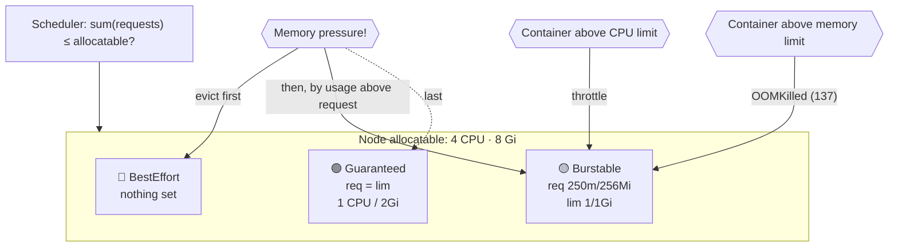

# 10 · Resources, QoS and Quotas

| Level | Duration | Prerequisites |
|---|---|---|
| ⚙️ Intermediate | 6 h | Modules 05, 07 · metrics-server ([module 03](../../level-0-foundations/03-local-lab/LAB.md)) |

**By the end you will be able to:**
- **Set** CPU and memory requests and limits and predict their effect.
- **Classify** Pods into Guaranteed, Burstable and BestEffort QoS classes.
- **Explain** CPU throttling, OOM kills and node-pressure eviction.
- **Enforce** sane defaults and budgets per namespace with LimitRange and ResourceQuota.

---

## 🧠 The analogy: a hotel

A node is a **hotel** with a fixed number of rooms (CPU) and beds (memory).

- A **request** is a **reservation**: "I need 2 beds guaranteed". The front desk (scheduler) only
  accepts you if the hotel has 2 unreserved beds — even if, right now, half the beds are empty.
- A **limit** is the **maximum you may use**: "you may use up to 4 beds, never more".
- **CPU** is like the **pool**: if it gets crowded, everyone swims slower (throttling), but nobody is kicked out.
- **Memory** is like **beds**: if you try to take a 5th bed, security throws you out (**OOMKilled**).
  And if the hotel is overbooked, guests without reservations are evicted first (**QoS**).

---

## 📖 Concepts

### 1. Units

| Resource | Unit | Examples |
|---|---|---|
| CPU | cores; `m` = millicores | `1` = 1 core, `500m` = half a core, `100m` = 10% of a core |
| Memory | bytes; binary suffixes | `128Mi`, `1Gi` (use `Mi`/`Gi`, not `M`/`G`) |
| Ephemeral storage | bytes | `2Gi` of container logs + writable layer + `emptyDir` |

### 2. Requests vs limits

```yaml
resources:
  requests:            # used by the SCHEDULER to place the Pod; guaranteed share
    cpu: 250m
    memory: 256Mi
  limits:              # enforced by the KERNEL (cgroups) at runtime
    cpu: "1"           # above this → throttled
    memory: 512Mi      # above this → OOMKilled
```

| | Requests | Limits |
|---|---|---|
| Used by | kube-scheduler (placement) + kubelet (cgroup weights) | Kernel cgroups |
| CPU exceeded | Can use idle CPU above request | **Throttled** (slowed), not killed |
| Memory exceeded | Can use free memory above request, but becomes an eviction candidate | **OOMKilled** (exit 137) |

The scheduler only looks at **requests**: a node's *allocatable* minus the sum of requests of its Pods.
Actual usage does not matter for scheduling.

### 3. QoS classes

| QoS class | Rule | Eviction order under memory pressure |
|---|---|---|
| **Guaranteed** | Every container has requests = limits for CPU **and** memory | Last |
| **Burstable** | At least one request or limit set, but not Guaranteed | Middle (by usage above request) |
| **BestEffort** | No requests or limits at all | **First** |

### 4. Node-pressure eviction

The kubelet watches node resources. When memory, disk or PIDs cross the **eviction thresholds** (e.g.,
`memory.available<100Mi`), it evicts Pods — BestEffort first, then Burstable Pods using the most above
their request — and sets a **node condition** (`MemoryPressure`, `DiskPressure`, `PIDPressure`) and a
taint so no new Pods land there.

### 5. CPU limits: the great debate

CPU limits cause throttling even when the node has idle CPU, which adds latency (especially for
multi-threaded runtimes like the JVM or Go). A common modern practice:

- **Always set memory requests and limits** (memory is not compressible).
- **Always set CPU requests** (for scheduling and fair share).
- **Set CPU limits only when you need strict isolation** (multi-tenant, batch jobs, benchmarks).

Watch `container_cpu_cfs_throttled_periods_total` to decide with data.

### 6. LimitRange: defaults and bounds per container

```yaml
apiVersion: v1
kind: LimitRange
metadata:
  name: defaults
spec:
  limits:
    - type: Container
      defaultRequest: { cpu: 100m, memory: 128Mi }   # applied when a container sets no request
      default:        { memory: 256Mi }              # applied when a container sets no limit
      max:            { cpu: "2", memory: 2Gi }      # reject bigger containers
      min:            { cpu: 10m, memory: 16Mi }
```

### 7. ResourceQuota: a budget per namespace

```yaml
apiVersion: v1
kind: ResourceQuota
metadata:
  name: team-budget
spec:
  hard:
    requests.cpu: "4"
    requests.memory: 8Gi
    limits.memory: 16Gi
    pods: "30"
    services.loadbalancers: "1"
    persistentvolumeclaims: "10"
```

When a quota covers `requests.cpu`, every new Pod **must** declare a CPU request (a LimitRange default
solves that).

### 8. Newer resource features

| Feature | Status (v1.37) | What it does |
|---|---|---|
| **In-place Pod resize** | GA (v1.35) | Change CPU/memory of a running Pod without restarting it (`kubectl patch --subresource resize`) — module 16 |
| **Pod-level resources** | Beta ⚠️ | `spec.resources` for the whole Pod, shared by its containers |
| **PSI metrics** | GA (v1.36) | Pressure Stall Information: *how long* tasks waited for CPU/memory/IO |
| **Memory QoS** (cgroup v2 `memory.high`) | Beta (v1.37) ⚠️ | Throttles memory before OOM for smoother behavior |

> ⚠️ Beta features may need a feature gate in some distributions — verify in the docs for your version.

---

## 🗺️ Diagram



---

## ⌨️ Essential commands

| Command | What it does |
|---|---|
| `kubectl top nodes` / `kubectl top pods --containers` | Live usage (metrics-server) |
| `kubectl describe node kc-worker \| grep -A8 'Allocated resources'` | Requested vs allocatable |
| `kubectl get pod web -o jsonpath='{.status.qosClass}'` | QoS class |
| `kubectl set resources deploy web --requests=cpu=100m,memory=128Mi --limits=memory=256Mi` | Set resources |
| `kubectl describe quota -n team-a` | Quota usage |
| `kubectl describe limitrange -n team-a` | Defaults and bounds |
| `kubectl get events --field-selector reason=Evicted -A` | Who was evicted |

---

## 🧯 SRE mindset

- **Requests are a capacity-planning contract.** Set them from observed usage (p95 + headroom), not guesses. VPA in recommendation mode helps (module 16).
- **No requests = BestEffort = first to die.** Enforce requests with LimitRange or policy (module 26).
- **Track utilization vs requests**: big gaps waste money; usage above requests risks eviction.
- **OOMKilled is an SLO risk**: alert on `kube_pod_container_status_last_terminated_reason{reason="OOMKilled"}`.
- **Reserve resources for the system** (`kube-reserved`, `system-reserved`) so nodes do not fall over under load.

## ⚠️ Common mistakes

| Symptom | Cause | Fix |
|---|---|---|
| `Pending` + `Insufficient cpu` | Sum of requests exceeds free allocatable | Lower requests, add nodes, or autoscale nodes |
| High latency, CPU looks "low" | CPU throttling by a tight limit | Raise or remove the CPU limit; check throttling metrics |
| `OOMKilled`, exit 137 | Memory above limit (or JVM heap > limit) | Raise the limit; set `-XX:MaxRAMPercentage` |
| `exceeded quota` on create | ResourceQuota reached | Raise the quota or free resources |
| `must specify requests.cpu` | Quota present, Pod without requests | Add requests or a LimitRange default |

## 🎓 Official tutorial companion

After the lab, run the upstream tutorial to see the same idea from the official docs:

- [Use Pod-level resources with kubelet resource managers](https://kubernetes.io/docs/tutorials/cluster-management/use-pod-level-resource-managers/)
- [Configuring swap memory on nodes](https://kubernetes.io/docs/tutorials/cluster-management/provision-swap-memory/)

> Tutorials that use minikube work on `kc` too; replace `minikube service` with `kubectl port-forward`.

## 📚 Official references

- [Resource management for Pods and containers](https://kubernetes.io/docs/concepts/configuration/manage-resources-containers/)
- [Pod Quality of Service classes](https://kubernetes.io/docs/concepts/workloads/pods/pod-qos/)
- [Node-pressure eviction](https://kubernetes.io/docs/concepts/scheduling-eviction/node-pressure-eviction/)
- [Limit Ranges](https://kubernetes.io/docs/concepts/policy/limit-range/)
- [Resource Quotas](https://kubernetes.io/docs/concepts/policy/resource-quotas/)
- [Resize CPU and memory resources assigned to containers](https://kubernetes.io/docs/tasks/configure-pod-container/resize-container-resources/)

➡️ Next: [🧪 LAB.md](LAB.md)
