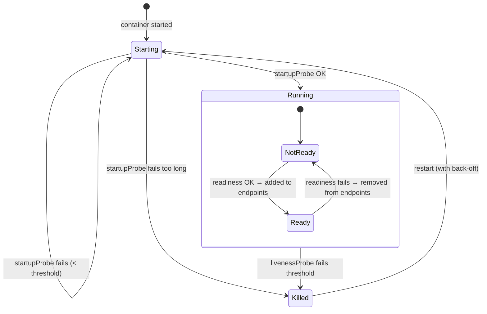
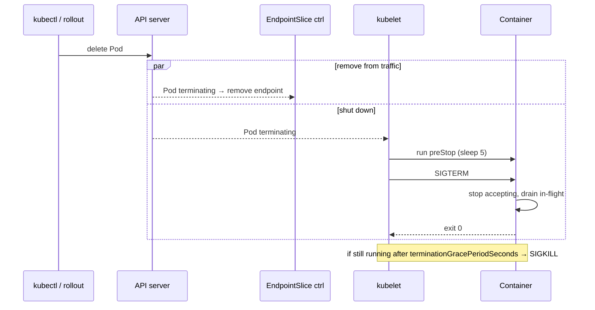

# 11 · Probes and Pod Lifecycle

| Level | Duration | Prerequisites |
|---|---|---|
| ⚙️ Intermediate | 5 h | Modules 05, 07, 08 |

**By the end you will be able to:**
- **Configure** startup, readiness and liveness probes and explain what each one controls.
- **Avoid** the classic probe anti-patterns that cause cascading outages.
- **Implement** graceful shutdown with `preStop`, `terminationGracePeriodSeconds` and `SIGTERM`.
- **Trace** the full lifecycle of a Pod from creation to termination.

---

## 🧠 The analogy: a hospital shift

Think of a Pod as a **nurse starting a shift**.

- **Startup probe** — "Have you arrived and changed into scrubs?" Until the answer is yes, nobody asks
  anything else. Slow starters (a 2-minute JVM boot) get time without being judged.
- **Readiness probe** — "Can you take a new patient right now?" If the nurse is busy or on a break, the
  front desk (Service) stops sending patients — but nobody fires the nurse.
- **Liveness probe** — "Are you conscious?" If the nurse faints, someone else takes over (the container
  is **restarted**). You only ask this question when restarting really helps.
- **Graceful shutdown** — at the end of the shift, the nurse stops taking new patients, finishes with
  the current ones and hands over. Leaving mid-procedure (`SIGKILL`) is how errors happen.

---

## 📖 Concepts

### 1. The three probes

| Probe | Question | On failure | Typical check |
|---|---|---|---|
| **startupProbe** | Has the app finished starting? | Container killed after `failureThreshold × periodSeconds` | Same endpoint as liveness, generous threshold |
| **readinessProbe** | Can it serve traffic now? | Removed from Service endpoints (no restart) | `/readyz`: dependencies needed to serve are OK |
| **livenessProbe** | Is it stuck beyond recovery? | **Container restarted** | `/livez`: the process itself is responsive |

While a startup probe is running, liveness and readiness probes are disabled.

### 2. Probe mechanisms

```yaml
readinessProbe:
  httpGet:                       # 2xx/3xx = success
    path: /readyz
    port: http
  # tcpSocket: { port: 5432 }    # the port accepts connections
  # grpc: { port: 9090 }         # gRPC Health Checking Protocol
  # exec: { command: ["pg_isready"] }   # exit code 0 = success (costly: spawns a process)
  initialDelaySeconds: 0         # prefer a startupProbe instead of long delays
  periodSeconds: 5               # how often
  timeoutSeconds: 1              # per attempt
  successThreshold: 1            # consecutive successes to be considered OK
  failureThreshold: 3            # consecutive failures to be considered failed
```

### 3. A production-grade probe set

```yaml
startupProbe:                    # up to 30 × 2 s = 60 s to start
  httpGet: { path: /livez, port: http }
  periodSeconds: 2
  failureThreshold: 30
readinessProbe:
  httpGet: { path: /readyz, port: http }
  periodSeconds: 5
  failureThreshold: 2
livenessProbe:                   # only restart if truly stuck for ~30 s
  httpGet: { path: /livez, port: http }
  periodSeconds: 10
  timeoutSeconds: 2
  failureThreshold: 3
```

### 4. Probe anti-patterns (the ones that cause outages)

| Anti-pattern | What happens |
|---|---|
| Liveness checks the **database** | DB has a blip → every Pod restarts at once → thundering herd → full outage |
| Liveness = readiness on a busy app | Under load the endpoint is slow → restarts → less capacity → more load → death spiral |
| No readiness probe | Traffic reaches Pods that are still warming up → errors on every deploy |
| `timeoutSeconds: 1` on a slow endpoint | Random failures during GC pauses |
| Long `initialDelaySeconds` instead of startupProbe | Slow detection of real failures after start-up |

**Rule of thumb:** readiness may check what you need to serve *right now*; liveness checks only the
process itself, and is often optional.

### 5. Container lifecycle hooks

- **`postStart`**: runs right after the container starts (no guarantee it runs before the entrypoint).
- **`preStop`**: runs **before** `SIGTERM` is sent. Perfect for "stop accepting, drain, then exit".

### 6. Pod termination, step by step

1. You delete the Pod (or a rollout/eviction does). It becomes `Terminating`.
2. **In parallel:** the endpoints controllers remove it from Services, **and** the kubelet starts shutdown.
3. kubelet runs `preStop` (if any), then sends **`SIGTERM`** to PID 1 of each container.
4. The app should stop accepting, finish in-flight requests and exit.
5. After `terminationGracePeriodSeconds` (default 30 s, counted from step 3), anything left gets **`SIGKILL`**.

Because step 2 happens in parallel, some traffic may still arrive for a few seconds after `SIGTERM`.
A small `preStop` sleep (`sleep 5`, or the native `sleep` action) gives load balancers time to update.

```yaml
spec:
  terminationGracePeriodSeconds: 45
  containers:
    - name: app
      lifecycle:
        preStop:
          sleep:
            seconds: 5           # native sleep action: no shell needed in the image
```

### 7. Pod readiness gates and conditions

A Pod has conditions: `PodScheduled`, `Initialized`, `ContainersReady`, `Ready` (plus
`PodReadyToStartContainers`). **Readiness gates** let an external controller (e.g., a cloud LB) add
its own condition that must be true before the Pod is Ready.

---

## 🗺️ Diagrams

### Probes over time



### Graceful termination



---

## ⌨️ Essential commands

| Command | What it does |
|---|---|
| `kubectl describe pod web \| grep -A3 -E 'Liveness\|Readiness\|Startup'` | See probe config |
| `kubectl get events --field-selector reason=Unhealthy` | Probe failures |
| `kubectl get pod web -o jsonpath='{.status.conditions}'` | Pod conditions |
| `kubectl get pod web -o jsonpath='{.status.containerStatuses[0].restartCount}'` | Restarts caused by liveness |
| `kubectl delete pod web --grace-period=0 --force` | ⚠️ Skip graceful shutdown (avoid; last resort) |

---

## 🧯 In production

- **Readiness protects users; liveness protects the app from itself.** Mixing them up is a top cause of self-inflicted outages.
- **Never let a shared dependency fail every liveness probe at once.**
- **Measure deploy-time errors**: if error rate spikes during every rollout, your readiness or shutdown is wrong.
- **Graceful shutdown is part of availability**: test it — kill Pods under load and watch the 5xx rate.
- **Probes are an API contract** between the app and the platform: document `/livez` and `/readyz` semantics.

## ⚠️ Common mistakes

| Symptom | Cause | Fix |
|---|---|---|
| Restart loop right after start | Liveness fires before the app is up | Add a startupProbe |
| `0/1 Ready` forever | Wrong path/port, or dependency down | `describe pod` → `Readiness probe failed: …` |
| 5xx spikes during deploys | No readiness, or no graceful shutdown | Readiness probe + `preStop` sleep + handle SIGTERM |
| Pods take exactly 30 s to stop | App ignores SIGTERM (often a shell as PID 1) | `exec` the app in the entrypoint; handle signals |
| All Pods restart together | Liveness depends on an external service | Make liveness local-only |

## 🎓 Official tutorial companion

After the lab, run the upstream tutorial to see the same idea from the official docs:

- [Pods and endpoint termination flow](https://kubernetes.io/docs/tutorials/services/pods-and-endpoint-termination-flow/)

> Tutorials that use minikube work on `kc` too; replace `minikube service` with `kubectl port-forward`.

## 📚 Official references

- [Liveness, readiness and startup probes](https://kubernetes.io/docs/concepts/configuration/liveness-readiness-startup-probes/)
- [Configure liveness, readiness and startup probes](https://kubernetes.io/docs/tasks/configure-pod-container/configure-liveness-readiness-startup-probes/)
- [Pod lifecycle](https://kubernetes.io/docs/concepts/workloads/pods/pod-lifecycle/)
- [Container lifecycle hooks](https://kubernetes.io/docs/concepts/containers/container-lifecycle-hooks/)
- [Explore termination behavior for Pods and their endpoints](https://kubernetes.io/docs/tutorials/services/pods-and-endpoint-termination-flow/)

➡️ Next: [🧪 LAB.md](LAB.md)
