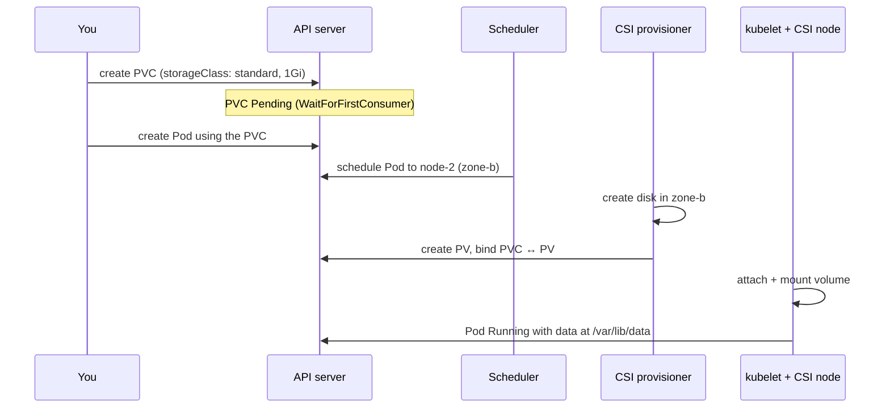

# 12 · Storage

| Level | Duration | Prerequisites |
|---|---|---|
| ⚙️ Intermediate | 6 h | Modules 05, 09 |

**By the end you will be able to:**
- **Choose** between ephemeral volumes and persistent storage for each use case.
- **Explain** the PersistentVolume / PersistentVolumeClaim / StorageClass model and dynamic provisioning.
- **Configure** access modes, reclaim policies, volume binding modes and expansion.
- **Describe** CSI, snapshots and the newest storage features.

---

## 🧠 The analogy: a self-storage company

- An **`emptyDir`** is the **desk drawer** in your office: handy, but when you leave the office (Pod
  deleted) it is emptied.
- A **PersistentVolume (PV)** is an actual **storage unit** in the warehouse, with a size and a type of lock.
- A **PersistentVolumeClaim (PVC)** is your **rental request**: "I need 10 m², climate controlled". You
  do not care which unit you get.
- A **StorageClass** is the **catalog of unit types** ("standard", "climate-controlled", "high-security")
  — and the company builds a new unit on demand when you ask (**dynamic provisioning**).
- The **CSI driver** is the **company's construction crew**: each storage vendor brings its own.

When you move offices (Pod rescheduled), your rental contract (PVC) follows you, and so does the unit.

---

## 📖 Concepts

### 1. Volume types at a glance

| Category | Examples | Lives as long as… |
|---|---|---|
| Ephemeral | `emptyDir` (disk or `medium: Memory`), `configMap`, `secret`, `downwardAPI`, `projected`, `image` | The Pod |
| Generic ephemeral | `ephemeral.volumeClaimTemplate` | The Pod, but provisioned by a StorageClass |
| Persistent | `persistentVolumeClaim` → CSI volume (EBS, PD, Azure Disk, Ceph, NFS, local…) | Independent of Pods |
| Node-local (avoid) | `hostPath` | The node — security risk, ties Pod to node |

### 2. The persistent model

```yaml
apiVersion: v1
kind: PersistentVolumeClaim
metadata:
  name: data
spec:
  accessModes: [ReadWriteOnce]       # how it can be mounted
  storageClassName: standard         # which "catalog entry"
  resources:
    requests:
      storage: 1Gi
```

```yaml
# Used in a Pod
volumes:
  - name: data
    persistentVolumeClaim:
      claimName: data
```

**Lifecycle:** PVC created → (StorageClass provisioner creates a PV) → PVC `Bound` to PV → Pod uses it
→ PVC deleted → PV handled by its **reclaim policy**.

### 3. Access modes

| Mode | Short | Meaning |
|---|---|---|
| ReadWriteOnce | RWO | Read-write by Pods on **one node** |
| ReadWriteOncePod | RWOP | Read-write by **one Pod** only (strongest guarantee) |
| ReadOnlyMany | ROX | Read-only by many nodes |
| ReadWriteMany | RWX | Read-write by many nodes (NFS, CephFS, EFS, Azure Files…) |

Block disks (EBS, PD) are usually RWO. RWX needs a shared filesystem.

### 4. StorageClass

```yaml
apiVersion: storage.k8s.io/v1
kind: StorageClass
metadata:
  name: fast
  annotations:
    storageclass.kubernetes.io/is-default-class: "false"
provisioner: ebs.csi.aws.com               # the CSI driver
parameters:
  type: gp3                                # driver-specific
reclaimPolicy: Delete                      # Delete | Retain
volumeBindingMode: WaitForFirstConsumer    # create the disk where the Pod is scheduled
allowVolumeExpansion: true
```

| Setting | Why it matters |
|---|---|
| `reclaimPolicy: Retain` | Keeps the data when the PVC is deleted (safer for databases) |
| `volumeBindingMode: WaitForFirstConsumer` | Avoids creating a zonal disk in a zone where the Pod cannot run |
| `allowVolumeExpansion: true` | Grow a PVC by editing `spec.resources.requests.storage` |

### 5. CSI: the plug-in system

The **Container Storage Interface** lets vendors ship drivers without changing Kubernetes. A CSI driver
has a controller part (create/attach/snapshot) and a node part (mount). Kubernetes objects involved:
`CSIDriver`, `CSINode`, `VolumeAttachment`.

### 6. Snapshots and cloning

- **VolumeSnapshot** / **VolumeSnapshotClass** / **VolumeSnapshotContent**: point-in-time copies (requires
  the snapshot CRDs + controller and a driver that supports it).
- **Volume Group Snapshots** (GA in v1.36): crash-consistent snapshots of several volumes at once.
- **Clone**: a new PVC with `dataSource` pointing to an existing PVC.
- **Volume populators**: `dataSourceRef` to fill a new volume from a custom source.

### 7. Recent storage features

| Feature | Status | Note |
|---|---|---|
| `ReadWriteOncePod` | GA | Single-writer guarantee |
| Volume Group Snapshots | GA (v1.36) | Multi-volume consistency for databases |
| Image volumes (`volumes[].image`) | ⚠️ Verify status for your version | Mount an OCI image/artifact as a read-only volume (models, data sets) |
| PVC last-used tracking | Beta (v1.37) ⚠️ | Find unused PVCs to save cost |
| Volume attributes classes (`VolumeAttributesClass`) | ⚠️ Verify | Change IOPS/throughput of a live volume |

---

## 🗺️ Diagram: dynamic provisioning



---

## ⌨️ Essential commands

| Command | What it does |
|---|---|
| `kubectl get sc` | StorageClasses (the default is marked) |
| `kubectl get pvc,pv` | Claims and volumes, status and binding |
| `kubectl describe pvc data` | Events: provisioning errors, waiting for consumer |
| `kubectl patch pvc data -p '{"spec":{"resources":{"requests":{"storage":"2Gi"}}}}'` | Expand |
| `kubectl get volumeattachments` | Which volume is attached to which node |
| `kubectl get csidrivers` | Installed CSI drivers |

---

## 🧯 In production

- **Stateful data needs a backup *and* a tested restore.** A snapshot you never restored is a hope, not a backup.
- **Use `Retain` for important data** and protect PVCs from accidental deletion (GitOps, RBAC).
- **Zonal disks pin Pods to zones**: plan capacity per zone, use `WaitForFirstConsumer`.
- **Watch volume fill rate**: alert on `kubelet_volume_stats_available_bytes` before it reaches 0.
- **Prefer managed databases** unless you have the operational maturity to run them on Kubernetes (operators help: module 25).

## ⚠️ Common mistakes

| Symptom | Cause | Fix |
|---|---|---|
| PVC `Pending` | No default StorageClass / no matching PV / waiting for consumer | `describe pvc`; set `storageClassName` |
| Pod `ContainerCreating`: `Multi-Attach error` | RWO volume still attached to another node | Wait for detach; avoid two Pods on RWO across nodes |
| Pod `Pending`: `volume node affinity conflict` | Disk in zone A, Pod forced to zone B | Topology-aware scheduling; `WaitForFirstConsumer` |
| Data gone after `kubectl delete pvc` | `reclaimPolicy: Delete` | Use `Retain` for critical data; backups |
| Permission denied writing to volume | Volume owned by root, app runs as non-root | `securityContext.fsGroup` |

## 🎓 Official tutorial companion

After the lab, run the upstream tutorial to see the same idea from the official docs:

- [WordPress and MySQL with persistent volumes](https://kubernetes.io/docs/tutorials/stateful-application/mysql-wordpress-persistent-volume/)

> Tutorials that use minikube work on `kc` too; replace `minikube service` with `kubectl port-forward`.

## 📚 Official references

- [Volumes](https://kubernetes.io/docs/concepts/storage/volumes/)
- [Persistent Volumes](https://kubernetes.io/docs/concepts/storage/persistent-volumes/)
- [Storage Classes](https://kubernetes.io/docs/concepts/storage/storage-classes/)
- [Ephemeral volumes](https://kubernetes.io/docs/concepts/storage/ephemeral-volumes/)
- [Volume snapshots](https://kubernetes.io/docs/concepts/storage/volume-snapshots/)
- [Volume group snapshots](https://kubernetes.io/docs/concepts/storage/volume-snapshots/#volume-group-snapshots)
- [Configure a Pod to use a volume for storage](https://kubernetes.io/docs/tasks/configure-pod-container/configure-volume-storage/)

➡️ Next: [🧪 LAB.md](LAB.md)
