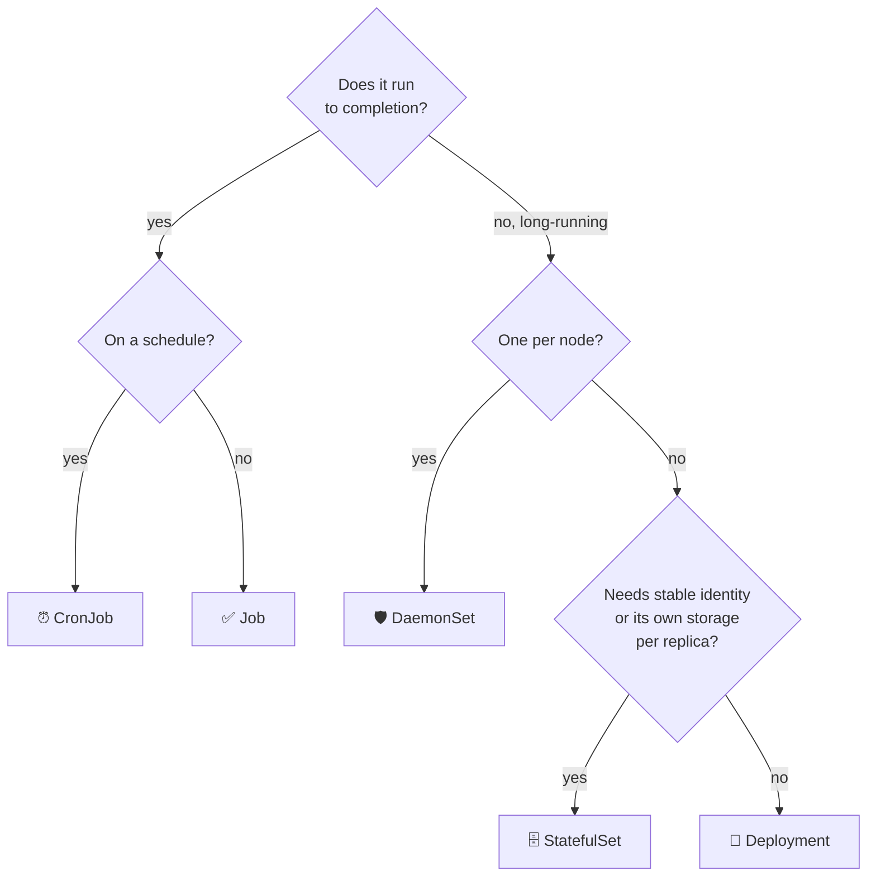

# 13 · StatefulSets, DaemonSets, Jobs and CronJobs

| Level | Duration | Prerequisites |
|---|---|---|
| ⚙️ Intermediate | 6 h | Modules 07, 08, 12 |

**By the end you will be able to:**
- **Choose** the right workload controller for each type of application.
- **Run** stateful apps with stable identities and per-replica storage.
- **Deploy** one agent per node with DaemonSets.
- **Run** batch work reliably with Jobs (parallelism, retries, failure policies) and CronJobs.

---

## 🧠 The analogy: different kinds of staff

| Staff | Controller | Why |
|---|---|---|
| **Call-center agents**: any one can take any call; replace them freely | **Deployment** | Stateless, interchangeable |
| **Surgeons**: each has a name, their own locker and their own patients; you cannot swap Dr. Smith-0 for Dr. Smith-2 mid-surgery | **StatefulSet** | Stable identity + own storage + ordered start |
| **Security guards**: exactly one per building, no matter how many buildings | **DaemonSet** | One Pod per node |
| **A moving company** hired to do a job and leave | **Job** | Runs to completion |
| **The cleaning crew** that comes every night at 22:00 | **CronJob** | Jobs on a schedule |

---

## 📖 Concepts

### 1. StatefulSet

For apps where each replica is **not** interchangeable: databases, queues, consensus systems
(PostgreSQL, Kafka, etcd, ZooKeeper, Elasticsearch).

| Guarantee | Deployment | StatefulSet |
|---|---|---|
| Pod names | Random (`web-7d4b9-x2k`) | Ordinal and stable (`db-0`, `db-1`, `db-2`) |
| Network identity | Through a Service only | Stable DNS per Pod via a **headless** Service: `db-0.db.ns.svc.cluster.local` |
| Storage | Shared PVC or none | **One PVC per replica** from `volumeClaimTemplates`, kept across rescheduling |
| Start / stop order | All at once | Ordered (0, 1, 2…) by default; `podManagementPolicy: Parallel` to opt out |
| Updates | Rolling, any order | Rolling in **reverse ordinal**; `partition` for canaries |

```yaml
apiVersion: apps/v1
kind: StatefulSet
metadata:
  name: db
spec:
  serviceName: db                  # the headless Service that gives Pods DNS names
  replicas: 3
  selector:
    matchLabels: { app: db }
  template:
    metadata:
      labels: { app: db }
    spec:
      containers:
        - name: db
          image: postgres:17
          volumeMounts:
            - { name: data, mountPath: /var/lib/postgresql/data }
  volumeClaimTemplates:            # one PVC per Pod: data-db-0, data-db-1, data-db-2
    - metadata:
        name: data
      spec:
        accessModes: [ReadWriteOnce]
        resources:
          requests:
            storage: 5Gi
  persistentVolumeClaimRetentionPolicy:
    whenDeleted: Retain            # keep PVCs when the StatefulSet is deleted
    whenScaled: Retain             # keep PVCs of scaled-down replicas
```

> ⚠️ A StatefulSet gives you **identity and storage**, not **replication or failover**. The app (or an
> operator, module 25) must handle leader election, replication and backups.

### 2. DaemonSet

Runs one Pod on every (or every selected) node — and adds one automatically when a node joins.
Used for node agents: log collectors (Fluent Bit), monitoring (node-exporter), CNI and CSI node
plugins, security agents. It supports rolling updates (`maxUnavailable`, `maxSurge`), node selectors,
and usually tolerates control-plane taints.

### 3. Job

Runs Pods until a number of them **complete successfully**.

```yaml
apiVersion: batch/v1
kind: Job
metadata:
  name: reports
spec:
  completions: 10                  # 10 successful Pods needed
  parallelism: 3                   # at most 3 at a time
  completionMode: Indexed          # each Pod gets JOB_COMPLETION_INDEX 0..9
  backoffLimit: 4                  # total retries before the Job fails
  activeDeadlineSeconds: 600       # hard timeout for the whole Job
  ttlSecondsAfterFinished: 3600    # auto-delete 1 h after finishing
  podFailurePolicy:                # smarter retries
    rules:
      - action: FailJob            # a bug: do not retry
        onExitCodes: { containerName: worker, operator: In, values: [42] }
      - action: Ignore             # node disruption: does not count as a failure
        onPodConditions: [{ type: DisruptionTarget }]
  template:
    spec:
      restartPolicy: Never         # Jobs require Never or OnFailure
      containers:
        - name: worker
          image: busybox:1.36
          command: ["sh", "-c", "echo processing chunk $JOB_COMPLETION_INDEX; sleep 5"]
```

| Pattern | Settings |
|---|---|
| One-off task | `completions: 1` (default) |
| Fixed work, split into chunks | `completions: N`, `completionMode: Indexed`, `parallelism: P` |
| Work queue | `parallelism: P`, no `completions`; workers exit when the queue is empty |

Other useful Job fields: `backoffLimitPerIndex`, `successPolicy` (finish when certain indexes succeed),
`suspend: true` (queue it until a controller such as Kueue releases it), `managedBy` (GA in v1.35:
let an external controller manage the Job).

### 4. CronJob

Creates Jobs on a cron schedule.

```yaml
apiVersion: batch/v1
kind: CronJob
metadata:
  name: nightly-backup
spec:
  schedule: "0 2 * * *"            # 02:00 every day
  timeZone: "America/Bogota"       # otherwise the kube-controller-manager time zone
  concurrencyPolicy: Forbid        # Allow | Forbid | Replace
  startingDeadlineSeconds: 300     # skip if it cannot start within 5 min
  successfulJobsHistoryLimit: 3
  failedJobsHistoryLimit: 3
  jobTemplate:
    spec:
      backoffLimit: 2
      template:
        spec:
          restartPolicy: OnFailure
          containers:
            - name: backup
              image: busybox:1.36
              command: ["sh", "-c", "echo backing up; sleep 10"]
```

---

## 🗺️ Diagram: picking a controller



---

## ⌨️ Essential commands

| Command | What it does |
|---|---|
| `kubectl get sts,ds,job,cronjob` | List the controllers |
| `kubectl rollout status sts/db` | StatefulSet rollout |
| `kubectl patch sts db -p '{"spec":{"updateStrategy":{"rollingUpdate":{"partition":2}}}}'` | Only update ordinals ≥ 2 |
| `kubectl create job manual-1 --from=cronjob/nightly-backup` | Run a CronJob now |
| `kubectl patch cronjob nightly-backup -p '{"spec":{"suspend":true}}'` | Pause a CronJob |
| `kubectl wait --for=condition=complete job/reports --timeout=10m` | Wait for a Job |
| `kubectl logs job/reports` | Logs from a Job Pod |

---

## 🧯 In production

- **Make Jobs idempotent**: they *will* be retried (node failures, preemption). Running twice must be safe.
- **Always set `activeDeadlineSeconds` and `ttlSecondsAfterFinished`**: stuck Jobs and thousands of finished Pods are common outages of the slow kind.
- **Monitor CronJobs by "last successful run"**, not by "is it running" (`kube_cronjob_status_last_successful_time`).
- **StatefulSet storage outlives Pods** — scaling down does not free disks by default. Track orphaned PVCs.
- **DaemonSets multiply resources by node count**: 100 nodes × 200 Mi = 20 Gi just for one agent.

## ⚠️ Common mistakes

| Symptom | Cause | Fix |
|---|---|---|
| StatefulSet stuck at `db-0` | `db-0` not Ready, and ordered start waits | Fix `db-0`; or `podManagementPolicy: Parallel` |
| StatefulSet Pod DNS does not resolve | Missing or wrong headless Service (`serviceName`) | Create the headless Service |
| Job keeps creating Pods | App fails; `backoffLimit` not reached yet | Check logs; use `podFailurePolicy` for non-retriable errors |
| CronJob ran twice at once | `concurrencyPolicy: Allow` and a slow run | `Forbid` or `Replace` |
| DaemonSet skips some nodes | Taints not tolerated, or nodeSelector | Add tolerations; check `DESIRED` vs node count |

## 🎓 Official tutorial companion

After the lab, run the upstream tutorial to see the same idea from the official docs:

- [StatefulSet basics](https://kubernetes.io/docs/tutorials/stateful-application/basic-stateful-set/)
- [Cassandra with StatefulSets](https://kubernetes.io/docs/tutorials/stateful-application/cassandra/)
- [Running ZooKeeper, a CP distributed system](https://kubernetes.io/docs/tutorials/stateful-application/zookeeper/)

> Tutorials that use minikube work on `kc` too; replace `minikube service` with `kubectl port-forward`.

## 📚 Official references

- [StatefulSets](https://kubernetes.io/docs/concepts/workloads/controllers/statefulset/)
- [DaemonSet](https://kubernetes.io/docs/concepts/workloads/controllers/daemonset/)
- [Jobs](https://kubernetes.io/docs/concepts/workloads/controllers/job/)
- [CronJob](https://kubernetes.io/docs/concepts/workloads/controllers/cron-jobs/)
- [Handling retriable and non-retriable pod failures](https://kubernetes.io/docs/tasks/job/pod-failure-policy/)
- [StatefulSet basics (tutorial)](https://kubernetes.io/docs/tutorials/stateful-application/basic-stateful-set/)

➡️ Next: [🧪 LAB.md](LAB.md)
