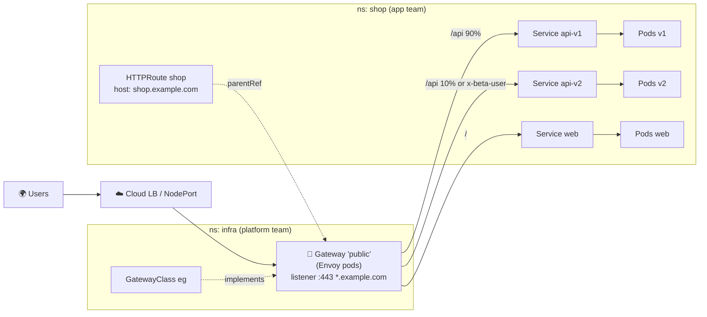

# 14 · Ingress and Gateway API

| Level | Duration | Prerequisites |
|---|---|---|
| ⚙️ Intermediate | 6 h | Module 08 · `helm` installed |

**By the end you will be able to:**
- **Explain** how north-south HTTP traffic enters a cluster.
- **Write** Ingress resources and understand their limits.
- **Model** traffic with Gateway API: GatewayClass, Gateway, HTTPRoute and friends.
- **Implement** host/path routing, TLS termination, header matching and weighted canaries.
- **Plan** a migration from Ingress to Gateway API.

---

## 🧠 The analogy: an airport

- The **cloud load balancer** is the **airport entrance**: one public door for everyone.
- An **Ingress** is an old-style **information desk** with a single paper list: "flights to Lima → gate
  4, flights to Quito → gate 7". It works, but anything special (priority boarding, splitting
  passengers 90/10 between two gates) has to be scribbled in the margins (annotations), and every
  airport scribbles differently.
- **Gateway API** is a **modern airport with clear roles**:
  - The **airport authority** decides which kind of terminal can be built (**GatewayClass**).
  - **Operations** opens a terminal with specific doors and security (**Gateway**: listeners, ports, TLS).
  - Each **airline** manages its own signs and gate assignments (**HTTPRoute**), only in the terminals
    it was allowed to use.

---

## 📖 Concepts

### 1. North-south vs east-west

**North-south** = traffic from outside into the cluster (this module). **East-west** = traffic between
services inside the cluster (Services, NetworkPolicy, service mesh — modules 08, 18, 19).

### 2. Ingress (GA, feature-frozen)

```yaml
apiVersion: networking.k8s.io/v1
kind: Ingress
metadata:
  name: shop
spec:
  ingressClassName: example-controller     # which controller implements it
  tls:
    - hosts: [shop.example.com]
      secretName: shop-tls                  # kubernetes.io/tls Secret
  rules:
    - host: shop.example.com
      http:
        paths:
          - path: /api
            pathType: Prefix                # Exact | Prefix | ImplementationSpecific
            backend:
              service:
                name: api
                port: { number: 80 }
          - path: /
            pathType: Prefix
            backend:
              service:
                name: web
                port: { number: 80 }
```

An Ingress does nothing by itself: an **Ingress controller** (a reverse proxy watching the API) must be
installed. Limits of Ingress: HTTP(S) only, one object mixes infrastructure and app concerns, and any
advanced feature (rewrites, canaries, timeouts) lives in **controller-specific annotations**.

> ⚠️ The community **ingress-nginx** controller was **retired** by Kubernetes SIG Network (announced
> November 2025, with maintenance ending in March 2026). The Ingress **API** is still GA and supported by
> many controllers, but new designs should use **Gateway API**. Verify the current status before choosing a controller.

### 3. Gateway API: role-oriented and portable

| Resource | Owner (persona) | Purpose |
|---|---|---|
| **GatewayClass** | Infrastructure provider | "Which implementation" (Envoy Gateway, Istio, Cilium, NGINX Gateway Fabric, cloud LBs…) |
| **Gateway** | Cluster operator | Listeners: ports, protocols, hostnames, TLS certificates, which namespaces may attach routes |
| **HTTPRoute** / **GRPCRoute** | App developer | Matching (host, path, headers, query, method) → backends, with filters and weights |
| **TLSRoute**, **TCPRoute**, **UDPRoute** | App developer | L4 / passthrough (some still experimental) |
| **ReferenceGrant** | Owner of the target namespace | Allows cross-namespace references |
| **BackendTLSPolicy** | App / platform | TLS from the gateway to the backend |

### 4. A complete Gateway + HTTPRoute

```yaml
apiVersion: gateway.networking.k8s.io/v1
kind: Gateway
metadata:
  name: public
  namespace: infra
spec:
  gatewayClassName: eg
  listeners:
    - name: https
      protocol: HTTPS
      port: 443
      hostname: "*.example.com"
      tls:
        mode: Terminate
        certificateRefs:
          - name: wildcard-example-com
      allowedRoutes:
        namespaces:
          from: Selector
          selector:
            matchLabels:
              gateway-access: "true"
---
apiVersion: gateway.networking.k8s.io/v1
kind: HTTPRoute
metadata:
  name: shop
  namespace: shop                     # labeled gateway-access=true
spec:
  parentRefs:
    - name: public
      namespace: infra
  hostnames: ["shop.example.com"]
  rules:
    - matches:
        - path: { type: PathPrefix, value: /api }
          headers:
            - { name: x-beta-user, value: "true" }
      backendRefs:
        - { name: api-v2, port: 80 }
    - matches:
        - path: { type: PathPrefix, value: /api }
      backendRefs:                    # weighted canary: 90/10
        - { name: api-v1, port: 80, weight: 90 }
        - { name: api-v2, port: 80, weight: 10 }
      timeouts:
        request: 10s
    - backendRefs:
        - { name: web, port: 80 }
```

### 5. HTTPRoute filters (built-in, portable)

`RequestHeaderModifier`, `ResponseHeaderModifier`, `RequestRedirect` (e.g., HTTP → HTTPS),
`URLRewrite`, `RequestMirror` (shadow traffic). Also `retry` and `timeouts` on rules, and **status**
conditions (`Accepted`, `ResolvedRefs`, `Programmed`) that tell you exactly why a route is not working.

### 6. Ingress vs Gateway API

| | Ingress | Gateway API |
|---|---|---|
| Status | GA, frozen | GA (core), actively developed |
| Protocols | HTTP/HTTPS | HTTP, gRPC, TLS, TCP, UDP |
| Roles | One object | Split by persona |
| Canary / header routing | Annotations (non-portable) | Native (`weight`, `matches.headers`) |
| Cross-namespace | Not supported | Explicit (`allowedRoutes`, `ReferenceGrant`) |
| Status feedback | Minimal | Rich conditions per parent |
| Migration tool | — | `ingress2gateway` |

### 7. Certificates

Automate TLS with **cert-manager**: it watches Gateways/Ingresses (or `Certificate` resources), gets
certificates from ACME (Let's Encrypt) or a private CA, stores them in Secrets and renews them.

---

## 🗺️ Diagram



---

## ⌨️ Essential commands

| Command | What it does |
|---|---|
| `kubectl get gatewayclass,gateway,httproute -A` | Overview |
| `kubectl describe httproute shop` | Route **status** per parent: Accepted? ResolvedRefs? |
| `kubectl get gateway public -o jsonpath='{.status.addresses}'` | Gateway address |
| `kubectl get ingress -A` / `kubectl get ingressclass` | Ingress resources |
| `kubectl create secret tls shop-tls --cert=tls.crt --key=tls.key` | TLS Secret |
| `curl -H 'Host: shop.example.com' http://<addr>/api` | Test host-based routing without DNS |

---

## 🧯 In production

- **The edge is a shared critical dependency.** Run gateways with ≥ 2 replicas, PDBs, anti-affinity and their own SLOs.
- **Use canaries with real metrics** (error rate, latency) to decide promotion — module 24 automates it.
- **Read the status conditions**: `Accepted=False` or `ResolvedRefs=False` explain 90% of route problems.
- **Certificates expire**: automate with cert-manager and alert 14+ days before expiry.
- **Set timeouts and retries deliberately**: defaults differ by implementation; retries can amplify outages.

## ⚠️ Common mistakes

| Symptom | Cause | Fix |
|---|---|---|
| Ingress has no address | No controller, or wrong `ingressClassName` | Install a controller; check `kubectl get ingressclass` |
| HTTPRoute `Accepted=False, NotAllowedByListeners` | Namespace not allowed by `allowedRoutes` | Label the namespace or change the listener |
| `ResolvedRefs=False, BackendNotFound` | Wrong Service name/port | Fix `backendRefs` |
| `RefNotPermitted` | Cross-namespace backend without `ReferenceGrant` | Create a ReferenceGrant |
| 404 from the gateway | `Host` header does not match `hostnames` | Send the right Host / fix DNS |

## 📚 Official references

- [Ingress](https://kubernetes.io/docs/concepts/services-networking/ingress/)
- [Ingress controllers](https://kubernetes.io/docs/concepts/services-networking/ingress-controllers/)
- [Gateway API (Kubernetes docs)](https://kubernetes.io/docs/concepts/services-networking/gateway/)
- [Gateway API project site](https://gateway-api.sigs.k8s.io/)
- [Migrating from Ingress](https://gateway-api.sigs.k8s.io/guides/getting-started/migrating-from-ingress/)
- [ingress-nginx retirement announcement](https://kubernetes.io/blog/2025/11/11/ingress-nginx-retirement/)

➡️ Next: [🧪 LAB.md](LAB.md)
