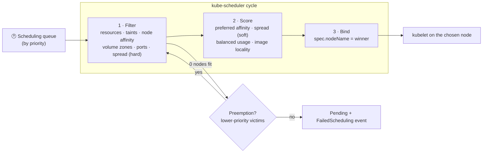

# 15 · Scheduling

| Level | Duration | Prerequisites |
|---|---|---|
| ⚙️ Intermediate | 6 h | Modules 04, 10 |

**By the end you will be able to:**
- **Describe** how kube-scheduler filters and scores nodes.
- **Steer** Pods with nodeSelector, node affinity, Pod affinity and anti-affinity.
- **Reserve** nodes with taints and tolerations.
- **Spread** replicas across zones and nodes with topology spread constraints.
- **Prioritize** workloads with PriorityClasses and explain preemption.

---

## 🧠 The analogy: seating guests at a wedding

The **wedding planner** (kube-scheduler) seats each guest (Pod) at a table (node).

- **nodeSelector / node affinity** — the guest's own wishes: "I must sit at a table near the stage"
  (required) or "I'd prefer a window table" (preferred).
- **Taints and tolerations** — some tables have a sign: "🚫 Family only". Only guests with a family
  badge (toleration) may sit there. The sign keeps others away; the badge does not *force* anyone there.
- **Pod affinity / anti-affinity** — "seat me next to my partner" / "never seat the two ex-partners at
  the same table".
- **Topology spread** — "spread the bridesmaids evenly across the tables, so no table has more than one extra".
- **Priority and preemption** — if the grandparents arrive late and the room is full, someone less
  important is politely asked to move.

---

## 📖 Concepts

### 1. The scheduling cycle

For each unscheduled Pod, kube-scheduler:

1. **Filters** nodes that cannot run it (not enough requested resources, taints, node affinity, volume
   zone, ports…).
2. **Scores** the remaining nodes (spread, image locality, balanced resources, preferred affinities…).
3. **Binds** the Pod to the best node (writes `spec.nodeName`).

If no node passes the filters, the Pod stays `Pending` with a `FailedScheduling` event explaining why
(e.g., `0/3 nodes are available: 1 node(s) had untolerated taint…, 2 Insufficient memory`).

### 2. nodeSelector and node affinity

```yaml
spec:
  nodeSelector:                       # simplest: all labels must match
    disktype: ssd
  affinity:
    nodeAffinity:
      requiredDuringSchedulingIgnoredDuringExecution:     # hard rule
        nodeSelectorTerms:
          - matchExpressions:
              - { key: kubernetes.io/arch, operator: In, values: [amd64, arm64] }
      preferredDuringSchedulingIgnoredDuringExecution:    # soft rule, weighted
        - weight: 80
          preference:
            matchExpressions:
              - { key: topology.kubernetes.io/zone, operator: In, values: [zone-a] }
```

`IgnoredDuringExecution` = if node labels change later, already running Pods are not evicted.

### 3. Taints and tolerations

A **taint** on a node repels Pods; a **toleration** on a Pod allows (but does not require) it to land there.

| Effect | Meaning |
|---|---|
| `NoSchedule` | New Pods without a toleration are not scheduled here |
| `PreferNoSchedule` | Avoid if possible |
| `NoExecute` | Also **evicts** running Pods without a toleration (optionally after `tolerationSeconds`) |

```bash
kubectl taint nodes gpu-node-1 dedicated=gpu:NoSchedule
```
```yaml
tolerations:
  - { key: dedicated, operator: Equal, value: gpu, effect: NoSchedule }
```

To **dedicate** nodes to a workload you need both: a taint (keep others out) **and** node affinity
(pull this workload in). Kubernetes adds taints itself, e.g. `node.kubernetes.io/not-ready`,
`node.kubernetes.io/unreachable` (NoExecute, tolerated for 300 s by default), `memory-pressure`.

### 4. Pod affinity and anti-affinity

```yaml
affinity:
  podAntiAffinity:
    requiredDuringSchedulingIgnoredDuringExecution:    # never two replicas on the same node
      - labelSelector:
          matchLabels: { app: web }
        topologyKey: kubernetes.io/hostname
  podAffinity:
    preferredDuringSchedulingIgnoredDuringExecution:   # try to be in the same zone as the cache
      - weight: 50
        podAffinityTerm:
          labelSelector:
            matchLabels: { app: cache }
          topologyKey: topology.kubernetes.io/zone
```

`topologyKey` defines the "same place": a node (`kubernetes.io/hostname`), a zone, a region, a rack.
Required anti-affinity limits replicas to the number of topology domains — prefer topology spread for HA.

### 5. Topology spread constraints

```yaml
topologySpreadConstraints:
  - maxSkew: 1                                 # max difference between the fullest and emptiest domain
    topologyKey: topology.kubernetes.io/zone
    whenUnsatisfiable: DoNotSchedule           # or ScheduleAnyway (soft)
    labelSelector:
      matchLabels: { app: web }
    minDomains: 2                              # require at least 2 zones
  - maxSkew: 1
    topologyKey: kubernetes.io/hostname
    whenUnsatisfiable: ScheduleAnyway
    labelSelector:
      matchLabels: { app: web }
```

The scheduler only spreads **at scheduling time**. Over time, Pods can become unbalanced; the
**descheduler** project can rebalance.

### 6. Priority and preemption

```yaml
apiVersion: scheduling.k8s.io/v1
kind: PriorityClass
metadata:
  name: business-critical
value: 100000
preemptionPolicy: PreemptLowerPriority     # or Never
description: "Customer-facing services"
```

When a high-priority Pod cannot be scheduled, the scheduler may **evict lower-priority Pods** to make
room. Built-in classes `system-cluster-critical` and `system-node-critical` protect core components.

### 7. Other scheduling tools

| Tool | Use |
|---|---|
| `nodeName` | Bypass the scheduler (static placement; avoid) |
| Scheduling gates (`schedulingGates`) | Hold a Pod unscheduled until an external controller removes the gate |
| Multiple schedulers / scheduler profiles | Custom plugins and policies per workload |
| **Workload-aware / gang scheduling** (Workload & PodGroup APIs) | All-or-nothing placement for distributed AI/HPC jobs — ⚠️ alpha/beta, see module 27 |
| Numeric toleration operators (`Gt`, `Lt`) | ⚠️ Alpha in v1.35 — tolerate taints by numeric comparison |

---

## 🗺️ Diagram



---

## ⌨️ Essential commands

| Command | What it does |
|---|---|
| `kubectl get nodes --show-labels` / `-L topology.kubernetes.io/zone` | Node labels |
| `kubectl label node kc-worker disktype=ssd` | Label a node |
| `kubectl taint nodes kc-worker dedicated=batch:NoSchedule` | Add a taint |
| `kubectl taint nodes kc-worker dedicated-` | Remove all taints with that key |
| `kubectl describe node kc-worker \| grep -i taints` | See taints |
| `kubectl get pods -o wide --sort-by=.spec.nodeName` | Where did Pods land? |
| `kubectl get events --field-selector reason=FailedScheduling` | Why not scheduled |
| `kubectl get priorityclass` | Priority classes |

---

## 🧯 SRE mindset

- **Spread replicas across zones and nodes** — a single-zone Deployment is one outage away from 100% failure.
- **Hard rules can make Pods unschedulable** during incidents (a zone down + `DoNotSchedule`). Decide consciously between availability and placement purity.
- **Use PriorityClasses** so critical services win when capacity is short, and batch jobs yield.
- **Taint special hardware** (GPUs, high-memory) so ordinary Pods do not steal it.
- **The `FailedScheduling` message is your best friend**: it lists every reason per node count.

## ⚠️ Common mistakes

| Symptom | Cause | Fix |
|---|---|---|
| `Pending`: `didn't match Pod's node affinity/selector` | Label missing or typo | `kubectl get nodes -L <key>` |
| `Pending`: `untolerated taint` | Node tainted, Pod has no toleration | Add a toleration (or remove the taint) |
| Pods still land on dedicated nodes | Taint only, no affinity on the dedicated workload (or vice versa) | Use taint + affinity together |
| All replicas on one node | No spread/anti-affinity | Add topology spread constraints |
| Third replica `Pending` with 2 zones | Required anti-affinity per zone | Use topology spread with `maxSkew` instead |

## 📚 Official references

- [Kubernetes scheduler](https://kubernetes.io/docs/concepts/scheduling-eviction/kube-scheduler/)
- [Assigning Pods to nodes](https://kubernetes.io/docs/concepts/scheduling-eviction/assign-pod-node/)
- [Taints and tolerations](https://kubernetes.io/docs/concepts/scheduling-eviction/taint-and-toleration/)
- [Pod topology spread constraints](https://kubernetes.io/docs/concepts/scheduling-eviction/topology-spread-constraints/)
- [Pod priority and preemption](https://kubernetes.io/docs/concepts/scheduling-eviction/pod-priority-preemption/)
- [Pod scheduling readiness](https://kubernetes.io/docs/concepts/scheduling-eviction/pod-scheduling-readiness/)

➡️ Next: [🧪 LAB.md](LAB.md)
