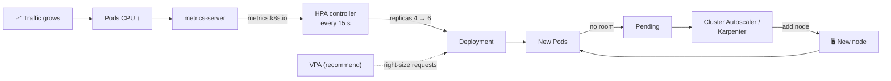

# 16 · Autoscaling

| Level | Duration | Prerequisites |
|---|---|---|
| 🛡️ Advanced | 6 h | Modules 07, 10, 11 · metrics-server |

**By the end you will be able to:**
- **Configure** the HorizontalPodAutoscaler (HPA) with resource, custom and external metrics.
- **Tune** scaling behavior to avoid flapping.
- **Resize** Pods vertically, in place, without restarts — and use the VPA to recommend sizes.
- **Explain** node autoscaling (Cluster Autoscaler, Karpenter) and event-driven scaling (KEDA).

---

## 🧠 The analogy: a supermarket on a Saturday

- **Horizontal scaling (HPA)** = **opening more checkout lanes** when the lines get long, and closing
  them when the store is quiet.
- **Vertical scaling (VPA / in-place resize)** = giving one cashier a **faster scanner** instead of
  opening a lane.
- **Node autoscaling** = when all the lanes are open and still not enough, **renting the store next
  door** (new nodes). When it is quiet, you give it back to save money.
- **KEDA (event-driven)** = opening lanes based on **how many customers are walking in from the parking
  lot** (queue length), before the lines even form — and closing *all* lanes at night (scale to zero).

---

## 📖 Concepts

### 1. The three layers of autoscaling

| Layer | What scales | Tooling |
|---|---|---|
| Pods, horizontally | Number of replicas | **HPA**, KEDA |
| Pods, vertically | CPU/memory per Pod | **VPA**, in-place Pod resize |
| Nodes | Number/size of nodes | **Cluster Autoscaler**, **Karpenter**, cloud node pools |

They work together: HPA adds Pods → Pods go `Pending` → node autoscaler adds nodes.

### 2. HPA: the algorithm

Every 15 s (by default) the HPA controller computes:

```text
desiredReplicas = ceil( currentReplicas × currentMetricValue / targetMetricValue )
```

Example: 4 replicas at 90% CPU with a 60% target → `ceil(4 × 90/60) = 6`.

CPU/memory **utilization is relative to requests** — no requests, no HPA on utilization.

```yaml
apiVersion: autoscaling/v2
kind: HorizontalPodAutoscaler
metadata:
  name: web
spec:
  scaleTargetRef:
    apiVersion: apps/v1
    kind: Deployment
    name: web
  minReplicas: 2
  maxReplicas: 20
  metrics:
    - type: Resource
      resource:
        name: cpu
        target:
          type: Utilization
          averageUtilization: 60          # % of the CPU request
    - type: Pods                          # custom metric per Pod (needs a metrics adapter)
      pods:
        metric:
          name: http_requests_per_second
        target:
          type: AverageValue
          averageValue: "100"
  behavior:
    scaleUp:
      stabilizationWindowSeconds: 0
      policies:
        - { type: Percent, value: 100, periodSeconds: 15 }   # at most double every 15 s
    scaleDown:
      stabilizationWindowSeconds: 300                         # wait 5 min of lower load
      policies:
        - { type: Pods, value: 2, periodSeconds: 60 }         # remove at most 2 Pods per minute
```

With several metrics, the HPA picks the **highest** recommendation.

### 3. Metric sources

| Type | Source | Example |
|---|---|---|
| `Resource` / `ContainerResource` | `metrics.k8s.io` (metrics-server) | CPU, memory |
| `Pods` / `Object` | `custom.metrics.k8s.io` (Prometheus Adapter, KEDA…) | Requests/s, queue length per Pod |
| `External` | `external.metrics.k8s.io` | Cloud queue depth, Kafka lag |

> The **Metrics API** (`metrics.k8s.io`) graduated to GA in v1.37.

### 4. Scale to zero

The core HPA historically needs `minReplicas ≥ 1`. **HPA scale-to-zero** (`minReplicas: 0` with
object/external metrics) is **beta in v1.37** ⚠️ behind the `HPAScaleToZero` feature gate. Today, the
common production path for scale to zero is **KEDA**, which also brings 60+ event sources (Kafka,
RabbitMQ, SQS, Prometheus queries, cron…).

### 5. Vertical scaling

**In-place Pod resize (GA in v1.35):** change a running container's CPU/memory through the `resize`
subresource, often without restarting it.

```bash
kubectl patch pod web-0 --subresource resize --patch \
  '{"spec":{"containers":[{"name":"web","resources":{"requests":{"cpu":"500m"},"limits":{"cpu":"1"}}}]}}'
kubectl get pod web-0 -o jsonpath='{.status.containerStatuses[0].resources}'
```

`resizePolicy` per resource decides whether a change needs a container restart
(`NotRequired` / `RestartContainer` — memory decreases often need a restart). Pod conditions
`PodResizePending` and `PodResizeInProgress` report progress (e.g., `Infeasible` if the node lacks room).

**Vertical Pod Autoscaler (VPA):** an add-on that watches usage and **recommends** (or applies)
requests. Modes: `Off` (recommend only — the safe start), `Initial`, `Recreate`, and `InPlaceOrRecreate`
(uses in-place resize when possible). Do not let VPA and HPA fight over the **same** metric (CPU).

### 6. Node autoscaling

| Tool | How it works |
|---|---|
| **Cluster Autoscaler** | Watches `Pending` Pods; grows predefined node groups; removes underused nodes |
| **Karpenter** | Watches `Pending` Pods; provisions right-sized nodes directly (any instance type), consolidates continuously |

Both rely on **requests** to decide, and respect PDBs when removing nodes.

---

## 🗺️ Diagram



---

## ⌨️ Essential commands

| Command | What it does |
|---|---|
| `kubectl autoscale deployment web --cpu=60% --min=2 --max=10` | Quick HPA (older kubectl: `--cpu-percent=60`) |
| `kubectl get hpa -w` | Watch targets and replicas |
| `kubectl describe hpa web` | Conditions (`AbleToScale`, `ScalingActive`, `ScalingLimited`) and events |
| `kubectl get --raw /apis/metrics.k8s.io/v1beta1/namespaces/default/pods` | Raw metrics |
| `kubectl patch pod <p> --subresource resize --patch '…'` | In-place resize |
| `kubectl top pods` | Current usage |

---

## 🧯 In production

- **Autoscaling is not capacity planning.** Know your max: quotas, node pools, DB connections and downstream limits all cap you.
- **Scale up fast, scale down slow.** Flapping wastes money and causes cold-start latency.
- **CPU is a proxy.** For I/O-bound or queue-based apps, scale on requests/s, latency or queue lag.
- **Cold starts matter**: if a Pod needs 60 s to be Ready, the HPA reacts 60 s late. Keep headroom (`minReplicas`, lower targets).
- **Test it**: run load tests and watch HPA + node autoscaler together before Black Friday, not during.

## ⚠️ Common mistakes

| Symptom | Cause | Fix |
|---|---|---|
| `TARGETS <unknown>/60%` | No metrics-server, or Pods lack CPU requests | Install metrics-server; set requests |
| Replicas jump up and down | No stabilization / aggressive policies | Tune `behavior.scaleDown` |
| GitOps keeps resetting replicas | `replicas` field in the Deployment manifest | Remove `replicas` when HPA owns it |
| HPA at max, still overloaded | `maxReplicas` too low or a downstream bottleneck | Raise max; find the real bottleneck |
| VPA and HPA oscillate | Both acting on CPU | HPA on custom metrics, or VPA in `Off` mode |

## 📚 Official references

- [Horizontal Pod Autoscaling](https://kubernetes.io/docs/concepts/workloads/autoscaling/horizontal-pod-autoscale/)
- [HPA walkthrough](https://kubernetes.io/docs/tasks/run-application/horizontal-pod-autoscale-walkthrough/)
- [Autoscaling workloads](https://kubernetes.io/docs/concepts/workloads/autoscaling/)
- [Resize CPU and memory resources assigned to containers](https://kubernetes.io/docs/tasks/configure-pod-container/resize-container-resources/)
- [Node autoscaling](https://kubernetes.io/docs/concepts/cluster-administration/node-autoscaling/)
- [Resource metrics pipeline](https://kubernetes.io/docs/tasks/debug/debug-cluster/resource-metrics-pipeline/)

➡️ Next: [🧪 LAB.md](LAB.md)
