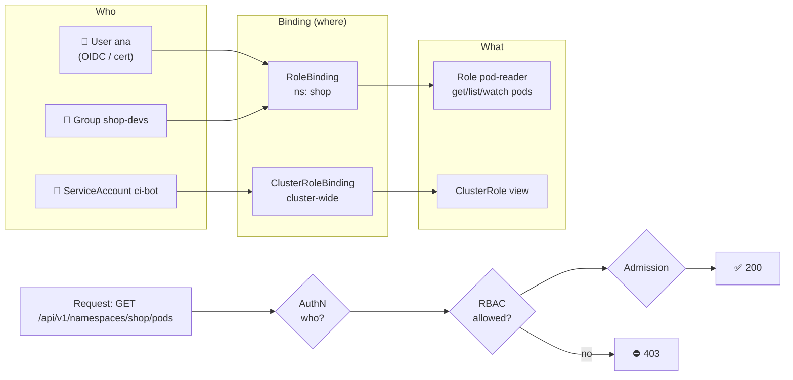

# 17 · Security I: Authentication, Authorization and RBAC

| Level | Duration | Prerequisites |
|---|---|---|
| 🛡️ Advanced | 6 h | Modules 04, 06 |

**By the end you will be able to:**
- **Explain** how the API server authenticates users and workloads.
- **Write** least-privilege Roles, ClusterRoles and bindings.
- **Use** ServiceAccounts and short-lived projected tokens correctly.
- **Audit** permissions with `kubectl auth can-i` and spot dangerous privileges.

---

## 🧠 The analogy: an office building's access control

1. **Authentication** = the **ID check at the entrance**: "Who are you?" (badge, passport, a visitor
   pass). Kubernetes does not keep a list of people; it trusts **issuers** (a certificate authority, an
   OIDC identity provider, its own ServiceAccount token signer).
2. **Authorization (RBAC)** = the **badge permissions**: "Your badge opens the 3rd-floor meeting rooms,
   but not the server room".
   - A **Role** is a *list of doors*. A **RoleBinding** *gives that list to a person* on one floor (namespace).
   - A **ClusterRole/ClusterRoleBinding** do the same for the whole building.
3. **Admission control** = the **security guard** who checks what you carry even when your badge
   opens the door: "you may enter, but not with that ladder" (module 26).

Employees are **users**. Robots that work in the building (apps) get their own badges: **ServiceAccounts**.

---

## 📖 Concepts

### 1. The request path

`kubectl` → **Authentication** → **Authorization** → **Admission** → validation → etcd.
Any step can reject the request: `401 Unauthorized` (authN) vs `403 Forbidden` (authZ/admission).

### 2. Authentication methods

| Identity | Method | Notes |
|---|---|---|
| Humans | **OIDC** (Okta, Entra ID, Keycloak, Google…) or structured authentication config | The recommended way; groups come from the IdP |
| Humans (labs, break-glass) | **X.509 client certificates** | CN = user, O = groups; cannot be revoked easily — keep short-lived |
| Workloads | **ServiceAccount tokens** (projected, short-lived, audience-bound) | Mounted automatically into Pods |
| Cloud | Provider plugins (`exec` credential plugins in kubeconfig) | EKS, GKE, AKS |

Kubernetes has **no User object**: a user is just a name and groups asserted by a trusted authenticator.

### 3. RBAC building blocks

```yaml
apiVersion: rbac.authorization.k8s.io/v1
kind: Role                                 # namespaced permissions
metadata:
  name: pod-reader
  namespace: shop
rules:
  - apiGroups: [""]                        # "" = core group (pods, services, configmaps…)
    resources: ["pods", "pods/log"]
    verbs: ["get", "list", "watch"]
  - apiGroups: ["apps"]
    resources: ["deployments"]
    verbs: ["get", "list", "watch", "patch"]
    resourceNames: ["web"]                 # only this object
---
apiVersion: rbac.authorization.k8s.io/v1
kind: RoleBinding                          # who gets the Role, in this namespace
metadata:
  name: ana-reads-pods
  namespace: shop
subjects:
  - kind: User
    name: ana@example.com
  - kind: Group
    name: shop-devs
  - kind: ServiceAccount
    name: ci-bot
    namespace: ci
roleRef:
  kind: Role
  name: pod-reader
  apiGroup: rbac.authorization.k8s.io
```

| Combination | Scope |
|---|---|
| Role + RoleBinding | One namespace |
| ClusterRole + RoleBinding | The ClusterRole's rules, **limited to the binding's namespace** (reuse common roles) |
| ClusterRole + ClusterRoleBinding | Whole cluster, including cluster-scoped resources |

RBAC is **additive only** — there are no "deny" rules. Built-in ClusterRoles: `cluster-admin`, `admin`,
`edit`, `view`. Aggregated ClusterRoles let CRDs extend them automatically.

### 4. Verbs

`get`, `list`, `watch`, `create`, `update`, `patch`, `delete`, `deletecollection`, plus special ones:
`impersonate`, `bind`, `escalate`, `approve`, and subresources like `pods/exec`, `pods/portforward`,
`deployments/scale`, `serviceaccounts/token`.

### 5. Dangerous permissions (privilege escalation paths)

| Permission | Why it is dangerous |
|---|---|
| `list`/`watch` **secrets** | Reveals the contents of every Secret, same as `get` |
| `create pods` (any workload) | Can mount any Secret or ServiceAccount in the namespace, or run privileged Pods (without Pod Security) |
| `pods/exec` | Shell into any container and use its credentials |
| `escalate`, `bind` on roles | Grant yourself more than you have |
| `impersonate` | Act as any user/group/ServiceAccount |
| `nodes/proxy`, kubelet API access | Direct control of nodes (fine-grained kubelet authorization is GA in v1.36) |
| `*` on `*` | It is `cluster-admin` |

### 6. ServiceAccounts

Every namespace has a `default` ServiceAccount. Each Pod runs as one. Since v1.24, tokens are
**projected**: short-lived (about 1 h, rotated by the kubelet), bound to the Pod and to an audience.

Good practices:
- One ServiceAccount **per app**, with only the permissions it needs.
- `automountServiceAccountToken: false` for Pods that never call the API.
- Use projected tokens with custom audiences for external systems (cloud IAM, Vault) — "workload identity".
- Avoid long-lived `kubernetes.io/service-account-token` Secrets.

### 7. Other authorizers

The API server can chain authorizers: **Node** (limits kubelets to their own objects), **RBAC**, and
**Webhook**. Structured authorization configuration lets you combine them with CEL-based conditions.

---

## 🗺️ Diagram



---

## ⌨️ Essential commands

| Command | What it does |
|---|---|
| `kubectl auth whoami` | Who does the API server think you are? |
| `kubectl auth can-i create deployments -n shop` | Check one permission |
| `kubectl auth can-i --list -n shop --as=ana@example.com` | All permissions of someone (needs impersonation rights) |
| `kubectl auth can-i get secrets --as=system:serviceaccount:shop:web -n shop` | Check a ServiceAccount |
| `kubectl create role pod-reader --verb=get,list,watch --resource=pods -n shop` | Create a Role |
| `kubectl create rolebinding ana-view --clusterrole=view --user=ana@example.com -n shop` | Bind a ClusterRole in one namespace |
| `kubectl create token web -n shop --duration=10m` | Mint a short-lived SA token |
| `kubectl get rolebindings,clusterrolebindings -A -o wide \| grep <subject>` | Find bindings of a subject |

---

## 🧯 SRE mindset

- **Least privilege is an availability control**, not just security: a CI token with `cluster-admin` can delete prod.
- **Bind to groups, not individuals** — joiners/leavers are handled in the IdP.
- **Break-glass access** must exist, be audited, and be tested.
- **Audit logs** (module 22) answer "who deleted that Deployment?" — enable them before you need them.
- **Review RBAC regularly**: tools like `kubectl-who-can`, `rbac-tool` or `rakkess` make it easy.

## ⚠️ Common mistakes

| Symptom | Cause | Fix |
|---|---|---|
| `forbidden: User "x" cannot list resource "pods"` | Missing Role/binding | `auth can-i`, then add a least-privilege rule |
| Binding has no effect | Wrong namespace, or `apiGroup` mistake in `roleRef` | Check the binding namespace and `roleRef` |
| `deployments` rule ignored | Wrong `apiGroups` (`""` instead of `"apps"`) | `kubectl api-resources` shows each group |
| App gets 403 calling the API | Pod uses `default` SA without permissions | Dedicated SA + Role |
| Everyone can read Secrets | `list secrets` granted broadly (e.g., via `edit`) | Narrow roles; separate namespaces |

## 📚 Official references

- [Controlling access to the Kubernetes API](https://kubernetes.io/docs/concepts/security/controlling-access/)
- [Authenticating](https://kubernetes.io/docs/reference/access-authn-authz/authentication/)
- [Using RBAC authorization](https://kubernetes.io/docs/reference/access-authn-authz/rbac/)
- [RBAC good practices](https://kubernetes.io/docs/concepts/security/rbac-good-practices/)
- [Service accounts](https://kubernetes.io/docs/concepts/security/service-accounts/)
- [Managing service accounts](https://kubernetes.io/docs/reference/access-authn-authz/service-accounts-admin/)

➡️ Next: [🧪 LAB.md](LAB.md)
