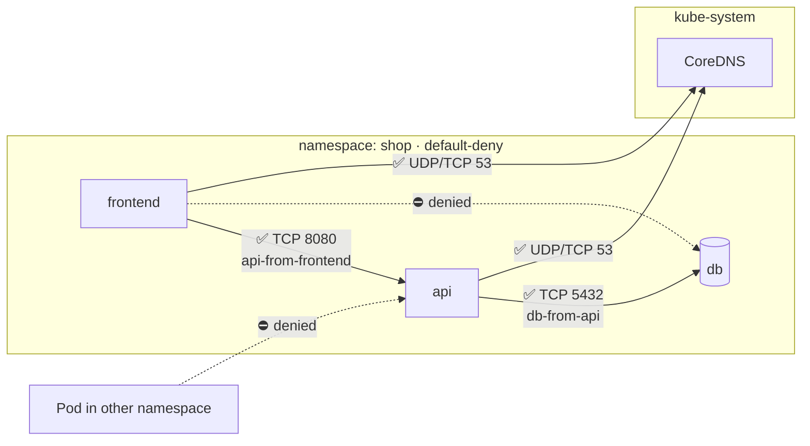

# 18 · Security II: Pod Security and NetworkPolicy

| Level | Duration | Prerequisites |
|---|---|---|
| 🛡️ Advanced | 7 h | Modules 05, 08, 17 |

**By the end you will be able to:**
- **Harden** containers with `securityContext`: non-root, read-only filesystem, dropped capabilities, seccomp, user namespaces.
- **Enforce** the Pod Security Standards with Pod Security Admission labels.
- **Isolate** network traffic with default-deny NetworkPolicies and explicit allows.
- **Explain** defense in depth for workloads, from image to kernel.

---

## 🧠 The analogy: a bank branch

- **securityContext** = the **rules for each employee**: no master key (non-root), cannot change the
  building's wiring (no capabilities), cannot write on the walls (read-only filesystem), and works
  behind bulletproof glass (seccomp, user namespaces).
- **Pod Security Standards** = the **bank's dress code and policies**, posted at the door, with three
  levels: *privileged* (maintenance crew), *baseline* (visitors), *restricted* (tellers handling cash).
- **NetworkPolicy** = **internal doors and corridors**. By default every door in Kubernetes is open. A
  default-deny policy locks them all, and then you open only the corridors you need: "tellers can talk
  to the vault, the vault talks to nobody".

If a robber gets in (a compromised container), each layer limits how far they get: the **blast radius**.

---

## 📖 Concepts

### 1. The hardened `securityContext`

```yaml
apiVersion: v1
kind: Pod
metadata:
  name: hardened
spec:
  hostUsers: false                     # user namespaces (GA v1.36): root in the container ≠ root on the node
  securityContext:                     # Pod level
    runAsNonRoot: true
    runAsUser: 10001
    runAsGroup: 10001
    fsGroup: 10001
    seccompProfile:
      type: RuntimeDefault             # block dangerous syscalls
  automountServiceAccountToken: false
  containers:
    - name: app
      image: ghcr.io/stefanprodan/podinfo:6.7.0
      securityContext:                 # container level (overrides Pod level)
        allowPrivilegeEscalation: false
        readOnlyRootFilesystem: true
        capabilities:
          drop: ["ALL"]
      volumeMounts:
        - { name: tmp, mountPath: /tmp }   # writable scratch space
  volumes:
    - { name: tmp, emptyDir: {} }
```

| Setting | Stops |
|---|---|
| `runAsNonRoot` / `runAsUser` | Running as UID 0 |
| `allowPrivilegeEscalation: false` | setuid binaries gaining privileges |
| `capabilities.drop: [ALL]` | Raw sockets, mounting, changing ownership, etc. (add back only what you need, e.g., `NET_BIND_SERVICE`) |
| `readOnlyRootFilesystem` | Attackers writing tools or modifying binaries |
| `seccompProfile: RuntimeDefault` | Rarely used, dangerous syscalls |
| AppArmor / SELinux (`appArmorProfile`, `seLinuxOptions`) | File and capability access via LSM profiles |
| `hostUsers: false` | Container root mapping to host root (container escapes) |
| No `privileged`, `hostNetwork`, `hostPID`, `hostPath` | Direct access to the node |

### 2. Pod Security Standards (PSS)

| Level | For | Highlights |
|---|---|---|
| **privileged** | System components (CNI, CSI, monitoring agents) | No restrictions |
| **baseline** | Most apps, minimal changes | Blocks privileged, host namespaces, hostPath, dangerous capabilities |
| **restricted** | Security-sensitive apps — the target for everything else | Baseline + non-root, drop ALL, no privilege escalation, seccomp required |

### 3. Pod Security Admission (built-in)

Enforced per namespace with labels, in three modes:

```yaml
apiVersion: v1
kind: Namespace
metadata:
  name: payments
  labels:
    pod-security.kubernetes.io/enforce: restricted      # reject violating Pods
    pod-security.kubernetes.io/enforce-version: latest
    pod-security.kubernetes.io/warn: restricted         # warn the user (kubectl output)
    pod-security.kubernetes.io/audit: restricted        # annotate audit log events
```

Roll out safely: start with `warn` + `audit`, fix workloads, then `enforce`. PSA checks **Pods** — a
Deployment is accepted, but its ReplicaSet cannot create Pods (look at ReplicaSet events!). For custom
rules beyond PSS, use admission policies (module 26).

### 4. NetworkPolicy

By default, **all Pods can talk to all Pods**. A NetworkPolicy selects Pods and lists allowed traffic.
Once a Pod is selected by any policy for a direction (Ingress/Egress), **everything not allowed is denied**
for that direction. Policies are additive (union of all allows).

```yaml
# 1. Default deny everything in the namespace
apiVersion: networking.k8s.io/v1
kind: NetworkPolicy
metadata:
  name: default-deny
  namespace: shop
spec:
  podSelector: {}                    # all Pods in the namespace
  policyTypes: [Ingress, Egress]
---
# 2. Allow DNS for everyone (otherwise nothing resolves!)
apiVersion: networking.k8s.io/v1
kind: NetworkPolicy
metadata:
  name: allow-dns
  namespace: shop
spec:
  podSelector: {}
  policyTypes: [Egress]
  egress:
    - to:
        - namespaceSelector:
            matchLabels: { kubernetes.io/metadata.name: kube-system }
          podSelector:
            matchLabels: { k8s-app: kube-dns }
      ports:
        - { protocol: UDP, port: 53 }
        - { protocol: TCP, port: 53 }
---
# 3. Allow frontend → api on 8080
apiVersion: networking.k8s.io/v1
kind: NetworkPolicy
metadata:
  name: api-from-frontend
  namespace: shop
spec:
  podSelector:
    matchLabels: { app: api }
  policyTypes: [Ingress]
  ingress:
    - from:
        - podSelector:
            matchLabels: { app: frontend }
      ports:
        - { protocol: TCP, port: 8080 }
```

> ⚠️ **YAML trap:** in `from`/`to`, a `namespaceSelector` and a `podSelector` in the **same list item**
> mean AND ("these Pods in those namespaces"). As **two separate items** (two dashes) they mean OR.

NetworkPolicy is implemented by the **CNI plugin** (Calico, Cilium, Antrea, and kindnet in recent kind
releases). If your CNI does not support it, policies are silently ignored. Cluster-wide, admin-level
policies come from the SIG Network **AdminNetworkPolicy / ClusterNetworkPolicy** CRDs and
CNI-specific CRDs (CiliumNetworkPolicy, Calico GlobalNetworkPolicy) ⚠️ verify support in your CNI.

### 5. Defense in depth for workloads

| Layer | Control |
|---|---|
| Image | Minimal base, no secrets, scanned (Trivy/Grype), signed (Sigstore cosign), SBOM |
| Admission | Only signed images from allowed registries; PSS; policies (module 26) |
| Runtime | securityContext, seccomp, AppArmor/SELinux, user namespaces, RuntimeClass sandboxes (gVisor, Kata) |
| Network | Default-deny NetworkPolicy, mTLS (service mesh) |
| Identity | Dedicated ServiceAccounts, no auto-mounted tokens, least-privilege RBAC |
| Detection | Runtime threat detection (Falco, Tetragon), audit logs |

---

## 🗺️ Diagram



---

## ⌨️ Essential commands

| Command | What it does |
|---|---|
| `kubectl label ns shop pod-security.kubernetes.io/enforce=restricted` | Enforce PSS |
| `kubectl label --dry-run=server --overwrite ns shop pod-security.kubernetes.io/enforce=restricted` | **Preview** which existing Pods would violate |
| `kubectl get netpol -A` | List NetworkPolicies |
| `kubectl describe netpol api-from-frontend` | Human-readable rules |
| `kubectl exec <pod> -- id` | Check the effective UID/GID |
| `kubectl exec <pod> -- grep Cap /proc/1/status` | Check effective capabilities |

---

## 🧯 SRE mindset

- **Security controls must be rolled out like features**: warn → audit → enforce, with a rollback plan.
- **Default-deny without allow-DNS is a self-inflicted outage.** Always ship them together.
- **Document network dependencies** (who calls whom); NetworkPolicies are that documentation, enforced.
- **Test policies continuously**: a connectivity test suite in CI catches broken rules before prod.
- **Privileged exceptions should be rare, labeled and reviewed** (system namespaces only).

## ⚠️ Common mistakes

| Symptom | Cause | Fix |
|---|---|---|
| Deployment has 0 Pods after enabling PSS | ReplicaSet blocked: `violates PodSecurity "restricted"` | Fix the securityContext; check RS events |
| `container has runAsNonRoot and image will run as root` | Image's default user is root | Set `runAsUser`, or rebuild with `USER` |
| App crashes with `read-only file system` | `readOnlyRootFilesystem` without writable mounts | Mount `emptyDir` at `/tmp`, cache dirs |
| Everything times out after default-deny | DNS egress blocked | Add the allow-DNS policy |
| Policies have no effect | CNI without NetworkPolicy support | Use a CNI that enforces them |

## 🎓 Official tutorial companion

After the lab, run the upstream tutorial to see the same idea from the official docs:

- [Pod Security Standards at cluster level](https://kubernetes.io/docs/tutorials/security/cluster-level-pss/)
- [Pod Security Standards at namespace level](https://kubernetes.io/docs/tutorials/security/ns-level-pss/)
- [Restrict access with AppArmor](https://kubernetes.io/docs/tutorials/security/apparmor/)
- [Seccomp](https://kubernetes.io/docs/tutorials/security/seccomp/)

> Tutorials that use minikube work on `kc` too; replace `minikube service` with `kubectl port-forward`.

## 📚 Official references

- [Pod Security Standards](https://kubernetes.io/docs/concepts/security/pod-security-standards/)
- [Pod Security Admission](https://kubernetes.io/docs/concepts/security/pod-security-admission/)
- [Configure a security context](https://kubernetes.io/docs/tasks/configure-pod-container/security-context/)
- [User namespaces](https://kubernetes.io/docs/concepts/workloads/pods/user-namespaces/)
- [Network policies](https://kubernetes.io/docs/concepts/services-networking/network-policies/)
- [Security checklist](https://kubernetes.io/docs/concepts/security/security-checklist/)
- [Seccomp tutorial](https://kubernetes.io/docs/tutorials/security/seccomp/)

➡️ Next: [🧪 LAB.md](LAB.md)
