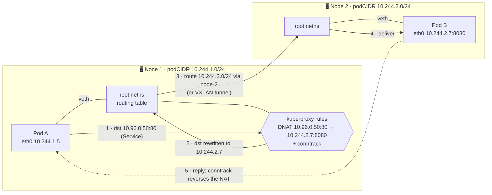

# 19 · Networking Deep Dive

| Level | Duration | Prerequisites |
|---|---|---|
| 🛡️ Advanced | 7 h | Modules 02, 08, 14, 18 |

**By the end you will be able to:**
- **State** the Kubernetes network model and its three rules.
- **Trace** a packet from one Pod to another, on the same node and across nodes.
- **Compare** kube-proxy modes (iptables, nftables, IPVS) and eBPF data planes.
- **Explain** CNI plugins, dual-stack, Service CIDRs and where a service mesh fits.
- **Capture** and read real traffic inside a cluster.

---

## 🧠 The analogy: a city's road network

- Each **Pod** is a house with its own street address (IP). Each **node** is a neighborhood.
- The **veth pair** is the house's **driveway** to the street; the **bridge or router** on the node is
  the neighborhood's **main street**.
- The **CNI plugin** is the **city planning department**: it assigns addresses and builds the roads
  between neighborhoods — sometimes with plain roads (routing), sometimes with **tunnels** under the
  river (VXLAN/Geneve overlays).
- **kube-proxy** is the set of **road signs and roundabouts** that redirect "City Hall" (Service IP) to
  whichever office is open today (Pod IP).
- A **service mesh** is a **private chauffeur service**: every trip is in an armored car (mTLS), with a
  logbook (telemetry) and an instruction to retry if the road is blocked.

---

## 📖 Concepts

### 1. The Kubernetes network model

1. Every Pod gets its **own IP**.
2. Pods can reach all other Pods **without NAT**, on any node.
3. Agents on a node (kubelet, etc.) can reach all Pods on that node.

How this is achieved is left to the **CNI plugin**.

### 2. Inside a node

- Each Pod has its own **network namespace** with an `eth0`.
- A **veth pair** connects the Pod's `eth0` to the node's root namespace.
- The node routes Pod traffic: via a bridge (`cni0`), via per-Pod routes (kindnet, Calico), or via eBPF programs (Cilium).
- Each node owns a slice of the Pod CIDR (`spec.podCIDR`, e.g., `10.244.1.0/24`).

### 3. Across nodes

| Approach | How | Examples |
|---|---|---|
| **Native routing** | Routes `10.244.2.0/24 via <node-2 IP>` (static, or announced with BGP) | kindnet, Calico BGP, cloud VPC routing |
| **Overlay** | Encapsulate Pod packets inside node packets (VXLAN, Geneve, IP-in-IP) | Flannel VXLAN, Calico VXLAN, Cilium tunnel |
| **Cloud-native IPs** | Pods get real VPC IPs | AWS VPC CNI, Azure CNI, GKE dataplane v2 |

### 4. CNI in one minute

The **Container Network Interface** is a simple contract: when the runtime creates a Pod sandbox it
calls the CNI binary with `ADD` (configure networking, return an IP) and later `DEL`. Configuration
lives in `/etc/cni/net.d/` and binaries in `/opt/cni/bin/` on each node. IP Address Management
(**IPAM**) plugins hand out addresses.

| CNI | Highlights |
|---|---|
| **Cilium** | eBPF data plane, kube-proxy replacement, L7 policies, Hubble observability, mesh features |
| **Calico** | BGP or overlay, rich policies, eBPF option |
| **Flannel** | Simple overlay, no policies on its own |
| **kindnet** | kind's default: simple routing, NetworkPolicy support in recent versions |
| Cloud CNIs | VPC-native IPs and integration with cloud load balancers and security groups |

### 5. Service data planes

| Mode | Mechanism | Notes |
|---|---|---|
| **iptables** | NAT chains per Service/endpoint, random selection | Long-time default; rule updates get slow with many thousands of Services |
| **nftables** | Kernel nftables sets/maps | GA in v1.33; faster updates, the modern choice on recent kernels |
| **IPVS** | Kernel L4 load balancer, many algorithms | ⚠️ Verify status in your version — the project has been steering users toward nftables |
| **eBPF** (CNI replacement) | Programs attached to sockets/interfaces | Cilium, Calico eBPF: no kube-proxy at all |

All of them use **conntrack** to remember established connections, which is why load balancing is per connection.

### 6. Dual-stack and Service CIDRs

- **Dual-stack** (GA): Pods and Services can have both IPv4 and IPv6 (`ipFamilyPolicy: PreferDualStack`, `ipFamilies`).
- **ServiceCIDR / IPAddress APIs** (GA in v1.33): Service IP ranges are API objects; you can add ranges
  when a cluster runs out of Service IPs, without rebuilding it.

### 7. Where a service mesh fits

A mesh (Istio, Linkerd, Cilium mesh) adds **L7 features between services**: mTLS with workload identity,
retries/timeouts, traffic splitting, and golden-signal telemetry — without changing app code.

| Model | How | Trade-off |
|---|---|---|
| Sidecar proxies | An Envoy/linkerd2-proxy per Pod (native sidecars help) | Mature; extra CPU/memory per Pod |
| Sidecar-less ("ambient", eBPF) | Per-node L4 proxy + optional L7 waypoints | Lower overhead; newer |

The Gateway API also covers mesh traffic (**GAMMA**): an HTTPRoute whose `parentRef` is a **Service**
configures routing *between* services.

---

## 🗺️ Diagram: Pod A (node 1) → Service → Pod B (node 2)

---

## ⌨️ Essential commands

| Command | Where | What it shows |
|---|---|---|
| `kubectl get nodes -o custom-columns=NAME:.metadata.name,CIDR:.spec.podCIDR` | kubectl | Pod CIDR per node |
| `ip -br addr` / `ip route` | Node / Pod | Interfaces and routes |
| `nft list ruleset \| less` / `iptables-save` | Node | Service rules |
| `conntrack -L` | Node | Tracked connections (if installed) |
| `tcpdump -ni any port 8080` | Node or debug container | Live packets |
| `kubectl debug -it <pod> --image=nicolaka/netshoot --target=<c>` | kubectl | Network tools inside a Pod's namespace |
| `ls /etc/cni/net.d/ && cat /etc/cni/net.d/*` | Node | CNI configuration |

---

## 🧯 SRE mindset

- **Understand your data plane before an incident**: "which component rewrites this packet?" must have an answer.
- **conntrack tables fill up** under high connection churn: watch `nf_conntrack_count` vs `nf_conntrack_max`.
- **MTU mismatches** (overlays add headers) cause mysterious hangs on large payloads only — test with big packets.
- **IP exhaustion is a capacity limit**: Pod CIDR per node caps Pods per node; Service CIDR caps Services.
- **A mesh adds latency and a control plane to operate** — adopt it for concrete needs (mTLS, traffic management), not fashion.

## ⚠️ Common mistakes

| Symptom | Cause | Fix |
|---|---|---|
| Small requests work, large ones hang | MTU too high for the overlay | Lower the CNI MTU |
| Pods on different nodes cannot talk | Missing routes, firewall blocking VXLAN (UDP 8472/4789) or BGP | Check routes and node security groups |
| Intermittent connection resets under load | conntrack table full | Raise `nf_conntrack_max`, reduce churn |
| New Pods `ContainerCreating`: `failed to allocate IP` | IPAM pool exhausted | Bigger Pod CIDR, more ranges |
| Service IPs exhausted | Small Service CIDR | Add a ServiceCIDR range |

## 🎓 Official tutorial companion

After the lab, run the upstream tutorial to see the same idea from the official docs:

- [Using source IP](https://kubernetes.io/docs/tutorials/services/source-ip/)

> Tutorials that use minikube work on `kc` too; replace `minikube service` with `kubectl port-forward`.

## 📚 Official references

- [Cluster networking](https://kubernetes.io/docs/concepts/cluster-administration/networking/)
- [Services, load balancing and networking](https://kubernetes.io/docs/concepts/services-networking/)
- [Virtual IPs and service proxies](https://kubernetes.io/docs/reference/networking/virtual-ips/)
- [Network plugins](https://kubernetes.io/docs/concepts/extend-kubernetes/compute-storage-net/network-plugins/)
- [IPv4/IPv6 dual-stack](https://kubernetes.io/docs/concepts/services-networking/dual-stack/)
- [Extend Service IP ranges](https://kubernetes.io/docs/tasks/network/extend-service-ip-ranges/)

➡️ Next: [🧪 LAB.md](LAB.md)
