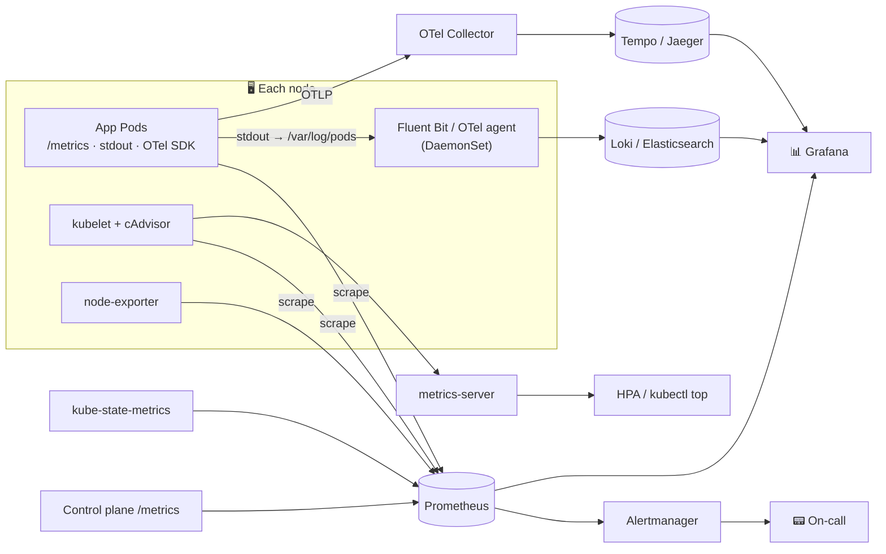

# 20 · Observability

| Level | Duration | Prerequisites |
|---|---|---|
| 🛡️ Advanced | 7 h | Modules 10, 11, 16 · `helm` |

**By the end you will be able to:**
- **Distinguish** the signals: metrics, logs, traces, events and profiles.
- **Explain** the Kubernetes metrics pipeline: cAdvisor, kubelet, metrics-server, kube-state-metrics, Prometheus.
- **Write** PromQL queries for the golden signals and for Kubernetes health.
- **Collect** logs at cluster scale and correlate them with metrics and traces.
- **Design** alerts that page humans only when users are affected.

---

## 🧠 The analogy: a car dashboard and a flight recorder

- **Metrics** are the **dashboard gauges**: speed, fuel, temperature. Cheap to collect, great for trends
  and alarms ("engine temperature high").
- **Logs** are the **mechanic's notes**: detailed text about specific moments ("at 14:02 the coolant
  sensor reported an error").
- **Traces** are the **GPS route of one trip**: every street (service) the car passed, and how long it
  waited at each light.
- **Events** are the **service-station stamps** in the car's logbook: "tire changed", "inspection failed".
- **Profiles** are an **engine X-ray**: which part burns the most fuel (CPU, memory).

A good driver looks at the dashboard; a good mechanic uses all of them to find *why*.

---

## 📖 Concepts

### 1. The signals

| Signal | Answers | Kubernetes sources | Typical tools |
|---|---|---|---|
| **Metrics** | Is something wrong? How much? | kubelet/cAdvisor, kube-state-metrics, control plane `/metrics`, app metrics | Prometheus, Thanos, Mimir, VictoriaMetrics |
| **Logs** | What exactly happened? | Container stdout/stderr, node/system logs, audit logs | Fluent Bit, Vector, Loki, Elasticsearch |
| **Traces** | Where is the time spent across services? | App instrumentation (OpenTelemetry), mesh proxies | OTel Collector, Tempo, Jaeger |
| **Events** | What did Kubernetes do and why? | Event API objects (kept ~1 h by default) | `kubectl events`, event exporters |
| **Profiles** | Which code uses the resources? | App profilers, eBPF | Pyroscope, Parca |

### 2. The metrics pipeline

| Component | Exposes | Used by |
|---|---|---|
| **cAdvisor** (inside kubelet) | Container CPU, memory, network, filesystem usage | `container_*` metrics |
| **kubelet** | `/metrics`, `/metrics/resource`, `/metrics/probes` | Prometheus, metrics-server |
| **metrics-server** | `metrics.k8s.io` API (latest CPU/memory only, no history) | `kubectl top`, HPA, VPA |
| **kube-state-metrics** | The *state* of objects (`kube_deployment_status_replicas_available`, `kube_pod_container_status_restarts_total`…) | Prometheus |
| **node-exporter** | Node hardware/OS metrics (`node_*`) | Prometheus |
| **Control plane** | API server, scheduler, controller manager, etcd metrics | Prometheus |

> metrics-server is **not** a monitoring system. For history, alerting and dashboards you need Prometheus (or a compatible system).

Recent additions: **PSI metrics** (GA v1.36) expose CPU/memory/IO *pressure* per container and node;
**native histograms** (beta v1.37) make latency metrics cheaper and more precise ⚠️.

### 3. Methods: what to measure

| Method | For | Signals |
|---|---|---|
| **Golden signals** (Google SRE) | User-facing services | Latency, traffic, errors, saturation |
| **RED** | Request-driven services | Rate, errors, duration |
| **USE** | Resources (nodes, disks, queues) | Utilization, saturation, errors |

### 4. PromQL you will use every day

```promql
# CPU used per Pod (cores)
sum by (namespace, pod) (rate(container_cpu_usage_seconds_total{container!=""}[5m]))

# Memory working set per Pod
sum by (namespace, pod) (container_memory_working_set_bytes{container!=""})

# CPU throttling ratio per container
rate(container_cpu_cfs_throttled_periods_total[5m]) / rate(container_cpu_cfs_periods_total[5m])

# Pods restarting a lot
increase(kube_pod_container_status_restarts_total[1h]) > 3

# Deployments not at desired replicas
kube_deployment_spec_replicas != kube_deployment_status_replicas_available

# Request error ratio and p99 latency (app metrics)
sum(rate(http_requests_total{code=~"5.."}[5m])) / sum(rate(http_requests_total[5m]))
histogram_quantile(0.99, sum by (le) (rate(http_request_duration_seconds_bucket[5m])))

# API server p99 latency by verb
histogram_quantile(0.99, sum by (le, verb) (rate(apiserver_request_duration_seconds_bucket{verb!="WATCH"}[5m])))
```

### 5. Logs in Kubernetes

Containers write to **stdout/stderr**. The runtime stores them on the node under `/var/log/pods/…`
(symlinked from `/var/log/containers/`), and the kubelet rotates them (`containerLogMaxSize`,
`containerLogMaxFiles`). `kubectl logs` reads those files through the kubelet. When a Pod is deleted,
its logs are gone — so a **node agent** (DaemonSet: Fluent Bit, Vector, OTel Collector) ships them to a
central store.

Best practices: **structured logs (JSON)**, a request/trace ID in every line, no secrets, sensible
levels, and labels (namespace, pod, app) added by the agent.

### 6. OpenTelemetry

**OpenTelemetry (OTel)** is the CNCF standard for traces, metrics and logs: SDKs in your apps, the
**OTel Collector** to receive/process/export, and the **OTel Operator** to auto-instrument workloads in
Kubernetes. Kubernetes components themselves can export traces (API server, kubelet).

### 7. Alerting philosophy

- **Page on symptoms** (users are affected: SLO burn rate, error ratio, latency), **ticket on causes**
  (disk 80%, a node NotReady with spare capacity).
- Every alert must be **actionable** and link to a **runbook**.
- Module 28 turns this into SLOs and multi-window burn-rate alerts.

---

## 🗺️ Diagram



---

## ⌨️ Essential commands

| Command | What it shows |
|---|---|
| `kubectl top pods -A --sort-by=memory` | Current heaviest Pods |
| `kubectl events -A --types=Warning` | Recent warnings cluster-wide |
| `kubectl logs deploy/web --since=10m --timestamps` | Recent logs with timestamps |
| `kubectl logs -l app=web --all-containers --prefix --max-log-requests=10` | Logs from many Pods |
| `kubectl get --raw /api/v1/nodes/kc-worker/proxy/metrics/resource` | Raw kubelet resource metrics |
| `kubectl get --raw /metrics \| grep apiserver_request_total \| head` | API server metrics |
| `kubectl port-forward -n monitoring svc/kps-grafana 3000:80` | Open Grafana |

---

## 🧯 In production

- **Observability is for unknown unknowns.** Dashboards answer known questions; high-cardinality, correlated signals answer new ones.
- **Watch cardinality**: a label with user IDs can take down Prometheus. Labels are for bounded dimensions.
- **Correlate**: same labels (namespace, pod, app, version) across metrics, logs and traces; exemplars link metrics to traces.
- **Monitor the monitoring**: a dead Prometheus is silent. Use a dead-man's-switch alert (`Watchdog`).
- **Events vanish after ~1 h**: export them if you want history for postmortems.

## ⚠️ Common mistakes

| Symptom | Cause | Fix |
|---|---|---|
| `kubectl top`: `Metrics API not available` | metrics-server missing/broken | Install it; on kind add `--kubelet-insecure-tls` |
| Logs missing after a crash | Pod was deleted; no log shipping | DaemonSet log agent; `logs --previous` for restarts |
| Prometheus OOM | Cardinality explosion | Drop/relabel high-cardinality labels |
| Alert storm during an outage | Alerting on every cause | Alert on symptoms; inhibit dependent alerts |
| Dashboards show averages only | Averages hide tail latency | Use percentiles/histograms |

## 📚 Official references

- [Observability](https://kubernetes.io/docs/concepts/cluster-administration/observability/)
- [Logging architecture](https://kubernetes.io/docs/concepts/cluster-administration/logging/)
- [Metrics for Kubernetes system components](https://kubernetes.io/docs/concepts/cluster-administration/system-metrics/)
- [Resource metrics pipeline](https://kubernetes.io/docs/tasks/debug/debug-cluster/resource-metrics-pipeline/)
- [Kubernetes metrics reference](https://kubernetes.io/docs/reference/instrumentation/metrics/)
- [Traces for Kubernetes system components](https://kubernetes.io/docs/concepts/cluster-administration/system-traces/)
- [Understand PSI metrics](https://kubernetes.io/docs/reference/instrumentation/understand-psi-metrics/)

➡️ Next: [🧪 LAB.md](LAB.md)
