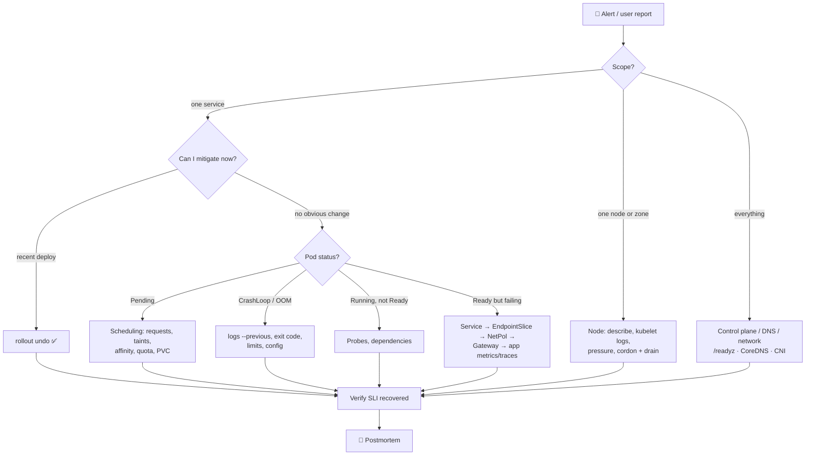

# 21 · Systematic Troubleshooting

| Level | Duration | Prerequisites |
|---|---|---|
| 🛡️ Advanced | 8 h | Modules 04–20 |

**By the end you will be able to:**
- **Apply** a repeatable, hypothesis-driven method to any Kubernetes incident.
- **Diagnose** workload, networking, storage, node and control plane failures layer by layer.
- **Use** `describe`, events, logs, `debug`, metrics and node tools in the right order.
- **Mitigate first**, then find and document the root cause in a blameless postmortem.

---

## 🧠 The analogy: an emergency-room doctor

An ER doctor does not start with a full-body MRI. They follow a **triage protocol**:

1. **Stabilize the patient** (mitigate: roll back, scale, fail over) — *before* the diagnosis is complete.
2. **Check vital signs** (is it one Pod, one node, one zone, or everything?).
3. **Ask what changed** ("did you eat something new?" = "what was deployed?").
4. **Form a hypothesis and test it** with the cheapest test first.
5. **Treat, observe, and write the chart** (postmortem) so the next doctor learns from it.

Panic and random tests waste time. A protocol makes average engineers fast and fast engineers reliable.

---

## 📖 Concepts

### 1. The method

| Step | Question | Tools |
|---|---|---|
| 1. **Scope** | Who is affected? One Pod / Service / node / namespace / zone / everything? | Dashboards, `get -A`, SLO alerts |
| 2. **Mitigate** | Can I stop the bleeding now? | `rollout undo`, scale up, drain node, fail over, feature flag |
| 3. **Changes** | What changed recently? | Deploy history, GitOps diff, `rollout history`, audit log, events |
| 4. **Observe** | What does the system say? | `describe`, events, logs, metrics, traces |
| 5. **Hypothesize** | What could explain *all* the evidence? | Write 2–3 candidates down |
| 6. **Test** | Cheapest experiment that proves/disproves one? | `exec`, `debug`, `curl`, `nslookup`, `auth can-i` |
| 7. **Fix and verify** | Is the symptom gone? Did the SLI recover? | Same signals as step 1 |
| 8. **Learn** | Why did it happen, and why didn't we catch it earlier? | Blameless postmortem, action items |

### 2. Layer by layer

```text
User → DNS → Load balancer → Gateway/Ingress → Service → EndpointSlice → Pod → Container → Node → Control plane
```

Work **outside-in** from the symptom, or **bottom-up** when the platform itself looks sick. At each
layer ask: *does it exist? is it healthy? is it connected to the next layer?*

### 3. Pod failure decision tree

| What you see | Look at | Usual causes |
|---|---|---|
| `Pending` + `FailedScheduling` | `describe pod` events | Requests too big, taints, affinity, PVC zone, quota |
| `Pending` + no events | Scheduler health | Scheduler down, scheduling gates |
| `ContainerCreating` for long | Events | Image pull slow, volume attach/mount, CNI IP allocation, missing Secret |
| `ImagePullBackOff` / `ErrImagePull` | Events | Name/tag, private registry, rate limits, network to registry |
| `CreateContainerConfigError` | Events | Missing ConfigMap/Secret/key |
| `CrashLoopBackOff` | `logs --previous`, exit code | App error (1), config, OOM (137), wrong command |
| `Running` but not Ready | `describe` → probe messages | Readiness path/port, dependency down |
| `Running`, Ready, but errors | App logs, metrics, traces | App bug, downstream dependency, resource throttling |
| `Terminating` forever | `metadata.finalizers`, node status | Finalizer controller gone, node unreachable |
| `Evicted` | `describe pod`, node conditions | Node pressure (memory/disk/PIDs), BestEffort QoS |

### 4. Service / networking checklist

1. `kubectl get svc,endpointslices` — selector matches? endpoints Ready?
2. DNS from a Pod: `nslookup svc.ns` (and check CoreDNS Pods/logs).
3. Pod IP directly: `curl <podIP>:<port>` — app listening on the right port and interface (`0.0.0.0`)?
4. Service IP: `curl <svc>:<port>` — `targetPort` correct?
5. NetworkPolicies selecting source or destination?
6. Gateway/Ingress: route status conditions, hostnames, backend refs.

### 5. Node checklist

```bash
kubectl get nodes; kubectl describe node <n>        # conditions: Ready, MemoryPressure, DiskPressure, PIDPressure
kubectl get pods -A -o wide --field-selector spec.nodeName=<n>
# On the node (kind: docker exec -it <node> bash):
systemctl status kubelet; journalctl -u kubelet --since "15 min ago" | tail -50
crictl ps -a; crictl logs <id>; df -h; free -m
```

### 6. Control plane checklist

```bash
kubectl get --raw='/readyz?verbose'
kubectl -n kube-system get pods -l tier=control-plane
kubectl -n kube-system logs kube-apiserver-<node> | tail
# Static Pod manifests: /etc/kubernetes/manifests ; certificates: /etc/kubernetes/pki (kubeadm certs check-expiration)
```

### 7. The debugging toolbox

| Tool | Use |
|---|---|
| `kubectl describe` + events | Always first: the system usually tells you |
| `kubectl logs [--previous] [-c]` | App-level clues and crash reasons |
| `kubectl debug -it pod --image=netshoot --target=c` | Tools inside a distroless Pod |
| `kubectl debug pod --copy-to=x --set-image=…` | Copy a failing Pod and change its command/image to investigate |
| `kubectl debug node/<n> -it --image=…` | Shell on a node (host filesystem at `/host`) |
| `kubectl get … -o yaml` vs your manifest | Find defaults, mutations and status |
| `kubectl auth can-i … --as` | Permission issues |
| `kubectl get --raw` | Raw API, health endpoints, metrics |

### 8. Blameless postmortems

A postmortem documents **impact, timeline, root cause(s), what went well, what went wrong, and action
items with owners**. "Blameless" means you assume people acted reasonably with the information they
had, and you fix the system that allowed the failure.

---

## 🗺️ Diagram: the triage flow



---

## ⌨️ Essential commands

```bash
# The 60-second overview
kubectl get nodes
kubectl get pods -A --field-selector=status.phase!=Running,status.phase!=Succeeded
kubectl events -A --types=Warning | tail -20
kubectl top nodes; kubectl top pods -A --sort-by=cpu | head

# One workload
kubectl describe pod <p>; kubectl logs <p> --previous --tail=50
kubectl get pod <p> -o jsonpath='{.status.containerStatuses[*].lastState}'
kubectl rollout history deploy/<d>; kubectl rollout undo deploy/<d>
```

---

## 🧯 In production

- **Mitigation beats diagnosis.** Users care that it works, not why it broke. Roll back first.
- **Write down hypotheses and evidence** during the incident (a shared doc). It stops circular debugging.
- **Change one thing at a time** while debugging, or you will not know what fixed it.
- **"It's always DNS"** is a joke because it is often true. Check it early and cheaply.
- **Every incident is a gift of information.** Turn it into tests, alerts, runbooks and guardrails.

## ⚠️ Common mistakes

| Mistake | Better |
|---|---|
| Restarting everything "to see if it helps" | Capture evidence first (`describe`, logs, `--previous`) |
| Debugging for 40 minutes while users suffer | Roll back at minute 5 if a change is suspected |
| Looking only at the failing Pod | Check the layer above/below (Service, node, dependency) |
| `--force --grace-period=0` deletes | Understand why it is stuck (finalizers, node) |
| Fixing by hand and not in Git | GitOps will revert your fix; change the source of truth |

## 📚 Official references

- [Troubleshooting](https://kubernetes.io/docs/tasks/debug/)
- [Debug Pods](https://kubernetes.io/docs/tasks/debug/debug-application/debug-pods/)
- [Debug Services](https://kubernetes.io/docs/tasks/debug/debug-application/debug-service/)
- [Debug running Pods (kubectl debug)](https://kubernetes.io/docs/tasks/debug/debug-application/debug-running-pod/)
- [Troubleshooting clusters](https://kubernetes.io/docs/tasks/debug/debug-cluster/)
- [Debugging DNS resolution](https://kubernetes.io/docs/tasks/administer-cluster/dns-debugging-resolution/)
- [Determine the reason for Pod failure](https://kubernetes.io/docs/tasks/debug/debug-application/determine-reason-pod-failure/)

➡️ Next: [🧪 LAB.md](LAB.md)
