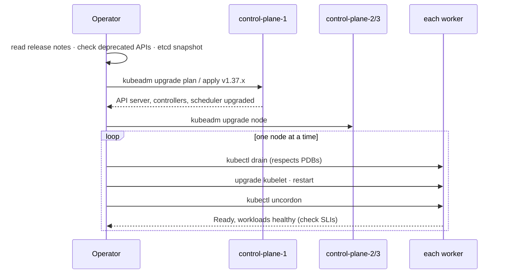

# 22 · Cluster Administration

| Level | Duration | Prerequisites |
|---|---|---|
| 🛡️ Advanced | 8 h | Modules 04, 09, 17, 21 |

**By the end you will be able to:**
- **Describe** how a production cluster is built with kubeadm, including a highly available control plane.
- **Plan and execute** a version upgrade that respects the version skew policy.
- **Maintain** nodes safely with cordon, drain and PodDisruptionBudgets.
- **Back up and restore** etcd.
- **Operate** certificates, encryption at rest, audit logging and kubelet configuration.

---

## 🧠 The analogy: running a power plant

Building a power plant is a one-time project. **Running it for 20 years** is the real job:

- **Upgrades** are replacing turbines **one at a time** while the city keeps its lights on.
- **Draining a node** is moving the load off a turbine before maintenance.
- A **PodDisruptionBudget** is the rule "never take more than one turbine offline at once".
- **etcd backups** are the plant's **blueprints and logbook in a fireproof safe** — if the control room
  burns, you rebuild from them.
- **Certificates** are the **operating licenses**: they expire, and if one expires unnoticed, the plant stops.
- **Audit logs** are the **security cameras**: who touched which switch, and when.

---

## 📖 Concepts

### 1. Building a cluster with kubeadm

| Step | Command (on each machine) |
|---|---|
| Prepare nodes | Container runtime (containerd), kubelet, kubeadm, kernel modules (`br_netfilter`, `overlay`), sysctl `net.ipv4.ip_forward=1` |
| Init the first control plane | `kubeadm init --control-plane-endpoint=lb.example.com:6443 --upload-certs --pod-network-cidr=10.244.0.0/16` |
| Install a CNI | `kubectl apply -f <cni manifest>` (Calico, Cilium…) |
| Join more control planes | `kubeadm join lb.example.com:6443 --control-plane --certificate-key …` |
| Join workers | `kubeadm join lb.example.com:6443 --token … --discovery-token-ca-cert-hash sha256:…` |

**High availability:** 3 (or 5) control-plane nodes behind a load balancer. etcd can be **stacked**
(on the control-plane nodes, simpler) or **external** (separate machines, more resilient). etcd needs a
quorum: with 3 members you survive 1 failure; with 5, you survive 2.

### 2. Version skew and upgrades

Kubernetes releases a minor version about **every 4 months** and supports the latest **3** minors
(~14 months of patches each). Rules of the **version skew policy**:

| Component | Allowed skew vs kube-apiserver |
|---|---|
| kube-apiserver (HA) | Members within 1 minor of each other |
| kube-controller-manager, kube-scheduler | Not newer; up to 1 minor older |
| kubelet, kube-proxy | Not newer; up to **3 minors older** |
| kubectl | ±1 minor |

**Upgrade one minor at a time** (1.35 → 1.36 → 1.37), control plane first, then nodes:

```bash
# On the first control-plane node
kubeadm upgrade plan
kubeadm upgrade apply v1.37.x
# On other control-plane nodes
kubeadm upgrade node
# For each node (control plane and workers), one at a time
kubectl drain <node> --ignore-daemonsets --delete-emptydir-data
#   upgrade kubelet + kubectl packages on the node, then:
systemctl daemon-reload && systemctl restart kubelet
kubectl uncordon <node>
```

Before any upgrade: read the release notes and the **deprecated API migration guide**, check
workloads for removed APIs (`kubectl get --raw /metrics | grep apiserver_requested_deprecated_apis`, or
tools like `pluto`/`kubent`), back up etcd, and upgrade a staging cluster first. Managed services (EKS,
GKE, AKS) automate the control plane; you still own node pools and API deprecations.

### 3. Node maintenance

| Command | Effect |
|---|---|
| `kubectl cordon <n>` | Mark unschedulable (existing Pods stay) |
| `kubectl drain <n>` | Cordon + **evict** Pods respecting PDBs and grace periods |
| `kubectl uncordon <n>` | Schedulable again |

`drain` uses the **Eviction API**, which honors **PodDisruptionBudgets** (module 28). A PDB with
`maxUnavailable: 0` (or `minAvailable` = replicas) blocks drains forever — a common upgrade blocker.

### 4. etcd backup and restore

```bash
# Backup (on a control-plane node, or via the etcd Pod)
ETCDCTL_API=3 etcdctl --endpoints=https://127.0.0.1:2379 \
  --cacert=/etc/kubernetes/pki/etcd/ca.crt \
  --cert=/etc/kubernetes/pki/etcd/server.crt \
  --key=/etc/kubernetes/pki/etcd/server.key \
  snapshot save /backup/etcd-$(date +%F-%H%M).db
etcdutl snapshot status /backup/etcd-…db -w table

# Restore (to a NEW data directory), then point the etcd static Pod at it
etcdutl snapshot restore /backup/etcd-…db --data-dir /var/lib/etcd-restored
```

Store snapshots **off the cluster**, encrypted, and test restores. Velero complements this by backing
up Kubernetes objects and volumes per namespace.

### 5. Certificates

kubeadm creates a cluster CA and certificates for every component (`/etc/kubernetes/pki`). Leaf
certificates are valid for **1 year**; the CA for 10 years. Upgrades renew them automatically; otherwise:

```bash
kubeadm certs check-expiration
kubeadm certs renew all          # then restart control-plane static Pods
```

The kubelet rotates its own client certificate automatically. Recent releases add **Pod certificates**
and **ClusterTrustBundles** for workload X.509 identity ⚠️ (check their status for your version).

### 6. Encryption at rest

```yaml
apiVersion: apiserver.config.k8s.io/v1
kind: EncryptionConfiguration
resources:
  - resources: ["secrets"]
    providers:
      - kms:                        # best: KMS v2 with an external key manager
          apiVersion: v2
          name: cloud-kms
          endpoint: unix:///var/run/kms.sock
      - aescbc:                     # or a local key (the key file then needs protecting)
          keys:
            - name: key1
              secret: <base64 32-byte key>
      - identity: {}                # fallback: read old, unencrypted data
```

Pass it with `--encryption-provider-config` to the API server, then rewrite existing Secrets:
`kubectl get secrets -A -o json | kubectl replace -f -`.

### 7. Audit logging

An **audit policy** decides what to record (`None`, `Metadata`, `Request`, `RequestResponse`) per
resource and user. Log at least `Metadata` for everything, `RequestResponse` for RBAC changes, and
**never** log Secret bodies. Send audit logs to a SIEM — they answer "who did what, when?".

### 8. Node and kubelet configuration

- `KubeletConfiguration` file (`/var/lib/kubelet/config.yaml`) plus a **drop-in directory**
  (`--config-dir`, GA in v1.35) to layer settings safely.
- Key settings: `maxPods`, `evictionHard`, `kubeReserved`/`systemReserved`, `containerLogMaxSize`,
  `shutdownGracePeriod` (graceful node shutdown), swap (`memorySwap.swapBehavior`, see the official swap tutorial).
- **Feature gates** enable alpha/beta features per component (`--feature-gates=Name=true`).

---

## 🗺️ Diagram: a rolling cluster upgrade



---

## ⌨️ Essential commands

| Command | What it does |
|---|---|
| `kubectl version` / `kubectl get nodes` | Control plane and kubelet versions |
| `kubeadm upgrade plan` | Available versions and component plan |
| `kubectl drain <n> --ignore-daemonsets --delete-emptydir-data --timeout=10m` | Safe node maintenance |
| `kubectl get pdb -A` | Budgets that may block drains |
| `etcdctl snapshot save` / `etcdutl snapshot restore` | Backup / restore |
| `kubeadm certs check-expiration` | Certificate expiry |
| `kubectl get --raw /metrics \| grep apiserver_requested_deprecated_apis` | Deprecated API use |
| `kubectl get --raw "/api/v1/nodes/<n>/proxy/configz"` | Live kubelet configuration |

---

## 🧯 SRE mindset

- **Upgrades are routine, not projects.** Clusters that skip upgrades end up three versions behind, forced into a risky jump.
- **Untested backups don't exist.** Schedule restore drills.
- **Certificate expiry is a top cause of full-cluster outages**: alert 30 days before.
- **Treat nodes as cattle**: replace instead of repair; automate node images and pools.
- **Every admin action through Git and automation** where possible; audit logs for the rest.

## ⚠️ Common mistakes

| Symptom | Cause | Fix |
|---|---|---|
| `drain` hangs: `Cannot evict pod as it would violate the pod's disruption budget` | PDB allows 0 disruptions | Scale up, fix the PDB, or coordinate with the owner |
| API calls fail after upgrade: `no matches for kind … in version …` | Workloads use a removed API | Migrate manifests before upgrading |
| `x509: certificate has expired` everywhere | Control-plane certs not renewed | `kubeadm certs renew all`, restart static Pods |
| etcd restore "did nothing" | Restored into the old data dir or old static Pod still running | Restore to a new dir and update the manifest |
| Secrets still plain in etcd after enabling encryption | Existing objects not rewritten | Rewrite all Secrets |

## 🎓 Official tutorial companion

After the lab, run the upstream tutorial to see the same idea from the official docs:

- [Running kubelet in standalone mode](https://kubernetes.io/docs/tutorials/cluster-management/kubelet-standalone/)
- [Configuring swap memory on nodes](https://kubernetes.io/docs/tutorials/cluster-management/provision-swap-memory/)

> Tutorials that use minikube work on `kc` too; replace `minikube service` with `kubectl port-forward`.

## 📚 Official references

- [Creating a cluster with kubeadm](https://kubernetes.io/docs/setup/production-environment/tools/kubeadm/create-cluster-kubeadm/)
- [Creating HA clusters with kubeadm](https://kubernetes.io/docs/setup/production-environment/tools/kubeadm/high-availability/)
- [Upgrading kubeadm clusters](https://kubernetes.io/docs/tasks/administer-cluster/kubeadm/kubeadm-upgrade/)
- [Version skew policy](https://kubernetes.io/releases/version-skew-policy/)
- [Deprecated API migration guide](https://kubernetes.io/docs/reference/using-api/deprecation-guide/)
- [Safely drain a node](https://kubernetes.io/docs/tasks/administer-cluster/safely-drain-node/)
- [Operating etcd clusters](https://kubernetes.io/docs/tasks/administer-cluster/configure-upgrade-etcd/)
- [Certificate management with kubeadm](https://kubernetes.io/docs/tasks/administer-cluster/kubeadm/kubeadm-certs/)
- [Encrypting confidential data at rest](https://kubernetes.io/docs/tasks/administer-cluster/encrypt-data/)
- [Auditing](https://kubernetes.io/docs/tasks/debug/debug-cluster/audit/)

➡️ Next: [🧪 LAB.md](LAB.md)
