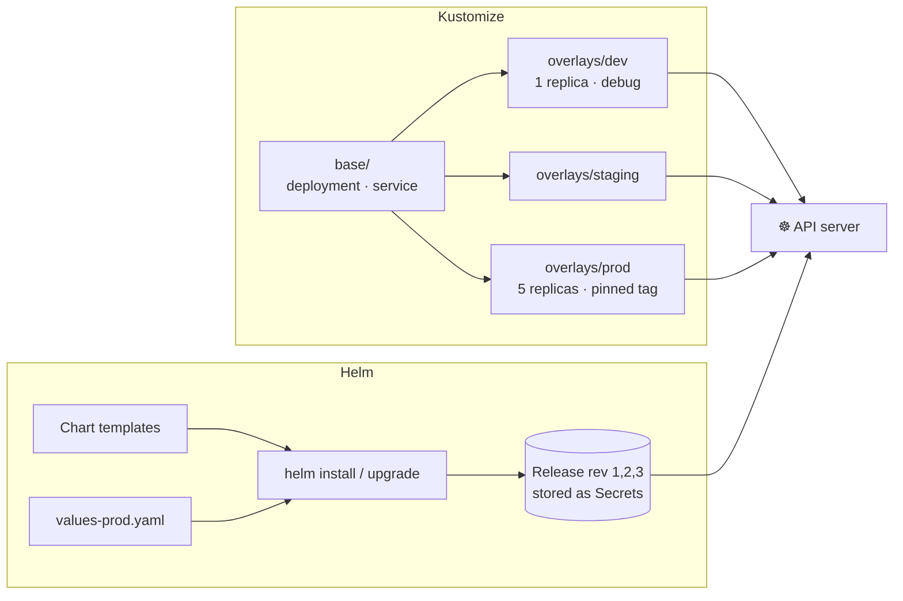

# 23 · Kustomize and Helm

| Level | Duration | Prerequisites |
|---|---|---|
| 🚀 Expert | 6 h | Modules 07–09 · `helm` installed |

**By the end you will be able to:**
- **Structure** manifests into a base plus per-environment overlays with Kustomize.
- **Generate** ConfigMaps and Secrets with content hashes for safe config rollouts.
- **Install, configure, upgrade and roll back** applications with Helm.
- **Author** a small Helm chart and **choose** between Kustomize and Helm (or combine them).

---

## 🧠 The analogy: a recipe, adjustments and a meal kit

- **Plain YAML** is a recipe copied by hand for every restaurant. One change → edit 10 copies.
- **Kustomize** is **one master recipe plus sticky notes per restaurant**: "Lima: double spice", "Quito:
  half portion". You never edit the master; you *patch* it. What you see is still a normal recipe.
- **Helm** is a **meal kit with a form**: you fill in "portions = 4, spicy = yes" (values) and the kit
  produces the dish (manifests from templates). It also remembers which kit version you cooked, so you
  can go back to last week's (rollback).

---

## 📖 Concepts

### 1. Kustomize (built into kubectl)

```text
app/
├── base/
│   ├── kustomization.yaml
│   ├── deployment.yaml
│   └── service.yaml
└── overlays/
    ├── dev/
    │   └── kustomization.yaml
    └── prod/
        ├── kustomization.yaml
        └── replicas-patch.yaml
```

```yaml
# base/kustomization.yaml
apiVersion: kustomize.config.k8s.io/v1beta1
kind: Kustomization
resources:
  - deployment.yaml
  - service.yaml
labels:
  - pairs:
      app.kubernetes.io/name: shop
    includeSelectors: true
```

```yaml
# overlays/prod/kustomization.yaml
apiVersion: kustomize.config.k8s.io/v1beta1
kind: Kustomization
namespace: shop-prod
resources:
  - ../../base
images:
  - name: ghcr.io/stefanprodan/podinfo
    newTag: 6.7.0                 # pin the version per environment
patches:
  - path: replicas-patch.yaml     # strategic merge patch
  - target: { kind: Deployment, name: shop }
    patch: |-                     # JSON 6902 patch
      - op: add
        path: /spec/template/spec/containers/0/env/-
        value: { name: ENV, value: prod }
configMapGenerator:
  - name: shop-config
    literals:
      - LOG_LEVEL=warn
```

Key features: `resources`, `namePrefix`/`nameSuffix`, `namespace`, `labels`, `images`, `replicas`,
`patches`, **`configMapGenerator` / `secretGenerator`** (append a content hash to the name, so changing
config changes the Pod template and triggers a rollout), `components` (reusable optional features).

```bash
kubectl kustomize overlays/prod      # render
kubectl apply -k overlays/prod       # apply
kubectl diff -k overlays/prod        # preview changes
```

### 2. Helm

| Concept | Meaning |
|---|---|
| **Chart** | A package: templates + default `values.yaml` + metadata (`Chart.yaml`) |
| **Values** | Inputs you override (`-f my-values.yaml`, `--set key=value`) |
| **Release** | One installed instance of a chart in a namespace (with revision history) |
| **Repository / OCI registry** | Where charts are published (`helm repo add`, `oci://…`) |

```bash
helm repo add podinfo https://stefanprodan.github.io/podinfo   # a classic repository
helm search repo podinfo
helm show values oci://ghcr.io/stefanprodan/charts/podinfo | less   # charts can also live in OCI registries
helm install web oci://ghcr.io/stefanprodan/charts/podinfo -n web --create-namespace -f values.yaml
helm list -A
helm upgrade web oci://ghcr.io/stefanprodan/charts/podinfo -n web -f values.yaml --atomic --timeout 5m
helm history web -n web
helm rollback web 1 -n web
helm uninstall web -n web
```

> Helm 3 has no server component (no Tiller). Release state is stored as Secrets in the release namespace.
> ⚠️ Check your Helm major version (`helm version`): newer majors may change some defaults and flags.

### 3. A tiny chart

```text
mychart/
├── Chart.yaml
├── values.yaml
└── templates/
    ├── _helpers.tpl
    ├── deployment.yaml
    └── service.yaml
```

```text
# templates/deployment.yaml (excerpt — Go templates, not plain YAML)
apiVersion: apps/v1
kind: Deployment
metadata:
  name: {{ include "mychart.fullname" . }}
  labels: {{- include "mychart.labels" . | nindent 4 }}
spec:
  replicas: {{ .Values.replicaCount }}
  template:
    spec:
      containers:
        - name: app
          image: "{{ .Values.image.repository }}:{{ .Values.image.tag | default .Chart.AppVersion }}"
          {{- with .Values.resources }}
          resources: {{- toYaml . | nindent 12 }}
          {{- end }}
```

Useful commands: `helm create`, `helm template` (render locally), `helm lint`, `helm install --dry-run --debug`,
`helm package`, `helm push` (to an OCI registry). Add a `values.schema.json` to validate inputs.

### 4. Kustomize vs Helm

| | Kustomize | Helm |
|---|---|---|
| Approach | Patch plain YAML (template-free) | Templates + values |
| Learning curve | Low | Medium (Go templates) |
| Distribution of third-party apps | Weak | **Strong** (the de facto packaging format) |
| Release history / rollback | No (use Git/GitOps) | Yes |
| Best for | Your own apps across environments | Installing/sharing complex apps |

They combine well: render a Helm chart, then patch it with Kustomize (`helmCharts` in Kustomize, or
GitOps tools that support both).

---

## 🗺️ Diagram



---

## ⌨️ Essential commands

| Command | What it does |
|---|---|
| `kubectl kustomize <dir>` / `kustomize build <dir>` | Render |
| `kubectl apply -k <dir>` | Apply an overlay |
| `helm template <rel> <chart> -f values.yaml` | Render a chart locally |
| `helm install/upgrade --install <rel> <chart> -f values.yaml` | Idempotent install |
| `helm get values <rel>` / `helm get manifest <rel>` | What was deployed |
| `helm diff upgrade …` (plugin) | Preview an upgrade |
| `helm rollback <rel> <rev>` | Roll back |

---

## 🧯 In production

- **Render and review what you apply.** Templates hide surprises; diff the output in CI.
- **Pin chart versions and image tags**; never deploy "latest" of a chart.
- **One source of truth per environment** (Git); avoid `--set` on the command line in production.
- **Use hashed config names** (generators) so config changes roll out — and roll back — like code.
- **Validate rendered manifests** (kubeconform, policy checks) before they reach the cluster.

## ⚠️ Common mistakes

| Symptom | Cause | Fix |
|---|---|---|
| Overlay change not applied | Patch target name/kind mismatch | `kubectl kustomize` and inspect output |
| ConfigMap changed but Pods did not restart | Plain ConfigMap instead of a generator | Use `configMapGenerator` |
| `helm upgrade` fails: `another operation is in progress` | Previous release stuck `pending-*` | `helm history`, then `helm rollback` |
| Values ignored | Wrong key path/indentation in values | `helm get values`, `helm template` |
| Resources not deleted on uninstall | Created outside the chart, or `helm.sh/resource-policy: keep` | Check annotations and ownership |

## 📚 Official references

- [Declarative management with Kustomize](https://kubernetes.io/docs/tasks/manage-kubernetes-objects/kustomization/)
- [Managing Kubernetes objects](https://kubernetes.io/docs/concepts/overview/working-with-objects/object-management/)
- [Kustomize documentation](https://kubectl.docs.kubernetes.io/references/kustomize/)
- [Helm documentation](https://helm.sh/docs/)
- [Chart best practices](https://helm.sh/docs/chart_best_practices/)

➡️ Next: [🧪 LAB.md](LAB.md)
