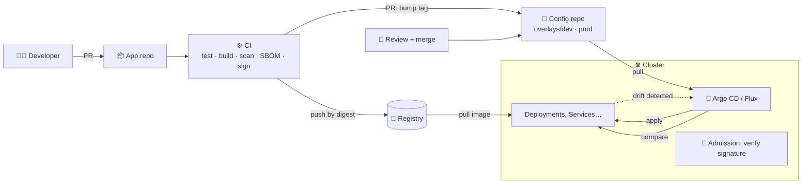

# 24 · GitOps and CI/CD

| Level | Duration | Prerequisites |
|---|---|---|
| 🚀 Expert | 7 h | Modules 07, 23 · a GitHub (or GitLab) account |

**By the end you will be able to:**
- **Explain** the four OpenGitOps principles and why pull-based delivery is safer.
- **Deploy** applications with Argo CD (and know the Flux equivalent).
- **Detect and heal drift** between Git and the cluster.
- **Design** a secure CI pipeline: build, test, scan, sign, publish, promote.
- **Automate** canary analysis with progressive delivery tools.

---

## 🧠 The analogy: the building's architectural plans

In a well-run building, **the plans in the architect's office are the truth**. If someone moves a wall
without updating the plans, the building inspector (the GitOps agent) notices the difference and either
reports it or puts the wall back.

- **Git** = the plans. Every change is a reviewed, signed, dated revision.
- **CI** = the factory that builds the bricks (images), tests them and stamps them as approved (signatures).
- **The GitOps agent** (Argo CD / Flux) = the inspector who lives *inside* the building and keeps
  comparing reality with the plans. Builders never need the master key to the building — they just
  update the plans.

---

## 📖 Concepts

### 1. The OpenGitOps principles

1. **Declarative** — the desired state is expressed declaratively.
2. **Versioned and immutable** — stored in a system that keeps full history (Git).
3. **Pulled automatically** — agents pull the desired state from the source.
4. **Continuously reconciled** — agents observe actual state and correct drift.

### 2. Push vs pull

| | Push (classic CI/CD) | Pull (GitOps) |
|---|---|---|
| Who touches the cluster | The CI system, with cluster credentials | An agent inside the cluster |
| Credentials | Admin kubeconfig in CI (big blast radius) | CI only needs to write to Git/registry |
| Drift | Undetected | Detected and optionally healed |
| Audit / rollback | Pipeline logs | `git log` / `git revert` |
| Multi-cluster | One pipeline step per cluster | Each cluster pulls its own config |

### 3. Argo CD and Flux

| | Argo CD | Flux |
|---|---|---|
| Core object | `Application` (+ `ApplicationSet`, `AppProject`) | `GitRepository`/`OCIRepository` + `Kustomization`/`HelmRelease` |
| UI | Rich web UI | CLI-first (UIs available separately) |
| Multi-cluster | One Argo CD can manage many clusters | One Flux per cluster (typical) |
| Sources | Git, Helm repos, OCI | Git, Helm, OCI, S3 buckets |
| Both | CNCF graduated, Kustomize + Helm support, sync waves / dependencies, health checks, notifications |

```yaml
apiVersion: argoproj.io/v1alpha1
kind: Application
metadata:
  name: shop-prod
  namespace: argocd
spec:
  project: default
  source:
    repoURL: https://github.com/acme/platform-config.git
    targetRevision: main
    path: apps/shop/overlays/prod          # a Kustomize overlay (module 23)
  destination:
    server: https://kubernetes.default.svc
    namespace: shop-prod
  syncPolicy:
    automated:
      prune: true                          # delete what was removed from Git
      selfHeal: true                       # revert manual changes (drift)
    syncOptions:
      - CreateNamespace=true
```

### 4. Repository structure

| Pattern | Description |
|---|---|
| **App repo vs config repo** | Source code + Dockerfile in one repo; manifests in another. CI updates the config repo |
| **Environments as directories** | `overlays/dev`, `overlays/prod` on one branch (preferred over branch-per-env) |
| **App of apps / ApplicationSet** | One root Application generates many (per cluster, per team, per directory) |
| **Promotion** | A PR that bumps the image tag from staging to prod (automated with Argo CD Image Updater, Flux image automation or Kargo) |

### 5. Secrets in GitOps

Never plain Secrets in Git. Options: **Sealed Secrets** (encrypted with a cluster key), **SOPS** (+ age/KMS;
Flux decrypts natively), **External Secrets Operator** (Git holds a reference; the value lives in Vault /
cloud secret managers).

### 6. A secure CI pipeline (supply chain)

```text
commit → lint & unit tests → build image → scan (Trivy/Grype) → SBOM → sign (cosign) →
push to registry (by digest) → update config repo (PR) → GitOps sync → progressive rollout
```

At admission time, verify signatures and allowed registries (module 26). Follow **SLSA** levels for
provenance.

### 7. Progressive delivery

**Argo Rollouts** and **Flagger** replace a Deployment's rollout with automated **canary** or
**blue/green** steps, shifting traffic (via Gateway API, a mesh or an ingress) and querying metrics
(Prometheus) to **promote or abort automatically**.

```yaml
# Argo Rollouts canary steps (excerpt)
strategy:
  canary:
    steps:
      - setWeight: 10
      - pause: { duration: 5m }
      - analysis: { templates: [{ templateName: success-rate }] }
      - setWeight: 50
      - pause: { duration: 10m }
```

---

## 🗺️ Diagram



---

## ⌨️ Essential commands

| Command | What it does |
|---|---|
| `kubectl -n argocd get applications` | App sync and health status |
| `argocd app get shop-prod` / `argocd app diff shop-prod` | Details / live vs Git diff |
| `argocd app sync shop-prod` | Manual sync |
| `argocd app history shop-prod` / `argocd app rollback shop-prod <id>` | History / rollback (prefer `git revert`) |
| `flux get kustomizations -A` / `flux reconcile kustomization <name>` | Flux equivalents |
| `cosign sign` / `cosign verify` | Sign and verify images |

---

## 🧯 SRE mindset

- **Rollback = `git revert`.** Fast, reviewed, auditable — practice it.
- **Self-heal is a safety net, not a substitute for access control**: also remove humans' write access to prod.
- **Watch sync and health status** as SLIs of your delivery platform; alert on apps `OutOfSync`/`Degraded` too long.
- **Small, frequent changes** lower change failure rate and MTTR (DORA metrics).
- **Break-glass**: document how to pause auto-sync during an incident, and how to resume.

## ⚠️ Common mistakes

| Symptom | Cause | Fix |
|---|---|---|
| App flips `OutOfSync` forever | A controller (HPA, webhook) mutates fields managed in Git | Remove `replicas` when using HPA; `ignoreDifferences` |
| Hotfix applied with kubectl disappears | `selfHeal: true` restored Git state | Fix in Git (or pause sync deliberately) |
| Resources deleted unexpectedly | `prune: true` + file moved/renamed | Review diffs; use `Prune=false` annotations on critical objects |
| CRD and CR in one sync fail | CR applied before its CRD | Sync waves / `SkipDryRunOnMissingResource` |
| Plain Secrets in Git | Convenience | Sealed Secrets / SOPS / External Secrets; rotate leaked ones |

## 📚 Official references

- [Managing workloads](https://kubernetes.io/docs/concepts/workloads/management/)
- [Declarative management of Kubernetes objects](https://kubernetes.io/docs/tasks/manage-kubernetes-objects/declarative-config/)
- [Server-side apply](https://kubernetes.io/docs/reference/using-api/server-side-apply/)
- [OpenGitOps principles](https://opengitops.dev/)
- [Argo CD documentation](https://argo-cd.readthedocs.io/)
- [Flux documentation](https://fluxcd.io/flux/)
- [Verify signed Kubernetes artifacts](https://kubernetes.io/docs/tasks/administer-cluster/verify-signed-artifacts/)

➡️ Next: [🧪 LAB.md](LAB.md)
