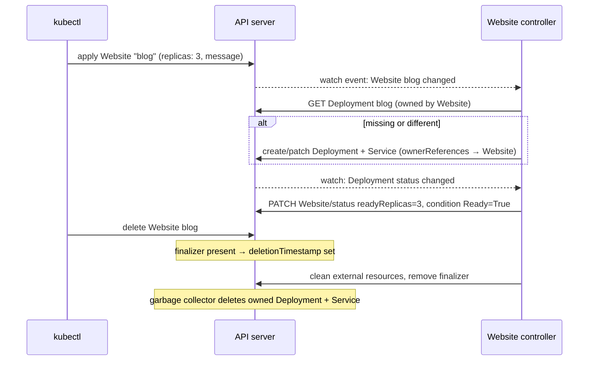

# 25 · CRDs and Operators

| Level | Duration | Prerequisites |
|---|---|---|
| 🚀 Expert | 7 h | Modules 04, 13, 17 |

**By the end you will be able to:**
- **Extend** the Kubernetes API with CustomResourceDefinitions (CRDs).
- **Validate** custom resources with OpenAPI schemas and CEL rules.
- **Explain** the operator pattern: controllers, reconciliation, status, owner references and finalizers.
- **Build** a minimal controller and **evaluate** production operators.

---

## 🧠 The analogy: teaching the city a new kind of form

The town hall (API server) knows standard forms: "building permit" (Deployment), "address registration"
(Service). One day you need a form that does not exist: **"street festival permit"**.

- A **CRD** is **adding a new form type** to the town hall: its name, its fields, which fields are
  required and what values are valid. After that, the clerks accept, store and list festival permits like
  any other form.
- A **custom resource** is **one filled-in festival permit**: "Festival on Main St., 2,000 people, 3 stages".
- An **operator** is the **festival office staff** who read every new permit and *make it happen*: close
  the street, rent stages, hire security — and keep checking until the festival matches the permit. When
  the permit is cancelled, they clean up (finalizers).

Operators encode **human operational knowledge** (how to run, upgrade, back up a database) as software.

---

## 📖 Concepts

### 1. Ways to extend Kubernetes

| Extension point | Use |
|---|---|
| **CRDs** | New resource types stored by the API server (the common way) |
| **API aggregation** (`APIService`) | A separate API server behind the main one (e.g., metrics-server) |
| **Admission webhooks / policies** | Validate or mutate objects (module 26) |
| **Controllers / operators** | Reconcile any resource to a desired state |
| Scheduler plugins, CNI, CSI, CRI, device plugins / DRA | Infrastructure plug-ins |
| kubectl plugins (`kubectl-foo`, krew) | CLI extensions |

### 2. A CRD with schema, CEL validation and printer columns

```yaml
apiVersion: apiextensions.k8s.io/v1
kind: CustomResourceDefinition
metadata:
  name: websites.kc.dev                 # <plural>.<group>
spec:
  group: kc.dev
  scope: Namespaced
  names:
    kind: Website
    plural: websites
    singular: website
    shortNames: [web]
  versions:
    - name: v1alpha1
      served: true
      storage: true                      # exactly one version is the storage version
      subresources:
        status: {}                       # /status written by the controller only
        scale:                           # enables `kubectl scale website/...`
          specReplicasPath: .spec.replicas
          statusReplicasPath: .status.readyReplicas
      additionalPrinterColumns:
        - { name: Replicas, type: integer, jsonPath: .spec.replicas }
        - { name: Ready, type: integer, jsonPath: .status.readyReplicas }
        - { name: Age, type: date, jsonPath: .metadata.creationTimestamp }
      schema:
        openAPIV3Schema:
          type: object
          properties:
            spec:
              type: object
              required: [message]
              properties:
                message: { type: string, maxLength: 100 }
                replicas: { type: integer, minimum: 1, maximum: 10, default: 1 }
                tier: { type: string, enum: [free, pro] }
              x-kubernetes-validations:            # CEL rules
                - rule: "self.tier != 'free' || self.replicas <= 2"
                  message: "free tier allows at most 2 replicas"
            status:
              type: object
              properties:
                readyReplicas: { type: integer }
```

CRDs give you, for free: storage in etcd, RBAC, `kubectl` support, watch, validation, defaulting,
OpenAPI publishing, server-side apply. New versions can be added with a **conversion webhook** when the
schema changes incompatibly.

### 3. The operator pattern

A **controller** watches resources and runs a **reconcile loop**: read desired state (spec), read actual
state (child objects, external systems), act to converge, then write **status** and **conditions**.

| Building block | Purpose |
|---|---|
| **Owner references** | Children (Deployment, Service) point to the CR → garbage collection on delete |
| **Finalizers** | Block deletion until the controller cleans up external resources (DNS, cloud LBs, backups) |
| **Status + conditions** | `Ready`, `Progressing`, `Degraded` with reasons — the CR's health report |
| **Idempotency** | Reconcile can run any number of times with the same result |
| **Leader election** | Only one replica of the controller acts at a time |

Frameworks: **Kubebuilder** / **controller-runtime** (Go), **Operator SDK** (Go, Ansible, Helm),
**kopf** (Python), **Java Operator SDK**, **Metacontroller**.

### 4. Operator capability levels

| Level | Capability | Example |
|---|---|---|
| 1 | Basic install | Deploys the app |
| 2 | Seamless upgrades | Rolls new versions safely |
| 3 | Full lifecycle | Backups, restores, failure recovery |
| 4 | Deep insights | Metrics, alerts, logs |
| 5 | Auto pilot | Auto-scaling, auto-tuning, self-healing |

Popular operators: CloudNativePG / Zalando (PostgreSQL), Strimzi (Kafka), Prometheus Operator,
cert-manager, Crossplane (cloud resources as CRDs), Rook (Ceph).

### 5. Recent API machinery features

| Feature | Status | Why it matters |
|---|---|---|
| CEL validation rules in CRDs | GA | Validation without writing a webhook |
| Validating Admission Policy | GA | Cluster policies in CEL (module 26) |
| Declarative validation for built-in types | GA (v1.36) | Built-in APIs validated from declarative tags |
| Storage version migration | GA (v1.37) | Rewrites stored objects after a CRD/API storage version change |

---

## 🗺️ Diagram: a reconcile loop



---

## ⌨️ Essential commands

| Command | What it does |
|---|---|
| `kubectl get crd` | Installed CRDs |
| `kubectl explain website.spec --recursive` | Schema docs for your CRD (yes, it works) |
| `kubectl api-resources --api-group=kc.dev` | Your new resource type |
| `kubectl get websites -A` / `kubectl get web` | Printer columns, short names |
| `kubectl get deploy blog -o jsonpath='{.metadata.ownerReferences}'` | Who owns this object |
| `kubectl patch website blog --type=merge -p '{"metadata":{"finalizers":null}}'` | ⚠️ Remove finalizers (last resort) |

---

## 🧯 In production

- **An operator is production software you now run**: version it, monitor it, give it SLOs, test its upgrades.
- **Controllers must be idempotent and level-triggered**; every reconcile may be the first one after a crash.
- **Status conditions are your observability contract** — alert on `Ready=False` for too long.
- **Finalizers can block namespace deletion**: if the controller is gone, objects hang in `Terminating`.
- **CRD deletion deletes every custom resource** of that type — protect CRDs like databases.

## ⚠️ Common mistakes

| Symptom | Cause | Fix |
|---|---|---|
| `no matches for kind "Website"` | CRD not installed yet (or wrong group/version) | Install CRDs first (sync waves) |
| Unknown fields silently dropped | Pruning of fields not in the schema | Add them to the schema, or `x-kubernetes-preserve-unknown-fields` |
| Updating status via `kubectl apply` does nothing | `status` subresource: main endpoint ignores status | Write status through `/status` |
| CR stuck `Terminating` | Finalizer and no controller running | Restore the controller; remove finalizer only if cleanup is done |
| Controller hot loop, API throttled | Status update triggers its own watch → infinite reconcile | Compare before updating; use generation/observedGeneration |

## 📚 Official references

- [Custom resources](https://kubernetes.io/docs/concepts/extend-kubernetes/api-extension/custom-resources/)
- [Extend the Kubernetes API with CustomResourceDefinitions](https://kubernetes.io/docs/tasks/extend-kubernetes/custom-resources/custom-resource-definitions/)
- [Versions in CustomResourceDefinitions](https://kubernetes.io/docs/tasks/extend-kubernetes/custom-resources/custom-resource-definition-versioning/)
- [Operator pattern](https://kubernetes.io/docs/concepts/extend-kubernetes/operator/)
- [Finalizers](https://kubernetes.io/docs/concepts/overview/working-with-objects/finalizers/)
- [Owners and dependents](https://kubernetes.io/docs/concepts/overview/working-with-objects/owners-dependents/)
- [Common Expression Language in Kubernetes](https://kubernetes.io/docs/reference/using-api/cel/)
- [Kubebuilder book](https://book.kubebuilder.io/)

➡️ Next: [🧪 LAB.md](LAB.md)
