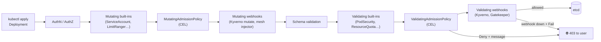

# 26 · Admission Policies

| Level | Duration | Prerequisites |
|---|---|---|
| 🚀 Expert | 6 h | Modules 17, 18, 25 |

**By the end you will be able to:**
- **Explain** the admission chain: mutating and validating, built-in plugins and webhooks.
- **Write** ValidatingAdmissionPolicies in CEL, with parameters and safe rollout (warn → audit → deny).
- **Mutate** objects declaratively with MutatingAdmissionPolicies.
- **Compare** CEL policies with Kyverno and OPA Gatekeeper, and **verify** image signatures at admission.
- **Avoid** the webhook failure modes that take clusters down.

---

## 🧠 The analogy: airport security

Your boarding pass (authentication) and your ticket for this flight (authorization) are valid. You still
go through **security screening**:

- **Mutating admission** = the officer who **adjusts** things: "put your liquids in this bag", "here is
  your tag". The bag goes on — slightly changed.
- **Validating admission** = the officer who **decides**: "this knife cannot fly". You are turned away,
  with a reason.
- **Policies** are the **posted rules**: "no liquids over 100 ml", "every bag must have a name tag" —
  enforced the same way for everyone, no matter which airline sold the ticket.

A security line that breaks down (a failing webhook) can stop **every** passenger. Design for that.

---

## 📖 Concepts

### 1. The admission chain

```text
request → authN → authZ → mutating admission (built-ins → MutatingAdmissionPolicies → mutating webhooks)
        → schema validation → validating admission (built-ins → ValidatingAdmissionPolicies → validating webhooks) → etcd
```

Built-in admission plugins you already used: `NamespaceLifecycle`, `LimitRanger`, `ResourceQuota`,
`ServiceAccount`, `DefaultStorageClass`, `PodSecurity`, `NodeRestriction`, `DefaultTolerationSeconds`…

### 2. ValidatingAdmissionPolicy (GA) — CEL, in-process, no webhook

```yaml
apiVersion: admissionregistration.k8s.io/v1
kind: ValidatingAdmissionPolicy
metadata:
  name: require-team-and-pinned-images
spec:
  failurePolicy: Fail
  matchConstraints:
    resourceRules:
      - apiGroups: ["apps"]
        apiVersions: ["v1"]
        operations: ["CREATE", "UPDATE"]
        resources: ["deployments"]
  validations:
    - expression: "has(object.metadata.labels) && 'team' in object.metadata.labels"
      message: "every Deployment needs a 'team' label"
    - expression: >
        object.spec.template.spec.containers.all(c,
          !c.image.endsWith(':latest') && c.image.contains(':'))
      messageExpression: "'images must use a pinned tag, got: ' + object.spec.template.spec.containers.map(c, c.image).join(', ')"
---
apiVersion: admissionregistration.k8s.io/v1
kind: ValidatingAdmissionPolicyBinding
metadata:
  name: require-team-and-pinned-images
spec:
  policyName: require-team-and-pinned-images
  validationActions: [Warn, Audit]          # roll out safely; switch to [Deny] later
  matchResources:
    namespaceSelector:
      matchLabels:
        policy.kc.dev/enforce: "true"
```

| Field | Purpose |
|---|---|
| `matchConstraints` | Which requests the policy can see |
| `matchConditions` | Extra CEL filters (e.g., skip system users) |
| `variables` | Reusable CEL expressions |
| `validations` / `auditAnnotations` | The rules and audit metadata |
| `paramKind` + binding `paramRef` | Parameters from a ConfigMap or CRD (same policy, different limits per namespace) |
| Binding `validationActions` | `Deny`, `Warn`, `Audit` (combinable) |

### 3. MutatingAdmissionPolicy — declarative mutation in CEL

```yaml
apiVersion: admissionregistration.k8s.io/v1beta1    # ⚠️ check the served version in your cluster
kind: MutatingAdmissionPolicy
metadata:
  name: default-team-label
spec:
  matchConstraints:
    resourceRules:
      - apiGroups: [""]
        apiVersions: ["v1"]
        operations: ["CREATE"]
        resources: ["pods"]
  failurePolicy: Fail
  reinvocationPolicy: IfNeeded
  mutations:
    - patchType: ApplyConfiguration
      applyConfiguration:
        expression: >
          Object{ metadata: Object.metadata{ labels: {"kc.dev/admitted": "true"} } }
```

> ⚠️ MutatingAdmissionPolicy graduated more recently than ValidatingAdmissionPolicy. Check
> `kubectl api-resources --api-group=admissionregistration.k8s.io` to see which version your cluster serves.

### 4. Webhooks

`ValidatingWebhookConfiguration` / `MutatingWebhookConfiguration` send an `AdmissionReview` to an
HTTPS service you run. Very flexible (any language, external data), but every request now depends on
that service.

| Setting | Safe choice |
|---|---|
| `failurePolicy` | `Fail` for security policies (with HA webhooks), `Ignore` for nice-to-have mutations |
| `namespaceSelector` / `objectSelector` | **Exclude `kube-system`** and the webhook's own namespace |
| `timeoutSeconds` | Low (1–5 s) |
| `sideEffects` | `None` (required for dry-run) |
| Webhook deployment | ≥ 2 replicas, PDB, priority class, monitored |

### 5. Policy engines

| | ValidatingAdmissionPolicy (CEL) | Kyverno | OPA Gatekeeper |
|---|---|---|---|
| Language | CEL | YAML policies (+ CEL) | Rego |
| Runs | In the API server | Webhook | Webhook |
| Mutation / generation | MutatingAdmissionPolicy | ✅ mutate, generate, cleanup | Mutation (limited) |
| Image signature verification | ❌ | ✅ `verifyImages` (cosign/notation) | Via external data |
| Background scans / reports | ❌ | ✅ | ✅ audit |
| Best for | Simple, fast, built-in rules | Rich Kubernetes-native policy | Org-wide policy-as-code with Rego |

### 6. Supply chain at admission

Typical policy set: only images from approved registries, **signed** images (Sigstore cosign; verified
with Kyverno or the sigstore policy-controller), no `:latest`, required resource requests, required labels,
PSS `restricted`, no `hostPath`, no privileged containers, LoadBalancer Services only in approved namespaces.

---

## 🗺️ Diagram



---

## ⌨️ Essential commands

| Command | What it does |
|---|---|
| `kubectl get validatingadmissionpolicies,validatingadmissionpolicybindings` | CEL policies |
| `kubectl get mutatingadmissionpolicies` | CEL mutations (if served) |
| `kubectl get validatingwebhookconfigurations,mutatingwebhookconfigurations` | Webhooks |
| `kubectl apply --dry-run=server -f x.yaml` | Run admission without persisting |
| `kubectl get vap <name> -o jsonpath='{.status}'` | Type-checking results of a policy |
| `kubectl get --raw /metrics \| grep apiserver_admission_webhook_rejection_count` | Webhook rejections |

---

## 🧯 In production

- **A webhook is in the critical path of every matching request.** Its availability caps the cluster's.
- **Always exclude `kube-system`** (and the policy engine's namespace) from blocking policies — or you cannot repair the cluster.
- **Warn → Audit → Deny**, with dashboards of violations, is how you roll out policy without outages.
- **Prefer CEL policies** for simple rules: no extra service to run, no network hop.
- **Policies are code**: version them, test them (`kyverno test`, `gator verify`, dry-run in CI) and review them.

## ⚠️ Common mistakes

| Symptom | Cause | Fix |
|---|---|---|
| Nothing can be created: `failed calling webhook … connection refused` | Webhook down with `failurePolicy: Fail` | Fix/scale the webhook; temporarily scope or delete the configuration |
| Policy "does nothing" | No binding, or binding selector does not match | Create/fix the binding; check `validationActions` |
| CEL error `no such key` | Accessing optional fields without `has()` | Guard with `has()` or `?` optional syntax |
| Deployment accepted, Pods rejected | Policy matches Pods, not Deployments | Match workload controllers too, or check ReplicaSet events |
| Mutations fight each other | Several mutators changing the same field | One owner per field; `reinvocationPolicy` awareness |

## 🎓 Official tutorial companion

After the lab, run the upstream tutorial to see the same idea from the official docs:

- [Explore validating and mutating admission policies](https://kubernetes.io/docs/tutorials/cluster-management/admission-policies/)

> Tutorials that use minikube work on `kc` too; replace `minikube service` with `kubectl port-forward`.

## 📚 Official references

- [Admission control in Kubernetes](https://kubernetes.io/docs/reference/access-authn-authz/admission-controllers/)
- [Validating Admission Policy](https://kubernetes.io/docs/reference/access-authn-authz/validating-admission-policy/)
- [Mutating Admission Policy](https://kubernetes.io/docs/reference/access-authn-authz/mutating-admission-policy/)
- [Dynamic admission control (webhooks)](https://kubernetes.io/docs/reference/access-authn-authz/extensible-admission-controllers/)
- [Admission webhook good practices](https://kubernetes.io/docs/concepts/cluster-administration/admission-webhooks-good-practices/)
- [CEL in Kubernetes](https://kubernetes.io/docs/reference/using-api/cel/)
- [Kyverno](https://kyverno.io/docs/) · [OPA Gatekeeper](https://open-policy-agent.github.io/gatekeeper/)

➡️ Next: [🧪 LAB.md](LAB.md)
