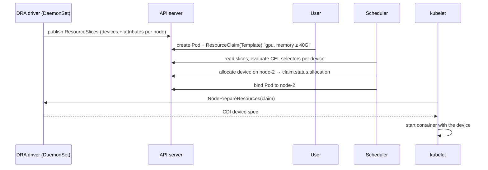

# 27 · DRA, GPUs and AI Workloads

| Level | Duration | Prerequisites |
|---|---|---|
| 🚀 Expert | 7 h | Modules 13, 15, 16, 25 |

**By the end you will be able to:**
- **Explain** how Kubernetes exposes special hardware: device plugins vs Dynamic Resource Allocation (DRA).
- **Request** devices with DeviceClasses, ResourceClaims and CEL selectors.
- **Share and partition** GPUs (time-slicing, MIG) and know the trade-offs.
- **Run** batch AI/ML jobs with queueing and gang scheduling (Kueue, JobSet, Workload API).
- **Serve** models on Kubernetes with autoscaling and inference-aware routing.

---

## 🧠 The analogy: renting specialized lab equipment

A research center has ordinary desks (CPU, memory) and a few **very expensive microscopes** (GPUs, TPUs,
FPGAs, fast NICs).

- **Device plugins** are the old **sign-up sheet**: "Lab B has 4 microscopes". You can only ask for "1
  microscope" — not "a microscope with 80 GB lens and the newest firmware, near the fast network port".
- **DRA** is a **modern booking system**: each lab publishes a detailed catalog (ResourceSlices); you
  file a **request form** (ResourceClaim) with precise criteria ("model = H100, memory ≥ 80 Gi"), choose
  from **categories** set by the lab manager (DeviceClasses), and can even **share one booking** between
  team members (several containers or Pods).
- **Gang scheduling** is a rule for group projects: "book all 8 microscopes **at once**, or none" —
  half a booking is useless for distributed training.
- **Kueue** is the **booking office's waiting list**, with quotas per department and fair sharing.

---

## 📖 Concepts

### 1. Device plugins (the classic way)

A vendor DaemonSet (e.g., NVIDIA device plugin) registers an **extended resource** with the kubelet:

```yaml
resources:
  limits:
    nvidia.com/gpu: 1        # integer only; requests = limits; no sharing semantics in the API
```

Simple and widely supported, but devices are opaque counters: no attributes, no partial devices, no
sharing between containers, no cross-node topology.

### 2. Dynamic Resource Allocation (DRA) — GA in v1.34

| Object | Who creates it | Purpose |
|---|---|---|
| **ResourceSlice** | The DRA driver | Publishes devices per node (or pool) with **attributes** and **capacity** |
| **DeviceClass** | Admin / driver | A category with selectors and config ("gpu.example.com", "nvidia-h100") |
| **ResourceClaim** | User | A concrete request; can be **shared** by several Pods |
| **ResourceClaimTemplate** | User | Generates one claim **per Pod** (e.g., in a Deployment) |

```yaml
apiVersion: resource.k8s.io/v1
kind: ResourceClaimTemplate
metadata:
  name: one-big-gpu
spec:
  spec:
    devices:
      requests:
        - name: gpu
          exactly:
            deviceClassName: gpu.example.com
            selectors:
              - cel:
                  expression: "device.capacity['gpu.example.com'].memory.compareTo(quantity('40Gi')) >= 0"
---
apiVersion: v1
kind: Pod
metadata:
  name: trainer
spec:
  resourceClaims:
    - name: gpu
      resourceClaimTemplateName: one-big-gpu
  containers:
    - name: train
      image: ubuntu:24.04
      command: ["sh", "-c", "env | grep -i gpu; sleep 3600"]
      resources:
        claims:
          - name: gpu               # this container gets the device
```

The scheduler reads ResourceSlices, finds a node where the claim can be satisfied, **allocates** the
devices (written to the claim status) and binds the Pod. The kubelet calls the driver to prepare the
device for the container (via CDI).

Other DRA capabilities (some beta/alpha ⚠️ — verify per version): **prioritized lists** (`firstAvailable`:
"an H100, or else two A100s"), **admin access** for monitoring tools, **partitionable devices**,
**device taints**, **consumable capacity**, extended-resource compatibility, and health status.

### 3. Sharing GPUs

| Technique | Isolation | Use |
|---|---|---|
| Whole GPU per Pod | Full | Training, large inference |
| **MIG** (Multi-Instance GPU) | Hardware partitions | Many small inference workloads with guarantees |
| **Time-slicing** | None (shared memory, contention) | Dev/test, light workloads |
| **MPS** | Partial | Many small CUDA processes |
| Shared ResourceClaim (DRA) | Driver-defined | Several containers/Pods on one device on purpose |

The **NVIDIA GPU Operator** installs drivers, container toolkit, device plugin or DRA driver, DCGM
exporter (metrics) and MIG manager as a bundle.

### 4. Batch AI: queueing and gang scheduling

| Tool | What it adds |
|---|---|
| **Kueue** | Job queueing, quotas per team (`ClusterQueue`, `LocalQueue`), fair sharing, preemption, admits suspended Jobs when resources are free |
| **JobSet** | A group of Jobs as one unit (driver + workers), with success/failure policies |
| **LeaderWorkerSet** | Multi-host inference/training groups (leader + workers) as one replica |
| **Workload API / PodGroup** (in-tree, ⚠️ alpha/beta) | Native **gang scheduling**: place all Pods of a group or none |
| Kubeflow Trainer, Ray (KubeRay) | Framework-level operators for training and distributed Python |

### 5. Serving models

- **Model servers**: vLLM, Text Generation Inference, Triton, KServe runtimes.
- **Autoscaling** on queue depth / tokens / GPU utilization (KEDA, HPA with custom metrics) — CPU is a poor signal.
- **Inference-aware routing**: the **Gateway API Inference Extension** routes requests by model, LoRA
  adapter and server load (KV-cache usage), instead of round-robin.
- **Model artifacts**: pull from object storage, PVCs, or mount OCI images directly as **image volumes**.
- **Cold starts** are huge (tens of GB of weights): pre-pull, cache on nodes, keep warm replicas.

---

## 🗺️ Diagram: DRA allocation



---

## ⌨️ Essential commands

| Command | What it shows |
|---|---|
| `kubectl get deviceclasses` | Available device categories |
| `kubectl get resourceslices -o wide` | Devices published per node |
| `kubectl get resourceclaims -A` | Claims and allocation state |
| `kubectl describe resourceclaim <c>` | Which device was allocated and to whom |
| `kubectl get nodes -o json \| jq '.items[].status.allocatable'` | Extended resources (device plugins) |
| `kubectl get clusterqueues,localqueues,workloads -A` | Kueue state |

---

## 🧯 In production

- **Accelerators are the most expensive resource in the cluster**: measure utilization (DCGM), not just allocation.
- **Idle GPUs are an incident for the budget**: use queueing, quotas and preemption so they are never parked.
- **Training is long and fragile**: checkpoint often; make jobs resumable; handle node failures with `podFailurePolicy`.
- **Taint GPU nodes** so ordinary Pods do not land there (module 15).
- **Pin driver/CUDA/runtime versions together** and roll them out like any other platform change.

## ⚠️ Common mistakes

| Symptom | Cause | Fix |
|---|---|---|
| Pod `Pending`: `cannot allocate all claims` | No device matches the selectors / all allocated | Check ResourceSlices and selectors; queue the job |
| `nvidia.com/gpu` not in allocatable | Device plugin/driver missing on the node | Install GPU Operator / driver; check DaemonSet logs |
| Distributed job deadlocks with half the workers | No gang scheduling | Kueue / JobSet / Workload API |
| Inference latency spikes under load | Round-robin to busy model servers | Inference-aware routing; autoscale on queue depth |
| GPU OOM inside the app | Model + batch too big for device memory | Smaller batch, quantization, bigger device (selector) |

## 🎓 Official tutorial companion

After the lab, run the upstream tutorial to see the same idea from the official docs:

- [Install drivers and allocate devices with DRA](https://kubernetes.io/docs/tutorials/cluster-management/install-use-dra/)

> Tutorials that use minikube work on `kc` too; replace `minikube service` with `kubectl port-forward`.

## 📚 Official references

- [Dynamic Resource Allocation](https://kubernetes.io/docs/concepts/scheduling-eviction/dynamic-resource-allocation/)
- [Allocate devices to workloads with DRA](https://kubernetes.io/docs/tasks/configure-pod-container/assign-resources/allocate-devices-dra/)
- [Set up DRA in a cluster](https://kubernetes.io/docs/tasks/configure-pod-container/assign-resources/set-up-dra-cluster/)
- [Device plugins](https://kubernetes.io/docs/concepts/extend-kubernetes/compute-storage-net/device-plugins/)
- [Schedule GPUs](https://kubernetes.io/docs/tasks/manage-gpus/scheduling-gpus/)
- [Kueue](https://kueue.sigs.k8s.io/) · [JobSet](https://jobset.sigs.k8s.io/) · [Gateway API Inference Extension](https://gateway-api-inference-extension.sigs.k8s.io/)

➡️ Next: [🧪 LAB.md](LAB.md)
