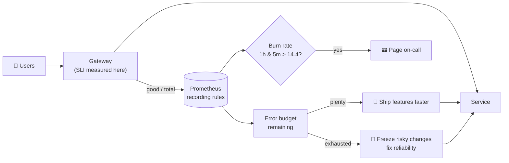

# 28 · Reliability Engineering

| Level | Duration | Prerequisites |
|---|---|---|
| 🚀 Expert | 8 h | Modules 11, 15, 16, 20, 21, 22 |

**By the end you will be able to:**
- **Define** SLIs, SLOs and error budgets for a Kubernetes service, and use them to make decisions.
- **Alert** with multi-window, multi-burn-rate rules instead of thresholds.
- **Design** for failure: replicas, spreading, PodDisruptionBudgets, graceful degradation, multi-zone and multi-cluster.
- **Run** chaos experiments and game days safely.
- **Lead** a Production Readiness Review.

---

## 🧠 The analogy: a city's water supply

Nobody promises water **100%** of the time — that would be infinitely expensive. The city promises
"water at the tap **99.9%** of the time each month". That promise is the **SLO**.

- The **SLI** is the **meter**: the share of minutes with good water pressure.
- The **error budget** is the **0.1%** allowed to fail (~43 minutes a month). While budget remains, the
  city may do risky maintenance (deploys, migrations). When it runs out, maintenance stops and the crew
  focuses on reliability.
- **Redundancy** (two reservoirs, several pipes) is replicas and zones; the **rule** "never close more
  than one valve per neighborhood at a time" is a **PodDisruptionBudget**.
- A **fire drill** is a **game day**: you practise the emergency before it happens.

---

## 📖 Concepts

### 1. SLI → SLO → error budget

| Term | Definition | Example |
|---|---|---|
| **SLI** | A ratio of good events to valid events | `successful requests / all requests` (non-5xx, < 300 ms) |
| **SLO** | Target for an SLI over a window | 99.9% of requests good over 30 days |
| **Error budget** | `1 − SLO` | 0.1% → ~43 min of full outage per 30 days, or 0.1% of requests |
| **SLA** | A contract with penalties, looser than the SLO | 99.5%, credits if missed |

| SLO | Allowed bad time per 30 days |
|---|---|
| 99% | 7 h 12 min |
| 99.5% | 3 h 36 min |
| 99.9% | 43 min |
| 99.95% | 21.6 min |
| 99.99% | 4.3 min |

**Error budget policy:** when the budget is spent, freeze risky releases and prioritize reliability
work; when there is plenty, ship faster. The budget turns reliability into a shared, objective decision.

### 2. Good SLIs for Kubernetes services

| Service type | SLI |
|---|---|
| Request/response (APIs, web) | Availability (non-5xx) and latency (p95/p99 under a threshold) at the **edge** (Gateway) |
| Pipelines / batch | Freshness (data age), correctness, completion within deadline |
| Storage | Durability, read/write latency |
| The platform itself | API server availability/latency, Pod start time, scheduling latency, DNS success rate |

Measure as close to the user as possible (gateway or client), not inside one Pod.

### 3. Burn-rate alerting

**Burn rate** = how fast you consume the budget. Burn rate 1 = you would spend exactly the budget in
the SLO window; burn rate 14.4 = you spend 2% of a 30-day budget in 1 hour.

| Severity | Long window | Short window | Burn rate | Budget spent |
|---|---|---|---|---|
| 📟 Page | 1 h | 5 min | 14.4 | 2% |
| 📟 Page | 6 h | 30 min | 6 | 5% |
| 🎫 Ticket | 3 days | 6 h | 1 | 10% |

Both windows must be over the threshold: the long window gives significance, the short one makes the
alert reset quickly after recovery. Tools like **Sloth** or **Pyrra** generate these rules from an SLO spec.

### 4. Designing for failure on Kubernetes

| Failure | Design answer |
|---|---|
| A Pod crashes | ≥ 2 replicas (3+ for critical), probes, restart policy |
| A node dies or is drained | Topology spread / anti-affinity by hostname; **PDB**; graceful shutdown |
| A zone fails | Spread across ≥ 3 zones; capacity for N−1 zones; zonal storage replicated |
| A bad deploy | Readiness gates, canaries with automatic analysis, fast rollback (module 24) |
| A dependency is slow | Timeouts, retries with back-off and jitter, circuit breakers, bulkheads |
| Overload | Autoscaling + **load shedding** + rate limits; API Priority and Fairness for the control plane |
| A region / cluster fails | Multi-cluster active-active or active-passive; GitOps to rebuild; global load balancing |
| Data loss | Backups + tested restores; defined RPO/RTO (module 22) |

### 5. PodDisruptionBudgets

```yaml
apiVersion: policy/v1
kind: PodDisruptionBudget
metadata:
  name: checkout
spec:
  maxUnavailable: 1                 # or minAvailable: "66%"
  selector:
    matchLabels: { app: checkout }
  unhealthyPodEvictionPolicy: AlwaysAllow   # don't let broken Pods block drains
```

PDBs protect against **voluntary** disruptions (drains, upgrades, autoscaler scale-down), not crashes.

### 6. Chaos engineering

1. Define **steady state** (the SLI).
2. Hypothesize it holds during a failure ("losing one node keeps availability ≥ 99.9%").
3. Inject the failure in a controlled scope (Pod kill, node drain, network latency, DNS failure, zone loss).
4. Observe, then **minimize the blast radius** and stop on SLO impact.
5. Fix what you learned; automate the experiment.

Tools: **Chaos Mesh**, **LitmusChaos** (CNCF), cloud fault-injection services, or simple scripts to start.

### 7. Production Readiness Review (PRR)

A checklist reviewed with the team before a service goes to production (the capstone self-check rubric uses it):
ownership and on-call, SLOs and alerts, dashboards and runbooks, capacity and autoscaling, resilience
(replicas, spread, PDB, probes, graceful shutdown), security (RBAC, PSS, NetworkPolicy, secrets),
delivery (GitOps, rollback), backups and DR, dependencies and their SLOs, load test results.

### 8. Measuring delivery and operations

**DORA metrics**: deployment frequency, lead time for changes, change failure rate, time to restore
service. Plus **toil** (manual, repetitive work) — SRE teams cap it (e.g., < 50%) and automate the rest.

---

## 🗺️ Diagram: error budget as a control loop



---

## ⌨️ Essential commands

| Command | What it does |
|---|---|
| `kubectl get pdb -A` | Disruption budgets and allowed disruptions |
| `kubectl get pods -l app=x -o wide` + `-L topology.kubernetes.io/zone` | Is it really spread? |
| `kubectl drain <node> --dry-run=server` | What would a drain evict? |
| `kubectl get prioritylevelconfigurations,flowschemas` | API Priority and Fairness |
| PromQL `sum(rate(…good…[1h])) / sum(rate(…total…[1h]))` | SLI over a window |

---

## 🧯 In production

- **100% is the wrong target.** Pick the lowest SLO users are happy with; every extra nine costs ~10×.
- **Alert on budget burn, not on CPU.** Causes go to dashboards and tickets.
- **Reliability is a feature** with a budget, a roadmap and owners.
- **Practise failure** — game days, restore drills, on-call training. Untested resilience is assumed resilience.
- **Blameless culture** makes people report problems early; that is the cheapest reliability tool there is.

## ⚠️ Common mistakes

| Mistake | Better |
|---|---|
| SLO = "CPU < 80%" | SLO on what users experience (availability, latency) |
| Paging on every 5xx spike | Multi-window burn-rate alerts |
| PDB `minAvailable` = replicas | `maxUnavailable: 1` (or a percentage) |
| 3 replicas, all in one zone | Topology spread across zones |
| Retries without limits or jitter | Bounded retries with exponential back-off + jitter; retry budgets |

## 🎓 Official tutorial companion

After the lab, run the upstream tutorial to see the same idea from the official docs:

- [Running ZooKeeper (PDBs, spreading, failover)](https://kubernetes.io/docs/tutorials/stateful-application/zookeeper/)

> Tutorials that use minikube work on `kc` too; replace `minikube service` with `kubectl port-forward`.

## 📚 Official references

- [Specifying a disruption budget](https://kubernetes.io/docs/tasks/run-application/configure-pdb/)
- [Disruptions](https://kubernetes.io/docs/concepts/workloads/pods/disruptions/)
- [Running in multiple zones](https://kubernetes.io/docs/setup/best-practices/multiple-zones/)
- [API Priority and Fairness](https://kubernetes.io/docs/concepts/cluster-administration/flow-control/)
- [Kubernetes SLIs/SLOs (component SLI metrics)](https://kubernetes.io/docs/reference/instrumentation/slis/)
- [Google SRE books](https://sre.google/books/) — *Site Reliability Engineering* and *The SRE Workbook*
- [Chaos Mesh](https://chaos-mesh.org/docs/) · [LitmusChaos](https://docs.litmuschaos.io/)

➡️ Next: [🧪 LAB.md](LAB.md)
