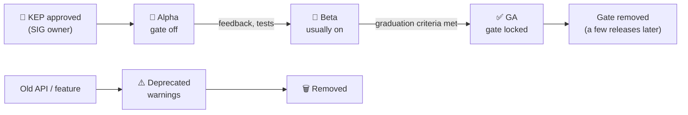

# 29 · What's New in Kubernetes v1.35 – v1.37

| Level | Duration | Prerequisites |
|---|---|---|
| 🚀 Expert | 5 h | The whole course |

**By the end you will be able to:**
- **Summarize** the most important changes of the last three releases and what they mean for operators.
- **Explain** the feature lifecycle (alpha → beta → GA → deprecation → removal) and the feature gate system.
- **Track** upcoming changes yourself through KEPs, release notes and the release blog.
- **Plan** the adoption of a new feature safely in production.

> 📅 This module reflects the official release blog up to **October 2026** (v1.37 "Garhwal", released
> August 2026). Kubernetes moves fast: always confirm details in the release notes of your exact version.

---

## 🧠 The analogy: a phone's operating-system updates

Every few months your phone gets a new OS version. Some features are **labs / experimental** (you must
switch them on), some are **beta** (on by default, but may still change), and some become **standard**.
Occasionally an old feature is **marked for removal** — and a couple of versions later it is gone.

Kubernetes works the same way, with a strict policy so you are never surprised — **if** you read the notes.

---

## 📖 Concepts

### 1. The feature lifecycle

| Stage | Default | Stability | Production use |
|---|---|---|---|
| **Alpha** | Off (feature gate) | May change or disappear; may be buggy | ❌ Labs only |
| **Beta** | Usually **on** for new betas only if no new API; check per feature | API may still change (with migration) | ⚠️ With care |
| **GA (stable)** | On, gate locked and later removed | Will not break; long-term support | ✅ |
| **Deprecated** | Still works, warns | Removal scheduled | Plan migration |
| **Removed** | Gone | — | Must have migrated |

Changes are designed in **KEPs** (Kubernetes Enhancement Proposals) in `kubernetes/enhancements`,
owned by a **SIG** (Node, Network, Storage, Apps, Scheduling, Auth, API Machinery…).

### 2. v1.35 "Timbernetes" (December 2025)

| Feature | Stage | Why operators care |
|---|---|---|
| **In-place Pod resize** | GA | Change CPU/memory of running Pods without restarts (module 16) |
| Job `managedBy` | GA | External controllers (e.g., multi-cluster Kueue) can own Jobs |
| Fine-grained `supplementalGroups` control | GA | Predictable group IDs inside containers (security) |
| kubelet configuration **drop-in directory** | GA | Layer node configuration safely (module 22) |
| Workload-aware scheduling (introduction) | Alpha ⚠️ | First step toward native gang scheduling for AI/HPC (module 27) |
| Restart all containers of a Pod in place | ⚠️ Verify | Faster recovery without rescheduling |
| Numeric operators in tolerations | Alpha | Tolerate taints by numeric comparison (module 15) |
| Service account tokens for CSI drivers via `secrets` field | Beta | Safer token handling for storage drivers |
| Mutable PersistentVolume node affinity | Alpha | Move volumes between topologies |
| Versioned z-pages APIs | ⚠️ Verify | Machine-readable component debug pages |
| kuberc exec plugin allowlist | ⚠️ Verify | Control which credential plugins kubectl may run |

### 3. v1.36 "Haru" (April 2026)

| Feature | Stage | Why operators care |
|---|---|---|
| **User namespaces** (`hostUsers: false`) | GA | Container root ≠ host root: big isolation win (module 18) |
| **Fine-grained kubelet API authorization** | GA | Least privilege for monitoring/agents hitting the kubelet |
| **PSI metrics** | GA | Pressure stall info for CPU/memory/IO — better saturation signals (module 20) |
| **Volume group snapshots** | GA | Crash-consistent snapshots across volumes (module 12) |
| **Declarative validation** | GA | Built-in API validation generated from declarative rules |
| SELinux volume labeling changes | GA | Faster mounts on SELinux systems; check for behavior changes |
| In-place vertical scaling of **Pod-level resources** | Beta | Resize the shared Pod budget |
| Mutable Pod resources for **suspended Jobs** | Beta | Queues (Kueue) can right-size Jobs before starting them |
| Mixed version proxy | Beta | Safer HA control-plane upgrades (requests routed to the right API server version) |
| Pod-level resource managers | Alpha | CPU/memory managers at Pod scope |
| Admission policies that cannot be deleted | ⚠️ Verify | Platform guardrails protected even from cluster admins |
| Server-side sharded list and watch | ⚠️ Verify | Scales large controllers |
| **Service `externalIPs`** | **Deprecated** | Long-standing security risk — migrate to LoadBalancer/Gateway |

### 4. v1.37 "Garhwal" (August 2026)

| Feature | Stage | Why operators care |
|---|---|---|
| **Metrics API** (`metrics.k8s.io`) | GA | Stable foundation for HPA/VPA and `kubectl top` |
| **Storage version migration** | GA | Safely rewrite stored objects after API/CRD storage changes |
| **HPA scale to zero** | Beta | `minReplicas: 0` for idle workloads (module 16) |
| **Memory QoS** (cgroup v2) | Beta | Throttle memory before OOM for smoother behavior |
| **Native histograms** | Beta | Cheaper, more precise latency metrics |
| Pod-level resource managers | Beta | NUMA/CPU pinning per Pod |
| **KubeletInUserNamespace** (rootless kubelet) | Beta | Run nodes with less privilege |
| PVC last-used time tracking | Beta | Find and reclaim unused volumes |
| Scheduler preemption for in-place resize | Alpha | Resize can evict lower-priority Pods to make room |
| Node lifecycle conditions | ⚠️ Verify | Clearer node state for maintenance automation |
| Workload-aware scheduling updates | ⚠️ Verify | Continued gang-scheduling work |
| DRA updates | ⚠️ Verify | More device-sharing and partitioning features (module 27) |
| Pod certificates and ClusterTrustBundles | ⚠️ Verify | Native X.509 workload identity |
| etcd RangeStream | ⚠️ Verify | Lower API server memory on big LIST calls |
| Container storage hardening (bind-mount options, `emptyDir` permissions) | ⚠️ Verify | Safer defaults for volumes |

### 5. Ecosystem changes you must know

| Change | Impact |
|---|---|
| **ingress-nginx retired** (SIG Network, maintenance ended March 2026) | Move to Gateway API or another maintained controller (module 14) |
| Gateway API keeps growing (GAMMA for mesh, Inference Extension) | The standard for north-south **and** east-west routing |
| DRA GA (v1.34) and fast follow-ups | The future of GPUs/accelerators in Kubernetes |
| cgroup v2 everywhere | Required for Memory QoS, PSI; cgroup v1 support is being phased out ⚠️ verify for your version |
| nftables kube-proxy (GA v1.33) | The modern data plane; plan away from IPVS ⚠️ verify |

### 6. How to stay current

| Source | What you get |
|---|---|
| [Kubernetes blog](https://kubernetes.io/blog/) | Release announcement + one post per major feature |
| [Release notes / CHANGELOG](https://kubernetes.io/releases/) | Every change, including **urgent upgrade notes** |
| [Feature gates reference](https://kubernetes.io/docs/reference/command-line-tools-reference/feature-gates/) | Stage and default of every gate, per version |
| [Deprecated API migration guide](https://kubernetes.io/docs/reference/using-api/deprecation-guide/) | What to change before an upgrade |
| [kubernetes/enhancements](https://github.com/kubernetes/enhancements) | KEPs: design, graduation criteria, target releases |
| SIG meetings and Slack (`kubernetes.slack.com`) | Discussions before decisions land |

---

## 🗺️ Diagram: a feature's journey

---

## ⌨️ Essential commands

| Command | What it shows |
|---|---|
| `kubectl version` | Server and client versions |
| `kubectl get --raw /metrics \| grep kubernetes_feature_enabled` | Every feature gate, its stage and whether it is on |
| `kubectl api-versions` / `kubectl api-resources` | APIs served by this version |
| `kubectl get --raw /metrics \| grep apiserver_requested_deprecated_apis` | Clients still using deprecated APIs |
| `kubectl explain <resource>.<field>` | Is a new field available in this version? |

---

## 🧯 In production

- **Read the urgent upgrade notes, every time.** Most upgrade incidents were announced months earlier.
- **Adopt features at GA by default**; use beta only with a clear benefit, a test plan and a rollback.
- **Track deprecations as tickets** with owners and dates.
- **Upgrade regularly** — staying within the supported window is a reliability requirement.
- **Contribute back**: file issues, comment on KEPs, join a SIG. That is how the platform you depend on gets better.

## ⚠️ Common mistakes

| Mistake | Better |
|---|---|
| Enabling alpha gates in production | Labs only; alpha may be removed without migration |
| Assuming a beta feature is on in your managed cluster | Providers may disable betas — check the gate metrics |
| Learning about removals from a failed upgrade | Scan for deprecated APIs continuously |
| Copying manifests from a blog for a newer version | Match `apiVersion`/fields to your cluster version |

## 📚 Official references

- [Kubernetes v1.35 release announcement](https://kubernetes.io/blog/2025/12/17/kubernetes-v1-35-release/)
- [Kubernetes v1.36 release announcement](https://kubernetes.io/blog/2026/04/22/kubernetes-v1-36-release/)
- [Kubernetes v1.37 release announcement](https://kubernetes.io/blog/2026/08/26/kubernetes-v1-37-release/)
- [Kubernetes releases](https://kubernetes.io/releases/)
- [Feature gates](https://kubernetes.io/docs/reference/command-line-tools-reference/feature-gates/)
- [Kubernetes deprecation policy](https://kubernetes.io/docs/reference/using-api/deprecation-policy/)

➡️ Next: [🧪 LAB.md](LAB.md)
